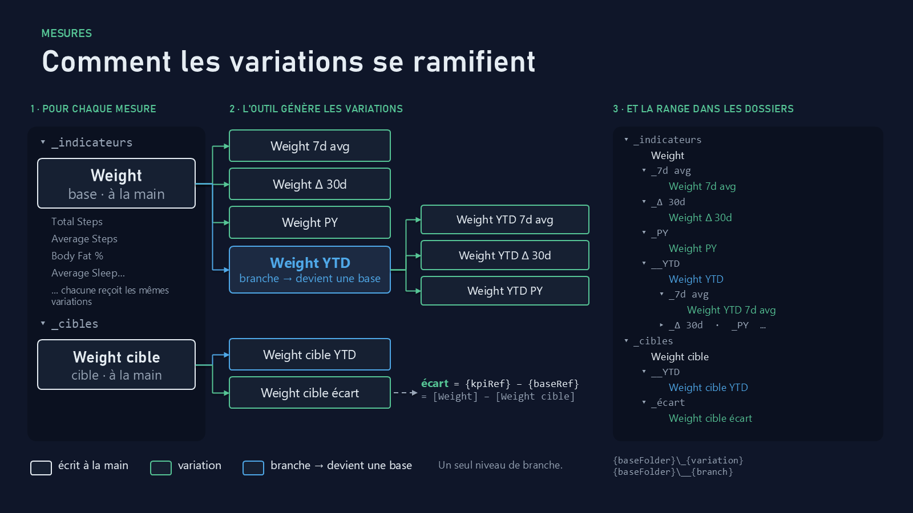
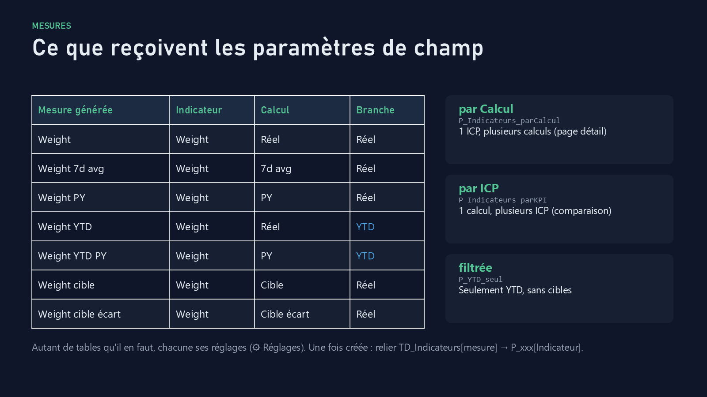
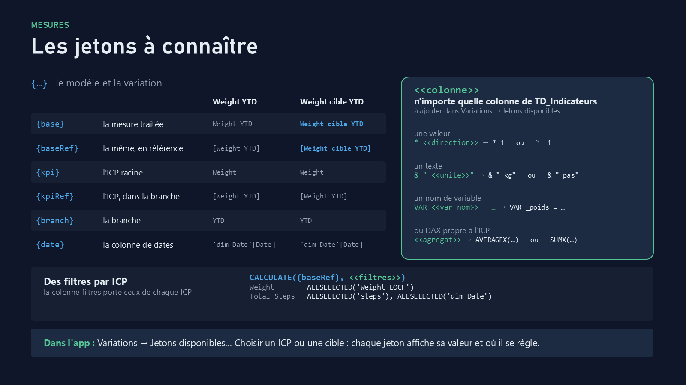
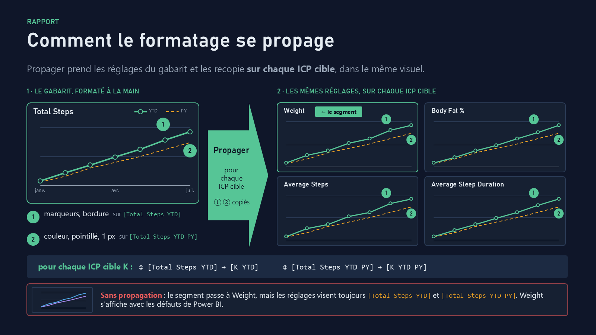
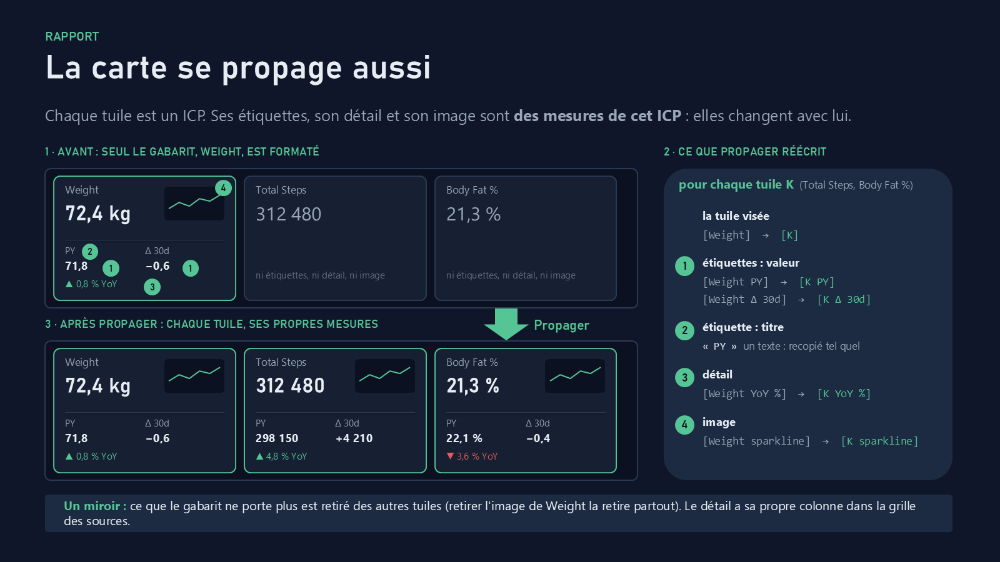
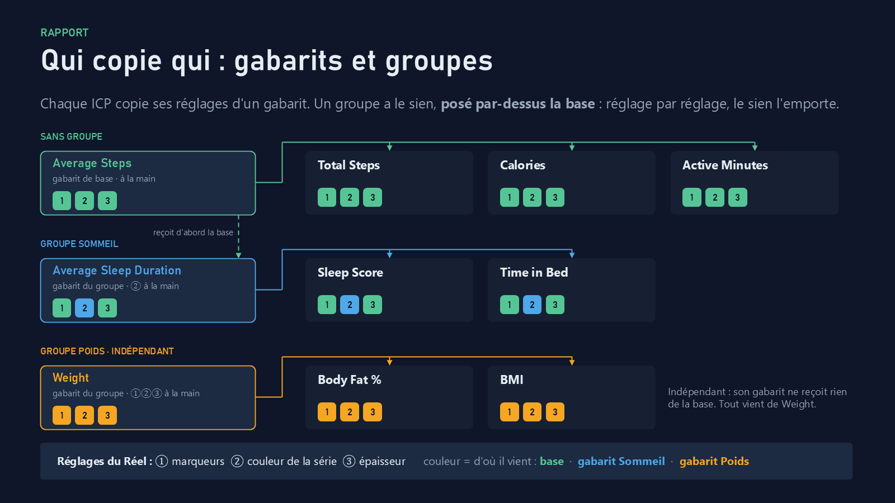
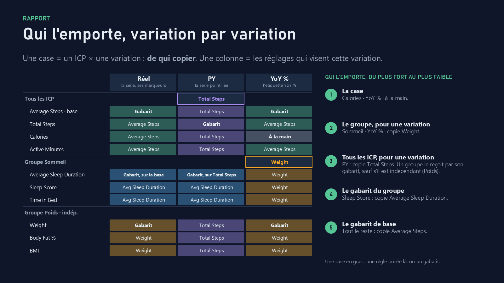

# PBIdouille 🔧

**Tester une contribution.** `py tests/lancer_tests.py` distingue les scripts réussis, ignorés et échoués. Les suites Fitbit utilisent le projet de démonstration externe. GitHub Actions exécute les tests hors écran sous Ubuntu et Windows, avec PyQt5 et PySide6, pour les PR vers `experimental` et `stable`. Chaque job affiche le nombre de scripts exécutés et ignorés.

Pour un essai autonome, installer `openpyxl` puis lancer `py tests/projet_minimal.py AtelierTest`. Ouvrir `AtelierTest/Atelier.pbip` dans Power BI Desktop et actualiser la matrice. Les deux ventes fictives donnent un total de 12. Le dossier contient aussi le classeur et le `measures_config.json` utilisables dans PBIdouille.

Une app de bureau pour les rapports Power BI au format **PBIP**. Elle écrit
automatiquement ce qui se répète dans un rapport : les mesures dérivées de chaque KPI
(7d avg, PY, YTD…), les tables paramètre de champ, le formatage conditionnel
recopié d'un KPI gabarit vers tous les autres, et le ménage de ce que plus
rien n'utilise.

Elle travaille directement sur les fichiers du projet (TMDL pour le modèle,
PBIR pour le rapport). Rien d'autre à installer qu'un Python et Qt. Power BI
Desktop peut rester ouvert pendant une écriture, mais il ne relit les fichiers
qu'à l'ouverture : on le ferme ensuite **sans enregistrer** et on rouvre le
`.pbip` (voir [les règles d'or](#11-règles-dor)).

- **[Documentation, élément par élément](docs/README.md)** : chaque partie de l'app, numérotée dans l'ordre
- [En images](#en-images)
- [Démarrage rapide](#démarrage-rapide)
- [1. Vue d'ensemble](#1-vue-densemble) · [2. Les composants](#2-les-composants)
- [3. Générer les mesures](#3-générer-les-mesures) · [4. measures_config.json](#4-measures_configjson--référence)
- [7. La propagation du formatage](#7-propagate_cfpy-rapport) · [8. ChopChop](#8-unused_measurespy-ménage)
- [13. L'interface en détail](#13-linterface-en-détail)

---

## En images

Les schémas du guide de démarrage :
[PBIdouille - Guide de demarrage rapide.pptx](docs/PBIdouille%20-%20Guide%20de%20demarrage%20rapide.pptx)
(20 diapos, à télécharger). L'app les montre aussi : bouton **Guide** de la
barre du haut, et liens **▣ Schéma** là où chaque notion sert.

### Les variations se ramifient

Chaque mesure de base reçoit toute sa famille de variations ; une variation
déclarée *branche* (YTD) devient à son tour une base.



### Ce que reçoivent les paramètres de champ



### Les jetons du DAX

Une variation s'écrit une fois, avec des jetons que la génération remplace pour
chaque KPI : `{baseRef}`, `{kpiRef}`, `{date}`…, et `<<n'importe quelle colonne>>`
de TD_Indicateurs. [Tout sur les jetons](docs/articles/03-2-jetons.md).



### Le formatage se propage, visuel par visuel

Dans un visuel, chaque réglage de formatage vise **une** mesure : celle du
KPI que le segment montre. Propager prend les réglages du gabarit et les
recopie, dans le même visuel, **pour chaque KPI cible** : seul le KPI change.



### La carte se propage aussi

Avant, seule la tuile gabarit est formatée ; après, chaque tuile l'est, avec
ses propres mesures : les étiquettes, le détail et l'image d'une tuile sont
des mesures de son KPI.



### Qui copie qui

Un gabarit de base pour tout le monde, un gabarit par groupe posé
par-dessus la base (réglage par réglage, le sien l'emporte), et un groupe
indépendant qui ne reçoit rien de la base.



### Qui l'emporte, variation par variation

La grille des sources sur le même exemple : pour chaque KPI et chaque
variation, de qui copier, et la règle qui décide.



---

## Démarrage rapide

**Prérequis**
- Python 3.8 ou plus récent (lancer avec `py`, pas `python` : sur certains
  postes, `python` est un faux alias du Microsoft Store) ;
- `qtpy` et un binding Qt : PyQt5 ou PySide6 ;
- `openpyxl` pour lire l'Excel des indicateurs (`TD_Indicateurs.xlsx`).

**Lancer**, depuis le dossier de l'app :

```
py app.py
```

L'app rouvre le dernier rapport utilisé. Le `measures_config.json` est
cherché à côté du `.pbip` ; le bouton 📄, à côté du nom du rapport, en choisit
un autre.

**Partager** : sur GitHub, branche `stable`, **Code → Download ZIP**. Le
dossier extrait démarre toujours en **édition production** (cf. §13,
« Édition production / dev ») : le fichier `.dev` n'est jamais versionné.

**Branches** : `stable` est ce qu'on partage ; `experimental` porte le
travail en cours.

---

## 1. Vue d'ensemble

```
TD_Indicateurs.xlsx               mesures de base (_mesures\_indicateurs)
  mesure, libellé, couleurs,              Weight, Total Steps, ...
  ordre, attributs                               │
        │                                        ▼
        │                       Mesures › Générer  ◄── measures_config.json
        │                       (generate_measures)
        │            ┌───────────────┬───────────┴────────────┐
        │            ▼               ▼                        ▼
        │      variations      branches (YTD ...)        cibles
        │      7d avg, PY...   YTD PY, YTD Δ 30d...      Weight cible écart...
        │            │               │
        │            └───────┬───────┘
        │                    ▼
        │      tables paramètre de champ
        │      (autant qu'il en faut, chacune ses réglages)
        │                    │
        └──── relations ─────┤
                             ▼
                       RAPPORT (.pbip)
                             │
   Rapport › Propager ───────┤ (formatage conditionnel, KPI par KPI)
   Rapport › Colorer ────────┤ (couleurs de matrice par KPI)
   Sources de données ───────┤ (d'où vient chaque table)
   Radiographie ─────────────┤ (KPI, visuels, filtres, colonnes)
   ChopChop ─────────────────┘ (ce que plus rien n'utilise)
```

Les onglets :

| Onglet | Ce qu'il fait |
|---|---|
| **Mesures** | Éditeur des variations, arbre des mesures, tables paramètre de champ, et la génération (en tête du journal) |
| **Rapport** | Propage le formatage d'un KPI gabarit vers les autres (grille des sources) ; colore les matrices |
| **Sources de données** | Le lineage du rapport ouvert : chaque table et sa source |
| **Radiographie 🩻** | La carte d'un rapport qu'on n'a pas fait : KPI et variations, ce que chaque visuel affiche et ce qui le filtre, où sert chaque colonne |
| **ChopChop 🪓** | Mesures, colonnes et tables que plus rien n'utilise ; export ; restauration des sauvegardes |
| **Wireframe** | Plan des pages et des visuels (édition dev seulement) |

Principe directeur : **une seule source de vérité par chose**. Les calculs
vivent dans `measures_config.json`, les attributs des KPI dans l'Excel des
indicateurs, le style de référence dans UN KPI gabarit. L'app matérialise le
reste et chaque écriture est **idempotente** : relancer met à jour, jamais de
doublon. Tout ce qui est réécrit est d'abord sauvegardé.

---

## 2. Les composants

| Fichier | Rôle |
|---|---|
| `app.py` | la fenêtre principale : barre du projet, onglets, journal |
| `bidouille\moteurs\generate_measures.py` | génère mesures, variations, branches, cibles et tables paramètre dans le TMDL |
| `bidouille\moteurs\propagate_cf.py` | propage le formatage conditionnel d'un KPI gabarit, selon la grille des sources |
| `bidouille\moteurs\color_matrix_by_kpi.py` | colore les colonnes d'une matrice par KPI (couleurs de l'Excel) |
| `bidouille\moteurs\unused_measures.py` | analyse de ce qui ne sert plus (mesures, colonnes, tables) |
| `bidouille\moteurs\unused_measures_ui.py` | le panneau ChopChop |
| `bidouille\moteurs\lineage.py` | les sources de données du rapport ouvert |
| `bidouille\moteurs
adiographie.py` | la radiographie d'un rapport : familles de KPI, visuels, filtres, colonnes |
| `bidouille\moteurs\backup_restore.py` | sauvegardes horodatées et restauration (manifeste : d'où vient chaque copie) |
| `bidouille\moteurs\xlsx_lecture.py` | lecture de l'Excel qui relâche toujours le fichier |
| `bidouille\moteurs\chemins.py` | où vivent l'outil et les projets |
| `bidouille\core\` | projet, journal, thème, édition, lecture du modèle et du rapport |
| `bidouille\tabs\` | les onglets et leurs fenêtres |
| `bidouille\aide\` | les images du guide intégré |
| `tests\` | les suites de tests (chacune finit par « TOUT OK ») ; `test_python38.py` garde l'app lisible en Python 3.8 |
| `docs\` | [la documentation](docs/README.md), le guide PowerPoint ; `docs\ressources\sources\build_deck.py` le reconstruit, `exporter_aide.ps1` en tire les images de `bidouille\aide\` (PowerPoint requis) |

Côté projet, à côté du `.pbip` : `measures_config.json` (variations,
branches, paramètres de champ, réglages), `TD_Indicateurs.xlsx` (l'Excel des
indicateurs), `propagation.json` (la grille des sources du formatage),
`_backupsPBIdouille\` (les sauvegardes). La bibliothèque de variations
(`catalogue_variations.json`) est globale, partagée entre rapports.

---

## 3. Générer les mesures

Dans l'app : **« Générer les mesures »**, en tête du journal de l'onglet
Mesures. En ligne de commande : `py bidouille\moteurs\generate_measures.py`.
Le générateur écrit directement les fichiers TMDL.

⚠ Après l'écriture réelle, fermer Desktop **sans enregistrer** et rouvrir le
`.pbip` ; backup automatique sous `_backupsPBIdouille\_tmdl_backups\`. `settings.dryRun` (ou la case
« Aperçu ») pour tout lister sans rien écrire. Idempotent : relancer sans
changement = 0 écriture. Les lineageTags
existants sont préservés ; une table paramètre créée est ajoutée aux
`ref table` de model.tmdl (penser à la relation TD → Indicateur ensuite).

**Collisions de nom** : les noms de mesures sont uniques dans le modèle. Si une
variation a un `namePattern` invariant par branche (utilise `{kpi}` au lieu de
`{base}`, ex. une mesure « direction »), la passe de base et la passe de
branche visent le même nom : la 1re (la base) est gardée, les suivantes sont
ignorées avec un avertissement (deux mesures du même nom, Power BI refuserait
de charger le modèle). Pour éviter carrément l'essai en branche, exclure la
variation de la branche (⚙ Réglages → Branches).

### Ce qu'il fait, dans l'ordre

1. **Découverte** : toutes les mesures de `settings.sourceTable` dont le
   displayFolder est `settings.sourceFolder` deviennent des « mesures de
   base ». Les mesures générées (annotation `MeasureVariation`) sont exclues —
   pas de variations de variations accidentelles. Elles sont triées **comme
   Power BI trie** (`sort_key_pbi`, réplique du comparateur culturel de
   .NET). C'est l'ordre d'écriture dans le TMDL, et **le repli** de la
   colonne **Ordre** des paramètres de champ quand aucune colonne d'ordre
   n'est configurée (`indicateursXlsx.orderColumn`, plus bas) : dès qu'il
   diverge, l'ordre du paramètre ne colle plus à l'ordre alphabétique affiché
   par le rapport.

   Un tri ordinal Python diverge de **trois** façons — majuscules toutes
   devant (`Weight` avant `avg`), accentués rejetés après le Z (`Écart` après
   `Zone`), et apostrophes remontées en tête (`Nombre d'unités` avant `Nombre
   de jours`). `sort_key_pbi` reproduit donc les quatre niveaux de .NET, dans
   l'ordre : **lettres nues → accents → casse** (minuscule d'abord) **→
   ponctuation de liaison**. Cette dernière (`'`, `ʼ`, `-`, `­`, `–`, `—`,
   ensemble vérifié un à un contre `StringComparer`) est *ignorée* au premier
   niveau : `Nombre d'unités` se range entre `Nombre de jours` et `Nombre dz`,
   exactement comme dans le rapport. À radical égal, la variante ponctuée
   passe après (`Nombre dunites` < `Nombre d'unites`). ⚠ L'apostrophe
   TYPOGRAPHIQUE `'` (U+2019), elle, est significative pour .NET — elle n'est
   volontairement pas dans l'ensemble.
2. **Variations** (1re passe) : une mesure par (base × template).
3. **Branches** (2e passe) : les variations déclarées comme branches (ex. YTD)
   deviennent des bases à leur tour.
4. **Cibles** (bases supplémentaires d'un dossier dédié, déclinées comme les
   KPI) : voir ci-dessous.
6. **Nettoyage** : si `removeOrphans`, supprime les mesures générées qui ne
   correspondent plus à la config.
7. **Paramètres de champ** : régénère l'expression complète des tables
   déclarées (voir §5).
7. **Rapport** : grille triable (Action / Objet) — créées, mises à jour,
   ignorées, orphelines supprimées, statut des paramètres.

### Mesures « cibles » (bases supplémentaires d'un dossier dédié)

Les **cibles/objectifs** d'un KPI ont une DAX de **base** spécifique (value-at-
close avec `LASTDATE`, source une table de cibles verticale filtrée par le nom
du KPI…) : impossible à générer par gabarit. On crée donc **à la main** la
cible **RACINE** par KPI (ex. `Weight cible`), toutes dans un **dossier dédié**.
Le générateur la traite comme une **base supplémentaire** et la **décline** —
chaque variation enveloppe `[Weight cible]`.

```json
"kpiMeasureFolders": [
  { "folder": "_cibles", "calcul": "Cible" }
]
```

**Portée par variation** (contrôlée dans l'UI, cases **Aux KPI** / **Aux
cibles** de l'éditeur de variations) : chaque variation décide si elle est
déclinée pour les KPI, les cibles, ou les deux. Une cible ne reçoit **que** ce
qui est coché « aux cibles » — typiquement pas la 7d avg ni la sparkline, mais
le YTD et surtout l'**écart réel−cible**. Défauts : Aux KPI **coché**, Aux
cibles **décoché** (comportement KPI inchangé ; les cibles ne prennent que ce
qui est choisi).

**Écart réel−cible** via le jeton **`{kpiRef}`** = la mesure du KPI dans la
même branche (`[Weight]` en Réel, `[Weight YTD]` en YTD) — à côté de `{baseRef}`
= la cible (`[Weight cible]`). On écrit deux variations « aux cibles » seulement
(Aux KPI décoché, sinon elles vaudraient 0) :

| Variation | DAX | Donne |
|---|---|---|
| `écart` | `{kpiRef} - {baseRef}` | `[Weight] - [Weight cible]` |
| `écart %` | `DIVIDE({kpiRef} - {baseRef}, {baseRef})` | (réel − cible) / cible |

En branche YTD, l'écart devient automatiquement `[Weight YTD] - [Weight cible
YTD]` (le `{kpiRef}` suit la branche).

⚠ **Ne pas écrire `[{kpi}] - {baseRef}`** : `{kpi}` est le KPI *racine*, sans
branche, donc en YTD on obtiendrait `[Weight] - [Weight cible YTD]`, soit le réel
courant comparé à la cible de l'année à date. Les deux côtés doivent être dans
la même branche : c'est `{kpiRef}` qu'il faut. (Voir le tableau des
placeholders §4 ; l'aide-mémoire est aussi affiché sous la zone DAX de
l'onglet Mesures.)

Au **paramètre de champ**, pour éviter toute collision avec les calculs du KPI
(même Indicateur = paramètre ambigu que Power BI refuse) :
- **Indicateur** = le KPI, retrouvé par le **préfixe du nom** (`Weight cible` →
  base `Weight`, préfixe le plus long), ce qui donne le bon filtre ;
- **Calcul** = **« Cible »** pour la racine, **« Cible écart »**, **« Cible
  écart % »**… pour les variations (préfixé par le libellé configuré) ;
- **Branche** = gérée normalement (`Weight cible YTD` → Branche `YTD`, Calcul
  « Cible »).

Règles : ne mettre que la cible **racine** dans le dossier, car une mesure qui
ressemble déjà à une variation/branche (`… YTD`, `… 7d avg`) est **ignorée**
avec un avertissement (le générateur crée le reste). Une racine dont le préfixe
ne correspond à **aucun** KPI est ignorée. Le dossier doit être **différent**
de `sourceFolder` ; un dossier **imbriqué** (`_indicateurs\_cibles`) matche la
config `_cibles` par son **nom de feuille**.

Ça se configure dans la fenêtre **⚙ Réglages → « Mesures cibles
(dossier dédié) »** (tableau Dossier / Calcul, boutons Ajouter/Retirer) — pas
besoin d'éditer le JSON à la main. Le journal de la génération indique combien de
cibles racine ont été déclinées (ou, si 0, liste les dossiers présents pour
diagnostiquer).

### Idempotence et traçabilité

Chaque mesure générée porte l'annotation `MeasureVariation = "base|variation"`.
C'est ce qui permet : mise à jour en place, exclusion de la découverte, et
nettoyage des orphelines. `"dryRun": true` = rapport sans modification —
recommandé pour la première exécution sur un nouveau modèle.

---

## 4. measures_config.json — référence

### settings

| Clé | Rôle | Exemple |
|---|---|---|
| `sourceTable` / `sourceFolder` | où découvrir les bases | `_mesures` / `_indicateurs` |
| `dateColumn` | remplace `{date}` dans les DAX | `'dim_Date'[Date]` |
| `targetTable` | où créer les mesures (omis = table de la base) | `_mesures` |
| `displayFolderPattern` | dossier des variations | `{baseFolder}\_{variation}` |
| `branchFolderPattern` | dossier de la MESURE de branche (racine) | `{baseFolder}\__{branch}` |
| `folderLayout` | `"kpi"` = un dossier par KPI (les deux motifs ci-dessus sont alors ignorés) ; omis = par variation — cf. [folderLayout](#folderlayout--ranger-par-variation-ou-par-kpi) | `"kpi"` |
| `overwriteExisting` | maj des mesures existantes | `true` |
| `removeOrphans` | supprime les générées hors config | `true` |
| `dryRun` | rapport seulement | `false` |

### variations (objet indexé par id)

```json
"Δ 30d": {
  "namePattern": "{base} Δ 30d",
  "inFieldParameter": true,
  "dax": ["VAR Cur = {baseRef}", "..."],
  "formatString": "delta",
  "description": "Variation de {base} vs 30 jours plus tôt"
}
```

| Clé | Rôle |
|---|---|
| `namePattern` | nom de la mesure générée |
| `dax` | chaîne OU tableau de lignes |
| `formatString` | voir « Formats » ci-dessous |
| `description` | description de la mesure |
| `inFieldParameter` | **opt-in** : `true` = entre dans les paramètres (défaut `false`) |
| `displayFolder` | dossier spécifique ; `{folder}` = dossier par défaut calculé |
| `folderVariation` | utilise le dossier d'une AUTRE variation (ex. les CF se rangent sous la variation qu'elles colorent, dans `{folder}\_CF`) |

### Placeholders (namePattern / dax / description)

Exemple de lecture : cible `Weight cible`, branche `YTD`.

| Placeholder | Valeur | Suit la branche ? |
|---|---|---|
| `{base}` | nom de la base traitée → `Weight cible YTD` | oui |
| `{baseRef}` | ↳ en référence DAX → `[Weight cible YTD]` | oui |
| `{kpi}` | **KPI racine, SANS branche** → `Weight` (un libellé, pas une réf) | **non — voulu** |
| `{kpiRef}` | ↳ la mesure du KPI **dans la branche** → `[Weight YTD]` (= `{baseRef}` pour un KPI ; ≠ pour une cible → écart réel−cible) | oui |
| `{branch}` | branche courante → `YTD` ; en Réel, **rien — ni l'espace qui le précède** : `[{kpi} cible {branch}]` → `[Weight cible]`, puis `[Weight cible YTD]` en branche | — |
| `{date}` | `settings.dateColumn` | — |
| `{variation}` | id du template | — |
| `{deltaScale}` | `100` si la base a un format `%`, sinon `1` — deltas en points | — |
| `{baseFormatString}` | le **format de la base**, en chaîne DAX → `"#,0.0"` (guillemets du dedans doublés) — pour `FORMAT({baseRef}, {baseFormatString})` | oui |

Dossiers seulement : `{baseFolder}` (dossier de la base — en 2e passe, racine
de la branche), `{folder}`.

**Une valeur mise en texte, au format de sa mesure.** DAX ne sait pas lire le
format d'une AUTRE mesure : `SELECTEDMEASUREFORMATSTRING()` ne vaut que dans
un groupe de calcul ou dans le format dynamique de la mesure elle-même, et les
fonctions `INFO.*` ne s'emploient pas dans une mesure. Le générateur, lui, lit
le format dans le TMDL et l'écrit en dur avec `{baseFormatString}` :

```
FORMAT({baseRef}, {baseFormatString}) & " pas"
→ FORMAT([Total Steps], "#,0") & " pas"
```

Donner à la variation le format `"text"` (elle rend du texte). Le format est
figé à la génération : si celui de la base change dans Desktop,
**régénérer**. Une base sans format donne `""` (le nombre brut), avec un
avertissement au journal. Dans le champ **format** de la variation, c'est
`{baseFormat}` qui sert (la section positive) ; dans le **DAX**, c'est
`{baseFormatString}` (le format entier, négatifs compris).

**Viser une autre mesure de la même branche.** `{kpiRef}` donne le KPI dans
la branche ; pour une AUTRE mesure — la cible du KPI, une de ses variations —,
compose le nom avec `{branch}`, qui emporte son espace quand il n'y a pas de
branche :

```
[{kpi} cible {branch}]  → [Weight cible]   puis  [Weight cible YTD]
[{kpi} {branch} PY]     → [Weight PY]      puis  [Weight YTD PY]
```

(Avant, `{branch}` n'était remplacé que dans les noms de dossiers : dans le
DAX il restait tel quel.) L'aperçu des noms suit la même règle.

> ⚠ **Le piège `{kpi}` / `{kpiRef}`.** Pour un écart réel−cible, écrire
> `[{kpi}] - {baseRef}` donne `[Weight] - [Weight cible YTD]` en branche YTD :
> le réel **courant** comparé à la cible **YTD**, deux périodes différentes.
> Utiliser `{kpiRef} - {baseRef}` → `[Weight YTD] - [Weight cible YTD]`. Les
> deux jetons existent exprès : `{kpi}` reste la racine (utile pour nommer ou
> pour un `LOOKUPVALUE` sur le KPI), `{kpiRef}` suit la branche.
>
> `{kpiRef}` prend le nom **réellement généré** pour la branche (via son
> `namePattern`), pas un suffixe supposé : une branche `Cumul` nommée
> `{base} cumul annuel` donne bien `[Weight cumul annuel]`.

### Formats

| Valeur | Comportement |
|---|---|
| `"inherit"` (ou omis) | copie le format de la base |
| `"delta"` | format **signé** à trois sections `+x;-x;x`, dérivé de la section positive de la base ; une base en `%` devient `pts` (le ×100 vient de `{deltaScale}` dans le dax) — voir « Symboles » ci-dessous |
| `"text"` | **AUCUN format** (FormatString null) — pour les mesures qui retournent du texte, ex. les hex des CF (vide/omis ≠ text : c'est inherit) |
| contient `{baseFormat}` | insère la section positive du format de la base |
| littéral | utilisé tel quel (ex. `"+#,0.0%;-#,0.0%;#,0.0%"`) |

#### Symboles d'un format « delta »

Power BI **n'ajoute jamais de signe tout seul** : dans un format multi-sections,
même le `-` du négatif doit être écrit, sinon la valeur s'affiche nue. D'où les
trois sections. Les symboles se règlent dans **⚙ Réglages** (un
aperçu montre le rendu en direct) :

```json
"settings": {
  "deltaSymbols": { "positive": "+", "negative": "-", "zero": "" },
  "deltaFallbackFormat": "#,##0.##"
}
```

| Réglage | Effet |
|---|---|
| `+` / `-` / (vide) | `+1 234` · `-1 234` · `0` — défaut |
| `▲ ` / `▼ ` / (vide) | `▲ 1 234` · `▼ 1 234` · `0` |

Avec une flèche, ne **pas** mettre de `-` : la section négative affiche la valeur
en absolu, la flèche porte le sens. Tout symbole autre que `+` / `-` est
automatiquement mis entre guillemets pour ne pas être lu comme un code de
format (`#`, `0`, `.`, `,`, `%`, `E`…).

#### Littéraux : une espace est une espace

Un format contient parfois du texte brut (une espace, `$`, `pts`). Trois
écritures circulent : `"X"` (guillemets), `\X` (échappement), ou **rien**.
Dans un format Power BI/VBA, ces caractères **s'affichent d'eux-mêmes** :

```
espace   +   -   $   (   )
```

Ils n'ont besoin d'aucune décoration : `#,0.00 $` s'écrit tel quel. Seules les
lettres et les symboles demandent un backslash (`pts` → `\p\t\s`), sans quoi
le moteur peut les lire comme des codes de format.

Le générateur ramène donc tout littéral à cette forme minimale
(`normalize_literals`), quelle que soit l'écriture de la base :

| Base | Delta généré |
|---|---|
| `#,0.00\ $` · `#,0.00" $"` · `#,0.00 $` | `+#,0.00 $;-#,0.00 $;#,0.00 $` |
| `0.0\ %` | `+0.0 \p\t\s;…` (pourcentage → points) |
| symboles `▲ ` / `▼ ` | `\▲ #,0;\▼ #,0;#,0` |

L'éditeur avertit si on tape des guillemets ou un `\` devant une espace. Le
format de la mesure de **base** n'est jamais réécrit : il reste tel que Power
BI l'a produit.

##### Le format lu est la VALEUR, pas la ligne TMDL

TMDL entoure de guillemets toute valeur de propriété qui en contient
elle-même, en **doublant** ceux du dedans. Un format « secondes » saisi dans
Desktop comme `#,0 "s"` arrive donc sur le disque entouré de guillemets, avec
ceux du dedans doublés — trois guillemets en fin de ligne.

Lire la ligne telle quelle prenait ce **quoting de TMDL** pour une partie du
format, et les deltas en sortaient doublement abîmés :

| | avant | après |
|---|---|---|
| `#,0 "s"` | `+\#\,\0 \s` — un backslash devant **chaque** caractère, le format ne formate plus rien | `+#,0 \s;-#,0 \s;#,0 \s` |
| `+#,0 "s";-#,0 "s";…` | `++\#\,\0 \s\;…` — le `+` de la base n'étant plus en tête, le signe du delta s'ajoutait **par-dessus** | `+#,0 \s;…` idem |

Une même cause pour les deux : la valeur entière passait pour un littéral, et
`positive_section` ne voyait plus le signe déjà présent (le guillemet était en
tête). `unquote_tmdl_value` / `quote_tmdl_value` encadrent désormais lecture et
écriture, et sont exactement inverses. Le quoting n'est ajouté à l'écriture que
s'il est **nécessaire** (valeur commençant par un guillemet) : les formats
`pts` déjà présents dans les modèles restent identiques au caractère.

Le backslash restant devant le `s` est, lui, **indispensable** : une lettre nue
dans un format se lit comme un code (`s` = secondes).

⚠ **Le JSON double les backslashes à l'affichage.** Le même format apparaît
`0.0\ %` en TMDL et dans le champ de l'UI, mais `0.0\\ %` dans l'onglet JSON
brut — c'est l'échappement JSON, il n'en stocke qu'un. En retaper deux dans le
champ produit un backslash **littéral** à l'écran : l'éditeur avertit aussi sur
`\\`.

⚠ `deltaFallbackFormat` : si la mesure de **base n'a aucun `formatString`**
(fréquent : Desktop n'en écrit un que s'il a été réglé), le delta n'héritait de
rien et n'avait donc **aucun format, donc aucun signe** — quels que soient les
symboles. Le repli lui donne un format numérique pour que le signe apparaisse.
`""` rétablit l'ancien comportement.

### Bibliothèque de variations

Le `measures_config.json` d'un rapport est **autonome** : ce qu'il contient est
exactement ce qui sera généré. À côté, un fichier **global** garde les
variations qu'on réutilise d'un rapport à l'autre — et on y **pioche**.

```json
// catalogue_variations.json  (hors projet)
{ "variations": { "7d avg": {...}, "YTD": {...}, "% du total": {...} },
  "branches":   { "YTD": {} } }
```

**Mesures → Bibliothèque…** ouvre deux listes face à face :

| | |
|---|---|
| **Importer →** | copie la variation de la bibliothèque **dans** le config du rapport |
| **← Publier** | l'inverse : une variation écrite ici part dans la bibliothèque |

Une fois importée, la variation **appartient au rapport** — rien à cocher ni à
retenir projet par projet, et la génération ne lit jamais la bibliothèque.

Trois comportements :

- une variation qui sert de **branche** amène son entrée `branches`, sinon la
  2ᵉ passe irait chercher une branche inexistante ;
- importer une variation **déjà présente** la remplace par celle de la
  bibliothèque — c'est ce qu'on demande en important — avec confirmation ;
- la copie est **profonde** : retoucher la variation dans le rapport n'altère
  pas la bibliothèque, et réciproquement.

**L'ordre** de la bibliothèque est celui de son fichier : c'est celui dans
lequel on la parcourt, et **dans lequel on importe** (une sélection multiple
arrive dans l'ordre de la liste, pas des clics). Sous la liste :
**↑ Monter / ↓ Descendre** déplacent la sélection d'un cran — un bloc
sélectionné bouge d'un seul tenant et s'arrête au bord — et **Trier A → Z** trie
tout par nom, sans tenir compte des majuscules ni des accents (après
confirmation : l'ordre actuel est remplacé pour toute l'équipe si le fichier
est partagé). Chaque changement est **écrit aussitôt** dans le fichier, comme
« Publier », puis relu : ce qui s'affiche est ce qui est sur le disque. La
liste « Dans ce rapport » suit l'ordre du config.

Le chemin du fichier est retenu au niveau de **l'application**, pas du projet :
le poser sur un lecteur partagé permet à toute l'équipe d'y puiser. Fichier absent ou
illisible = bibliothèque vide, jamais une erreur ; « Publier » le crée.

### folderLayout — ranger par variation ou par KPI

```json
"settings": { "folderLayout": "kpi" }
```

Absent (ou `"variation"`, le défaut) : un dossier **par variation**, tous KPI
confondus — les motifs `displayFolderPattern` et `branchFolderPattern`
décident des noms.

```
_indicateurs\Weight                          (la base)
_indicateurs\_7d avg\Weight 7d avg
_indicateurs\__YTD\Weight YTD
_indicateurs\__YTD\_7d avg\Weight YTD 7d avg
```

`"kpi"` : un dossier **par KPI**, la base restant **dehors** ; dedans, toutes
ses variations, et un dossier par branche qui porte la mesure de branche et
ses variations. Les deux motifs des settings sont alors ignorés.

```
_indicateurs\Weight                          (la base)
_indicateurs\Weight\Weight 7d avg
_indicateurs\Weight\YTD\Weight YTD
_indicateurs\Weight\YTD\Weight YTD 7d avg
_cibles\Weight\Weight cible écart           (les cibles pareil, sous leur dossier)
```

Les deux motifs ne pouvaient pas dire « par KPI » à eux seuls : une variation
**en branche** prend le motif des variations avec le dossier de la branche
pour `{baseFolder}`, et `{baseFolder}\{kpi}` la rangerait un cran trop bas
(`…\Weight\YTD\Weight`). Le rangement par KPI a donc ses trois motifs à lui
(`generate_measures.DOSSIERS_PAR_KPI`). Une variation qui **impose** son
dossier (`{baseFolder}\_SVG`, `{folder}\_CF`) le garde, mais `{baseFolder}`
y désigne le dossier du KPI : la sparkline de Weight reste dans le dossier de
Weight, comme celle de Weight YTD reste dans celui de la branche.
`folderVariation` est sans effet par KPI.

Le choix est dans **⚙ Réglages → Génération → Dossiers**. Il vit dans le
config, donc il vaut pour **le rapport**, quel que soit le poste. Basculer
**déplace** les mesures déjà générées à la prochaine génération : elles sont
*modifiées*, rien n'est recréé, et le retour rend exactement les dossiers
d'avant. Les mesures de base, elles, ne bougent jamais.

### branches

```json
"branches": { "YTD": {} }
```

La mesure générée par la variation YTD devient une base : `Weight YTD PY`,
`Weight YTD Δ 30d`, etc. Une branche applique **toutes** les variations (sauf
elle-même) ; `"excludeVariations": [ids...]` en écarte. C'est une liste
d'**exclusions** et non une liste blanche pour qu'une variation ajoutée plus
tard entre d'office dans la branche : on décoche ce qu'on ne veut pas
(⚙ Réglages → Branches), on n'a rien à cocher. L'ancien format
`"variations": [ids...]` (seulement celles-là) est encore lu tel quel ;
l'outil le réécrit en exclusions au prochain enregistrement. **Un seul niveau** (pas de branche de
branche). Dossiers : la mesure YTD vit à la racine `__YTD`, ses variations
autour (`__YTD\_7d avg`...). Dans les paramètres, les rangées de branche
gardent les MÊMES libellés/index — c'est la colonne `Branche` qui distingue,
et la mesure de branche devient la rangée « Réel » de sa branche.

#### Enveloppe (défaut) ou substitution

Deux façons de dériver une variation en branche.

**Enveloppe** (défaut) : la branche entoure la variation Réel —
`branche(variation(base))`.

```dax
Weight YTD PY = CALCULATE([Weight PY], DATESYTD('dim_Date'[Date]))
```

**Substitution** : le DAX de la variation est recopié avec la mesure de branche
à l'intérieur — `variation(branche(base))`.

```dax
Weight YTD PY = CALCULATE([Weight YTD], SAMEPERIODLASTYEAR('dim_Date'[Date]))
```

L'enveloppe gagne deux fois : toutes les mesures de la branche se lisent
pareil, donc un écart se débogue dans la variation Réel ; et un correctif
apporté à celle-ci se répercute **sans régénérer**, puisque la mesure est
référencée et non recopiée.

**Le patron vient du DAX de la branche**, il n'y a rien à écrire : sa base
(`{baseRef}` ou `[{base}]`) devient `{variationRef}`, la mesure Réel de la
variation. `YTD` = `CALCULATE({baseRef}, DATESYTD({date}))` donne
`CALCULATE({variationRef}, DATESYTD({date}))`. Une branche dont le DAX ne cite
pas sa base ne peut pas en tirer de patron : elle reste en substitution, et le
journal le dit une fois.

```json
"branches": {
  "YTD": {},                                                   // enveloppe, patron tiré du DAX de YTD
  "MTD": { "wrap": "TOTALMTD({variationRef}, {date})" },     // patron écrit à la main
  "R12": { "substitution": true }                              // recopie tout
},
"variations": { "7d avg": { "wrapInBranch": false, … } }       // elle seule est recopiée
```

Dans l'app : **⚙ Réglages → Branches**, case « Envelopper la variation Réel »
(et le champ *Patron*, vide = tiré du DAX) ; **éditeur de variation**, case
« envelopper en branche ». Les deux sont cochées par défaut, et seul le
**non-défaut** s'écrit dans le config.

> ⚠ **Ce n'est pas toujours équivalent** :
>
> | le DAX de la variation… | enveloppée |
> |---|---|
> | **décale** le contexte (`SAMEPERIODLASTYEAR`) | identique — `PY`, `YoY %`, `MTD` |
> | **épingle** une fenêtre sur la borne du contexte (`MAX({date})`, `DATEADD`, `DATESINPERIOD`) | **autre sens** — `7d avg` enveloppé est le 7d avg ordinaire (la même valeur que `Weight 7d avg`), pas la moyenne 7 jours du cumul ; `Δ 7d` compare deux plages YTD décalées d'une semaine |
>
> Pour celles-là, décocher « envelopper en branche » sur la variation si c'est
> la version « du cumul » qui est voulue, ou l'exclure de la branche.

Une variation dont le DAX cite **`{branch}`** (`[{kpi} {branch} PY]`) est
toujours **recopiée**, case cochée ou non : elle a été écrite *pour* la
branche, et l'envelopper jetterait ce qu'elle y fait.

Avant, l'enveloppe était **opt-in** et demandait deux choses à la fois : la
case sur la variation **et** un patron tapé sur la branche. La case seule ne
faisait rien. Un ancien `"wrapInBranch": true` se lit toujours (c'est le
défaut) et disparaît au prochain enregistrement. Noms, paramètres de champ,
annotations, formats et propagation ne changent pas — seul le DAX généré
diffère : à la première génération, les variations de branche sont
*modifiées*, rien n'est recréé.

### switch — retiré

La mesure Switch (`SWITCH(SELECTEDVALUE(selector), …)` sur tous les KPI, plus
ses variations sous `_switch`) n'est **plus générée** : elle produisait
beaucoup d'erreurs et ne servait pas. Un bloc `"switch"` resté dans un config
est ignoré par la génération, et retiré au prochain enregistrement des
Réglages.

Les mesures Switch qu'un modèle porte encore sont des **orphelines** comme les
autres : retirées par une génération avec « Supprimer les orphelines »,
gardées sinon. Le journal le dit en clair, avec leur nombre : vérifier avant
qu'aucun visuel ne s'en sert.

### fieldParameter

Une **liste** de tables paramètre de champ, aussi longue qu'il faut (une
seule, ou dix), et **chacune avec ses réglages**. Elles ont leur onglet,
**Mesures → Paramètres de champ** (elles étaient une page de ⚙ Réglages, où
l'on ne voyait pas ce qu'elles contiendraient) :

- **en haut, l'éditeur** : la liste à gauche (Ajouter, Dupliquer, Retirer),
  les réglages de la table choisie à droite, et les réglages communs (noms
  de colonnes, libellés) repliés dessous ;
- **en bas, ce que les tables contiendront**, recalculé à chaque réglage
  (génération à blanc sur une copie du config, rien n'est écrit) :
  - la **matrice KPI × tables** : quels KPI sont dans quelles tables, et
    combien de rangées chacun y a (0 = absent). Un clic sur une colonne ou
    une case ouvre la table, sur ce KPI ;
  - le **contenu** de la table choisie dans l'éditeur, rangé par KPI : pour
    chaque rangée, ce qu'elle **affiche** (le calcul, le KPI, ou son
    **libellé** en bleu italique, lu dans l'Excel des indicateurs comme le
    fera le `LOOKUPVALUE`), la **mesure** derrière, et les valeurs des
    colonnes Calcul et Branche, plus l'ordre de tri. L'état dit si la table
    sera *nouvelle*, *modifiée*, *inchangée* ou *vide* (aucune rangée après
    ses filtres : non touchée).

Comme pour les variations, un réglage changé allume « Sauvegarder », et
changer d'onglet le garde en mémoire sans l'écrire. Un lien vers l'ancienne
page des Réglages ouvre l'onglet.

```json
"fieldParameter": {
  "enabled": true,
  "tables": [
    { "name": "P_Indicateurs_parCalcul" },
    { "name": "P_Indicateurs_parCalcul_2" },
    { "name": "P_Indicateurs_mixte", "baseRow": "kpi" },
    { "name": "P_Indicateurs_parKPI", "rows": "kpi" },
    { "name": "P_YTD_seul", "excludeBranches": [""], "includeTargets": false }
  ],
  "kpiLabelLookup": {
    "table": "TD_Indicateurs", "keyColumn": "mesure",
    "labelColumn": "libelle_indicateur"
  },
  "kpiColumn": "Indicateur", "calcColumn": "Calcul", "branchColumn": "Branche",
  "noBranchLabel": "Réel", "baseLabel": "Réel"
}
```

Une table n'écrit que ce qui **s'écarte des défauts** : `{ "name": … }` seul
est la table « par calcul » complète.

| Réglage | Défaut | Effet |
|---|---|---|
| `rows` | `"calcul"` | ce qu'affiche chaque rangée : le **calcul** (Réel, 7d avg, PY…) ou le **KPI** (`"kpi"` — rangées alors triées par KPI) |
| `baseRow` | `"calcul"` | (`rows` = calcul) la rangée de **base** affiche `baseLabel`, ou le KPI (`"kpi"`) : un segment unique où l'on choisit le KPI *et* ses calculs |
| `kpiLabel` | `true` | là où le KPI s'affiche : son **libellé** (`LOOKUPVALUE` sur `kpiLabelLookup`) plutôt que le nom de sa mesure |
| `includeBase` | `true` | garder la rangée de la mesure de base (hors branche — la base d'une branche, « YTD », est un calcul de la branche et reste) |
| `includeTargets` | `true` | garder les rangées des cibles |
| `excludeKpis` | `[]` | KPI écartés (noms de mesure) |
| `excludeVariations` | `[]` | variations écartées — partout, branches comprises |
| `excludeBranches` | `[]` | branches écartées ; `""` = les rangées **hors branche** |

Les filtres sont des **exclusions** : un KPI, une variation ou une branche
ajoutés plus tard entrent d'eux-mêmes dans chaque table, comme avant. À
l'écran ce sont des cases cochées = gardé. Une exclusion qui ne correspond plus
à rien (KPI renommé) est **conservée**, jamais perdue en silence.

Toutes les tables gardent les **six mêmes colonnes** (affichage, Fields, Ordre,
`kpiColumn`, `calcColumn`, `branchColumn`) et le **même rang de tri** pour une
même mesure : une table filtrée est un sous-ensemble exact de la complète. Les
réglages communs (noms de colonnes, libellés, table de correspondance) sont
repliés sous « Réglages communs » dans la même page.

Ce que le générateur fait d'une table :

- **absente du modèle** → créée (penser à la relation `TD → Indicateur`, une
  fois, dans Desktop) ;
- **présente** → seule son expression `source =` est réécrite ;
- **vidée par ses filtres** → laissée telle quelle, avec un avertissement
  (`{}` n'est pas une table DAX valide) ;
- **retirée de la liste, ou renommée** → l'ancienne table **reste** dans le
  modèle avec les visuels qui s'en servent : la supprimer dans Desktop.

Si la table de `kpiLabelLookup` est **absente du modèle**, le `LOOKUPVALUE`
rendrait la table paramètre invalide : la génération retombe alors sur le nom
brut et l'écrit au journal, plutôt que d'émettre un DAX cassé.

#### L'ancien format se relit tel quel

Les trois familles d'avant — `tableNames` (par calcul), `tableNamesKpiBase`
(base = libellé du KPI) et `tableNamesByKpi` (par KPI, `byKpiUsesLabel`), avec
un `includeBase` commun — sont relues comme les trois cas particuliers de la
liste qu'elles étaient, et génèrent **exactement** les mêmes tables
(`tests/test_parametres_champ.py`). Le premier enregistrement depuis l'onglet
Paramètres de champ réécrit le bloc sous la forme `tables` et retire les anciennes clés.

Voir §5.

### appliesToFormats — limiter une variation à un TYPE de base

Une variation n'a pas toujours de sens sur toutes les bases : un « % du total »
sur une mesure **déjà en pourcentage** donne un pourcentage de pourcentage.
Plutôt que de la créer puis de la corriger, on ne la crée **pas**.

Le type se déduit du `formatString` de la base :

| formatString | Type |
|---|---|
| `0.0 %`, `+#,0.0%;-#,0.0%;#,0.0%` | `pourcentage` |
| `#,0.00 $`, `€#,0.00` | `devise` |
| `#,0`, `0.0`, *(aucun format)* | `nombre` |

Un `%` **entre guillemets** est un littéral, pas un pourcentage — `0.0" %"`
compte comme un nombre. Une base sans format compte comme un nombre : on
n'exclut pas une mesure faute d'information.

#### Ce qu'un format ne peut PAS dire : `excludeNameContains`

Un **ratio en décimal** (0,85) porte exactement le même `formatString` qu'un
nombre ordinaire — `0.00`. Aucune déduction ne peut les séparer.

Mais le **nom**, lui, le dit presque toujours : « Ratio … », « … / … »,
« Taux … ». On exclut donc par fragment de nom, sans attribut supplémentaire à
tenir à jour nulle part :

```json
"excludeNameContains": ["ratio", "/", "taux"]
```

Une base dont le nom contient l'un de ces fragments ne reçoit pas la variation.
Le nom complet d'un KPI y a sa place aussi, pour l'écarter entièrement :

```json
"excludeNameContains": ["Weight"]
```

- insensible à la **casse** et aux **accents** (`duree` attrape `Durée`) ;
- le nom du **KPI** est testé en plus de celui de la base, donc exclure
  `Weight` écarte aussi `Weight cible` ;
- les **branches** héritent de l'exclusion ;
- l'**aperçu** suit le filtre.

#### Rattraper nommément : `includeNameContains`

Une règle large finit toujours par attraper un cas qu'elle ne devrait pas.
Exclure tout ce qui contient `average`, **sauf** `Average Steps` — parce que
cette mesure est en réalité une somme malgré son nom :

```json
"excludeNameContains": ["average"],
"includeNameContains": ["Average Steps"]
```

Le rattrapage **prime sur tout** : sur l'exclusion par nom **et** sur le filtre
de type. C'est une décision nommée, prise KPI par KPI, alors que les deux
autres filtres sont des règles larges — l'ordre est donc :

| Priorité | Règle | Effet |
|---|---|---|
| 1 | `includeNameContains` | **gardée**, quoi qu'en disent les autres |
| 2 | `excludeNameContains` | écartée |
| 3 | `appliesToFormats` | selon le type déduit du format |

Une base rattrapée ne compte pas dans le résumé des écartées, et ses
**branches** suivent.

Les deux champs sont côte à côte sur une ligne de l'éditeur de variations :
`nom contient — exclure : [ average ]  mais garder : [ Average Steps ]`.
Fragments séparés par des virgules ; c'est propre au modèle courant, d'où un
réglage par variation plutôt qu'un attribut de plus dans TD_Indicateurs.

```json
"appliesToFormats": ["nombre", "devise"]
```

Sélecteur dans l'éditeur de variations, sur la ligne **Portée** :
`types de base : [nombre, devise ▾]` — une liste déroulante à cases, qui tient
sur une ligne. « tous » = aucun filtre, et rien n'est écrit dans le config. **L'aperçu suit le filtre** : les bases exclues
disparaissent de la liste, donc on voit avant de générer. Le journal résume :

```
« pct total » : 1 base(s) écartée(s) par le filtre de format (Body Fat %).
```

Le filtre s'applique aussi aux **branches**.

### Filtres propres à chaque KPI

Certaines variations doivent **retirer les filtres** des tables du KPI : part du
total, moyenne toutes catégories, indice base 100… Chaque KPI vit sur ses propres
tables, alors que le DAX d'une variation s'écrit une seule fois. La réponse est un
**attribut** (`hardcodedAttributes`, plus bas) : une colonne de TD_Indicateurs qui
porte directement les filtres de chaque KPI.

| mesure | filtres |
|---|---|
| Weight | `ALLSELECTED('Weight LOCF')` |
| Total Steps | `ALLSELECTED('steps'), ALLSELECTED('dim_Date')` |
| Body Fat % | *(vide : pas de mesure)* |

```
DIVIDE({baseRef}, CALCULATE({baseRef}, <<filtres>>))
```

```
Weight part du total       = DIVIDE([Weight], CALCULATE([Weight], ALLSELECTED('Weight LOCF')))
Total Steps part du total  = DIVIDE([Total Steps], CALCULATE([Total Steps],
                                   ALLSELECTED('steps'), ALLSELECTED('dim_Date')))
```

Voir [Les jetons](docs/articles/03-2-jetons.md#des-filtres-propres-à-chaque-kpi).

L'ancien réglage « Portée par KPI » a quitté l'interface, puisqu'un attribut fait
le même travail. Un config qui porte encore un bloc `kpiTables` et des jetons
`<<each …>>`, `<<allTables>>`, `<<removeFilters>>` ou `<<tables>>` **continue de
générer les mêmes mesures** ; le bloc se modifie dans le JSON brut.

### indicateursXlsx — l'Excel des indicateurs, défini UNE fois

`TD_Indicateurs.xlsx` décrit les KPI (libellé, direction, couleurs, portée,
type…). Il était configuré à **deux endroits** — dans ce fichier pour les
jetons `<<…>>`, et dans l'onglet Rapport pour les couleurs de matrice — deux
réglages qui pouvaient diverger sans prévenir. Une seule définition désormais :

```json
"indicateursXlsx": {
  "path": "TD_Indicateurs.xlsx",
  "keyColumn": "mesure",
  "fillColumn": "couleur_fill",
  "textColumn": "couleur_text",
  "orderColumn": "ordre"        // facultatif — vide = ordre alphabétique
}
```

Se règle dans **⚙ Réglages → Excel des indicateurs** (avec un
sélecteur de fichier et les colonnes proposées d'après les en-têtes réels).
Tout ce qui est au défaut n'est pas écrit — le config reste propre, et le bloc
disparaît entièrement si rien ne change.

#### Travailler dans l'Excel avec l'outil ouvert

Le contrat : **l'outil ne tient jamais le classeur**, sauf le temps d'une
action qu'on a lancée. On peut donc éditer dans Excel, enregistrer, puis
lancer une génération — sans jamais être mis dehors.

Trois règles, dans `moteurs/xlsx_lecture.py` et la couche UI :

| | |
|---|---|
| **lecture sur instantané** | le classeur est copié dans le temporaire, et c'est la copie qu'openpyxl analyse. On ne touche à l'original que le temps d'une copie d'octets, pas de toute l'analyse XML — et une lecture réussit même si Excel tient le fichier |
| **en-têtes en mémoire** | lus une fois au démarrage pour peupler les menus de colonnes ; se promener dans l'outil ne rouvre plus rien. Le bouton **↻** force la relecture (après avoir ajouté une colonne), et changer de chemin la déclenche tout seul |
| **exécutions toujours fraîches** | génération, couleurs, jetons `<<…>>`, ordre des KPI : chacune relit le disque. Ce qu'on vient d'enregistrer dans Excel est pris en compte sans rien rafraîchir |

> **Ce qui clochait.** openpyxl en mode `read_only` ne charge rien en mémoire :
> il garde le `.xlsx` **ouvert** et y lit à la demande. Un `close()` oublié
> (c'était le cas de l'option couleurs) laissait le fichier tenu par le
> processus, et Excel ne pouvait plus l'enregistrer — il écrit un temporaire
> puis le **substitue** au fichier, ce qu'un handle ouvert fait échouer. Le
> symptôme était **intermittent** : les objets openpyxl se référencent en
> cycle, donc seul un passage du ramasse-miettes libérait le fichier, quand il
> passait. Toute lecture passe désormais par un `finally`.

Seule exception, assumée : **« Couleurs des KPI » écrit** dans le classeur.
Cette écriture-là doit forcément prendre le fichier ; si Excel l'a ouvert, le
dialogue le dit (« le fermer et réessayer ») au lieu d'échouer en silence.

Un chemin **relatif** est résolu depuis le dossier du `.pbip` ; le sélecteur
re-relativise automatiquement un fichier choisi dans le projet, pour que le
config reste transportable d'un rapport à l'autre.

Qui s'en sert :

| Usage | Colonnes |
|---|---|
| jetons `<<label>>` figés dans le DAX | `keyColumn` + celles de `hardcodedAttributes.tokens` |
| **couleurs des matrices** (onglet Rapport) | `keyColumn`, `fillColumn`, `textColumn` |
| **ordre des KPI** dans les tables paramètre | `keyColumn`, `orderColumn` |

#### orderColumn — choisir l'ordre des KPI

Par défaut les KPI sortent dans l'ordre **alphabétique** (`sort_key_pbi`,
section 6). `orderColumn` nomme une colonne de l'Excel qui prend la main : sa
valeur devient la colonne **Ordre** des tables paramètre, et donc l'ordre du
slicer (`sortByColumn`).

| | |
|---|---|
| valeurs numériques | comparées comme des **nombres** — `10` vient après `9`, pas entre `1` et `2`. Numérote par 10 pour pouvoir intercaler |
| valeur texte | acceptée, rangée **après** les nombres, alphabétiquement |
| KPI absent de la colonne, ou cellule vide | rangé **à la fin** (pas en tête : la place la plus visible ne doit pas revenir à la seule ligne dont personne n'a décidé) — et nommé dans le journal |
| deux ex æquo | départagés alphabétiquement, donc de façon **stable** : re-générer ne rebrasse pas la table |
| colonne introuvable | avertissement, repli sur l'alphabétique — jamais une génération qui échoue |

L'ordre vit dans l'Excel, **avec le rapport** : le config ne retient que le nom
de la colonne, donc il reste transportable. UI : **⚙ Réglages
→ Excel des indicateurs → « Ordre des KPI »** (vide = alphabétique).

L'onglet Rapport n'a plus de champs propres : il **affiche** ce que le config
dit (et signale en clair si le fichier est introuvable), relu à chaque usage —
un réglage enregistré dans l'onglet Mesures est donc pris en compte aussitôt.

> Compatibilité : un config plus ancien qui ne porte l'Excel que sous
> `hardcodedAttributes.xlsx` / `.keyColumn` reste lu. À la première
> sauvegarde, la définition migre vers `indicateursXlsx` et ces clés-là sont
> retirées.

### hardcodedAttributes (figer un attribut du KPI dans le DAX)

Au lieu d'un `LOOKUPVALUE(TD_Indicateurs[direction], …, "{kpi}")` coûteux à
l'exécution, on **fige** la valeur au moment de la génération.

```json
"hardcodedAttributes": {
  "tokens": { "direction": "direction" }   // label -> colonne d'attribut
}
```

Dans le DAX d'une variation, écrire **`<<label>>`** (ex. `<<direction>>`). À la
génération, pour la mesure du KPI *X*, le jeton est remplacé par la valeur de la
colonne (ligne `mesure == X` dans l'Excel). Valeur **brute** : un entier donne
`1`/`-1` (pour du texte, ajouter les guillemets : `"<<label>>"`). Un KPI absent de
l'Excel (ajouté au modèle, pas encore à l'Excel) → la mesure n'est **pas générée** (avertissement),
pour ne jamais écrire du DAX cassé. Re-générer après avoir modifié l'Excel met
les valeurs à jour. UI : **⚙ Réglages → Excel des indicateurs → « Attributs
codés en dur »** (colonne au menu déroulant, label à côté).

Une cellule peut contenir du **DAX, jetons compris** (`SUMX(VALUES({date}),
{baseRef})`) : l'attribut est remplacé avant les `{jetons}`. Il sert aussi dans le
nom et la description de la mesure, mais pas dans `displayFolder`. Voir
[Les jetons](docs/articles/03-2-jetons.md).

---

## 5. Les paramètres de champ — comment s'en servir

Trois tables, **mêmes rangées**, deux orientations. Colonnes : affichage,
champs (NAMEOF, cachée), ordre (cachée), `Indicateur` (= nom de la mesure,
clé vers TD_KPI), `Calcul`, `Branche`.

| Table | Affichage | Pour |
|---|---|---|
| `P_Indicateurs_parCalcul` | nom du calcul (`7d avg`, `PY`...) | **1 KPI × plusieurs calculs** : le KPI vient de TD_KPI, l'axe montre les calculs |
| `P_Indicateurs_parCalcul_2` | idem | copie indépendante — 2e sélection sur la même page |
| `P_Indicateurs_parKPI` | nom du KPI | **1 calcul × plusieurs KPIs** : slicer `Calcul` (sélection simple) + l'axe montre les KPIs |

**À faire une fois après création**, dans Power BI Desktop : une relation
`TD_KPI[mesure] → P_xxx[Indicateur]` **par table** (Modélisation → Gérer les
relations). Le journal de la génération le rappelle quand il crée une table.

Règles de tri (pourquoi les index se répètent) : la colonne d'affichage est
triée par la colonne d'ordre, et un même libellé doit pointer vers UN seul
index. Donc index par calcul dans les tables parCalcul, par KPI dans parKPI,
et les rangées de branche réutilisent l'index de leur calcul. Les trous dans
la séquence sont normaux.

Si Desktop refuse la **création** d'une table calculée par outil externe :
créer un paramètre bidon du même nom via l'interface (Modélisation > Nouveau
paramètre > Champs), relancer la génération (la mise à jour passe), et la
suivante renomme les colonnes `Value4`-`Value6`.

---

## 6. Les deux façons de construire un visuel

1. **Paramètre parCalcul** — page « détail d'un KPI » : TD_KPI filtre le KPI,
   le visuel montre Base/7d avg/Δ.../PY..., slicer `Branche` pour basculer
   Réel ↔ YTD. Le formatage conditionnel exige des entrées par KPI → c'est le
   rôle de `propagate_cf.py`.
2. **Paramètre parKPI** — page « comparaison » : slicer `Calcul` en sélection
   simple, l'axe/la légende montre les KPIs.
(Une troisième, la mesure Switch, n'est plus générée — cf. §4, « switch —
retiré ».)

---

## 7. propagate_cf.py (rapport)

**Problème résolu** : avec un paramètre de champ, le formatage conditionnel
est ancré à une mesure précise (`selector.metadata = "_mesures.Total Steps
YoY %"`). Quand le slicer change de KPI, le CF disparaît.

**Solution** : on configure le CF UNE fois sur le KPI template dans Desktop ;
le script clone l'entrée pour chaque KPI (selector + mesure CF adaptés).
Plusieurs familles de KPI, des exceptions : c'est la **grille des sources**,
plus bas.

Ça couvre aussi les **étiquettes de référence** (carte) : valeur, **titre custom**
et détail. Subtilité : sur une carte à paramètre, chaque KPI est un *point de
donnée* du paramètre, et le **titre** a deux propriétés aux portées **opposées** :

- `titleContentType` (la bascule *source* : Custom vs Nom du champ) → doit rester
  au **niveau champ** (`{metadata, id}`, sans `dataViewWildcard`). Ajouter la
  portée point de donnée fait que Power BI l'**ignore** → le titre retombe sur
  « nom du champ ».
- `titleText` (le texte) → doit être au **niveau point de donnée**
  (`dataViewWildcard`, comme la valeur) pour suivre le paramètre sur chaque KPI.

Les deux ne peuvent donc pas cohabiter dans un même selector : le script
**scinde** chaque titre en une entrée *source* (niveau champ) et une entrée
*texte* (niveau point de donnée), pour le template comme pour les clones. Il
répare aussi les entrées combinées héritées. Résultat : un titre custom posé sur
le KPI template s'affiche, source ET texte, sur tous les KPI cibles.

Généralisation (display units, détail, etc.) : une propriété est « point de
donnée » si elle est **portée par une mesure** (`value`, `detailValue` du
détail, couleur CF…) ou connue littérale (`titleText`) — sinon elle reste au
**niveau champ** tel que Desktop l'écrit (titleContentType, `labelDisplayUnits`,
`show` du détail…). La règle « porte une Measure » évite de coder en dur chaque
nom : le détail à mesure (que Desktop nomme `detailValue`, pas `value`) est
reconnu automatiquement — lui
ajouter le wildcard ferait que Power BI l'ignore (retour au défaut, ex.
display units « Automatique ») **et Desktop PURGE l'entrée ignorée à la
sauvegarde suivante** (c'est comme ça que des réglages « disparaissent »).
La **scission** s'applique à toutes les entrées mixtes des clés
`referenceLabel*` — dont le **détail à mesure** ({show, value} : le `show`
part au niveau champ, la mesure d'écart au niveau point de donnée, permutée
par KPI×branche). Le script **répare** les entrées abîmées par une version
antérieure (wildcard pur retiré).

**Plusieurs étiquettes sur une même carte** : chaque étiquette de référence
porte un `selector.id` propre (« field-<uuid> »), et son titre/détail s'y
rattachent par cet id. La clé de déduplication inclut donc `id` **et** `order`
— sans ça, deux étiquettes du même KPI (même metadata, même propriété `value`)
collidaient et seule la dernière était propagée. Chaque étiquette est désormais
clonée séparément, avec son détail (ou son absence de détail). ⚠ Un réglage purgé par Desktop doit être
REPOSÉ dans Desktop avant de re-propager (le script ne peut pas ressusciter ce
qui n'est plus dans le fichier). Et le **Réel du template est MAÎTRE** : ses
entrées ne sont jamais réécrites par un clone, et une entrée de branche du
template (relique d'un run précédent) ne sert plus de source quand une entrée
Réel équivalente existe — modifier le Réel rafraîchit donc branches ET cibles,
sans jamais se faire écraser en retour.

```python
TEMPLATE_KPI    = "Total Steps"            # le KPI dont le CF fait foi
TARGET_KPIS     = None                     # None = auto via le tmdl du paramètre
FIELD_PARAMETER = "P_Indicateurs_parCalcul"
ENTITY          = "_mesures"
```

**Procédure** : configurer le CF sur le template → enregistrer le PBIP →
`py propagate_cf.py` → fermer Desktop **sans enregistrer** → rouvrir. Idempotent : le template
est maître, les clones sont remplacés à chaque exécution. Le remplacement de
noms est borné au début des noms de mesures (pas de collision entre
« Average Steps » et « Average Sleep Duration »).

### Cibles : la branche via le paramètre de champ (pas via le nom)

Une mesure de KPI a la branche juste après le KPI (`Weight YTD PY`), mais une
**cible** l'a après « cible » (`Weight cible YTD`). Insérer bêtement la branche
après le KPI donnerait `Body Fat % YTD cible` — une mesure qui n'existe pas, et
la cible « ne se propage pas » sur les branches. Donc au lieu de parser le nom,
la propagation lit le **paramètre de champ** (`read_fp_maps`) : chaque mesure y
porte sa `(Indicateur, Calcul, Branche)`. Pour propager, on relit la
`(KPI, Calcul, Branche)` de la mesure source et on cherche la mesure cible
`(autre KPI, MÊME Calcul, autre branche)` — `Weight cible` (Cible/Réel) →
`Body Fat % cible YTD` (Cible/YTD), sans jamais toucher au nom.

**Les mesures dérivées hors paramètre suivent aussi**, par le **plus long
préfixe** connu. Beaucoup de mesures n'entrent pas dans le paramètre
(`inFieldParameter: false` — couleurs de formatage conditionnel, sparklines)
alors que leur *racine*, elle, y est. `Weight cible ecartCF` n'est pas mappée,
mais `Weight cible` l'est : on traduit la racine (→ `Body Fat % cible YTD`) et
on recolle le reste (`ecartCF`) → `Body Fat % cible YTD ecartCF`. Sans ça, ces
mesures-là retombaient sur le remplacement par le nom et produisaient
`Body Fat % YTD cible ecartCF`, **inexistant** — exactement le symptôme que la
correction par paramètre était censée supprimer, mais qui survivait pour les
couleurs CF, c'est-à-dire le cœur de métier de `propagate_cf`. Le préfixe ne
traverse jamais les KPI (on n'apparie qu'à l'intérieur du KPI source).
`detect_branch` applique la même règle : une dérivée hérite de la branche de sa
racine.

#### Mesures communes à plusieurs branches

Le plus long préfixe a sa limite : il suppose que la mesure dérivée **a** une
variante par branche. Un titre, un libellé, une unité — une mesure unique
partagée par le Réel et le YTD — n'en a pas. Elle se voyait quand même coller
le suffixe (`Total Steps titre` → `Total Steps YTD titre`), donc une référence
morte : le visuel perdait l'attribut.

La règle est désormais simple : **la propagation n'écrit jamais une référence
vers une mesure absente du modèle.** Elle lit les noms réellement présents
(`measures_of_model`) et descend une cascade d'intentions :

| | on essaie | cas visé |
|---|---|---|
| 1 | la variante de la branche visée — `Weight YTD` | la mesure a bien ses branches |
| 2 | le même KPI **sans** branche — `Weight titre` | un titre par KPI, commun à ses deux branches |
| 3 | la mesure d'origine, inchangée | un titre commun à tout le rapport |

Les candidats viennent de **deux** sources, et les deux sont tentées : le
paramètre de champ d'abord (fiable, aucun parsing), puis le nom. Ne s'arrêter
qu'aux premiers était un piège : un paramètre sans ligne « Réel » pour le KPI
visé (il n'a que sa ligne YTD) coupait la cascade avant le repli par le nom, et
le titre du KPI **template** restait sur les faces YTD de tous les autres.

Rien à déclarer dans le config : l'existence dans le modèle **est** la
déclaration. Le journal liste en fin de course les mesures gardées telles
quelles — si l'une d'elles devrait avoir une variante, c'est qu'elle manque au
modèle, et il suffit de la générer puis de relancer.

Modèle introuvable → la vérification se désactive d'elle-même (ancien
comportement) plutôt que de tout bloquer.

### La grille des sources : une base, des groupes, un gabarit par variation

De quel KPI chaque KPI copie-t-il le formatage de chaque variation ? Une
**grille** KPI × variation répond, case par case, et plusieurs **gabarits**
s'y partagent le travail :

- le **gabarit de base** sert à **tout le monde** : on le formate en entier
  dans Desktop, et ce qu'aucune règle plus précise ne décide vient de lui ;
- un **groupe** est une famille de KPI qui se propagent **entre eux** : son
  gabarit — un de ses membres — donne aux autres. Son gabarit se pose
  **par-dessus la base** : il en reçoit d'abord tout, puis ses propres
  réglages l'emportent, propriété par propriété — et ses KPI copient le
  résultat. Un KPI n'est que dans un groupe ; le gabarit de base, dans aucun ;
- la ligne **« Tous les KPI »** donne un **gabarit par variation**, pour tout
  le monde, **groupes compris** (sous leur gabarit) : le PY se formate une
  fois, sur un KPI, et vaut partout — chaque gabarit de groupe n'a plus à
  porter le PY lui aussi ;
- une ligne de **groupe** peut aussi avoir un gabarit par variation (le YoY %
  de la famille Sommeil vient de Weight) ;
- une **case** peut avoir sa propre règle : copier un autre KPI, ou rester
  **« à la main »** — rien ne lui est copié, elle garde ce qui est formaté
  sur elle.

**Priorité** — pour une case, la première règle qui répond l'emporte :

| | règle | où la poser |
|---|---|---|
| 1 | la case elle-même (ce KPI, cette variation) | une case de KPI |
| 2 | son groupe, pour cette variation | la ligne du groupe |
| 3 | tous les KPI, pour cette variation | la ligne « Tous les KPI » |
| 4 | ce KPI, toutes ses variations | le fichier seulement |
| 5 | le gabarit de son groupe | menu Groupes |
| 6 | le gabarit de base | en haut de la fenêtre |

Une règle **pour une variation** passe donc avant une règle « toutes
variations », et à niveau égal, le plus étroit gagne (KPI > groupe > tous).
Une exception : pour les KPI d'un groupe, « Tous les KPI » (3) passe **par**
le gabarit du groupe (5) — dessous lui, voir plus bas. « Tous les KPI » à la
main reste à la main pour tous, groupes compris.

Dans Desktop, on formate la base **en entier**, chaque gabarit de groupe pour
**ce qui distingue** sa famille (le reste lui vient de la base), et un gabarit
par variation pour ce qui vaut partout.
Contrepartie, voulue : ce qu'un KPI porte hors de ce que ses règles lui
laissent est remplacé à la prochaine propagation — c'est ce qui fait tenir le
tout. La sauvegarde de l'action défait tout.

Les colonnes sont les **variations**, lues dans les **noms des mesures** qui
existent — qu'elles soient dans le paramètre de champ ou non (sparkline,
couleurs CF…) : le Réel, les variations du KPI dans l'ordre du config, puis
chaque **cible** et ses variations, puis le reste. Une variation vit sur
**toutes ses branches** — la case « PY » couvre `Weight PY` et `Weight YTD PY`
—, donc une branche (YTD) n'est pas une colonne à elle : la colonne « Réel »
couvre `Weight` et `Weight YTD`.

**Sur une carte, une entrée appartient à la variation qu'elle MONTRE.**
D'ordinaire, le selector d'une entrée dit sa variation : la série
`Weight YTD PY` d'un graphique, la colonne `Weight PY` d'une matrice. Mais sur
une carte, toutes les entrées visent la mesure du KPI (`_mesures.Weight`) — la
variation est dedans : une **étiquette de référence** montre `Weight PY` en
valeur, son titre et son détail s'y rattachent par le même `selector.id`, et
l'**image** de la carte est `Weight sparkline`. Elles vont donc dans les
colonnes PY et sparkline ; seuls les réglages de la carte entière (sans id)
restent au Réel. Avant, tout tombait au Réel : sur une page de cartes, un
gabarit par variation n'avait rien à donner, et seul le gabarit de base
propageait.

Une **cible** est une base à part entière, déclinée comme un KPI : ses
variations ont leurs colonnes, au nom que le générateur leur donne au
paramètre de champ — `Weight cible` est dans « Cible », `Weight cible écart`
et `Weight cible YTD écart` dans « Cible écart ». Une cible se reconnaît à son
dossier dédié (`kpiMeasureFolders`), ou au paramètre de champ seul (un Calcul
qui n'est ni le Réel ni une variation). Un KPI qui a une cible a donc ses
variations de cible, même absentes du paramètre ; un KPI sans cible y lit
« pas de mesure ». Et quand une case copie un KPI qui n'a PAS la mesure — la
base, souvent, qui n'a pas de cible —, la case est en retrait et le verdict
le dit : rien ne lui serait copié, donne la colonne à un KPI qui a une cible
(ligne « Tous les KPI »).
Pour ranger une mesure dans sa colonne : le paramètre de champ d'abord (son
Calcul), sinon le suffixe d'une variation du config (le plus long d'abord :
`CF YoY %` n'est pas du `YoY %`), une cible (dossier dédié), et à défaut le
Réel du KPI. Une règle vaut dans **tous les visuels** (plus tard : par
visuel, pour les gros rapports — un champ de plus dans le fichier, sans rien
changer au reste).

```json
{ "version": 2,
  "base": "Average Steps",
  "colonnes": { "PY": "Average Steps" },
  "groupes": [
    { "nom": "Sommeil",
      "kpis": ["Average Sleep Duration", "Sleep Score"],
      "base": "Average Sleep Duration",
      "colonnes": { "YoY %": "Weight" } },
    { "nom": "Poids", "kpis": ["Weight", "Body Fat %"], "base": "Weight",
      "independant": true } ],
  "exceptions": [
    { "source": "Weight", "kpis": ["Body Fat %"], "variations": ["YoY %"] },
    { "source": "(manuel)", "kpis": ["Total Steps"], "variations": ["Réel"] } ] }
```

`"(manuel)"` = « à la main ». Une exception sans `"variations"` vaut pour
toutes (niveau 4). Le gabarit d'un groupe en est membre d'office.
`"independant": true` : le gabarit du groupe ne reçoit rien de la base (cf.
ci-dessous).

**Une source est toujours sa propre source** pour ce qu'elle donne : Weight,
qui donne son YoY % à la famille Sommeil, le garde — c'est implicite, inutile
de l'écrire. C'est la seule contrainte, et elle tient tout : une **copie de
copie** (Body Fat % copie Weight, qui copie lui-même la base) ferait dépendre
le résultat de l'ordre des passes. Elle est **refusée**, coupable nommé, et
rien n'est écrit. Refusés aussi : une source inconnue, une case à deux
sources, un KPI dans deux groupes, le gabarit de base dans un groupe. Un KPI
absent du modèle est signalé et ignoré.

**Les pertes sont annoncées avant d'écrire.** Une case qui copie un KPI qui
n'a **rien** pour cette variation, dans un visuel que ce KPI pilote, perd son
formatage — le miroir : ce que la source ne porte plus est retiré. C'est voulu
quand on retire un réglage d'un gabarit ; sur une case qu'on croyait couverte,
c'est une perte. La grille la marque d'un **coin orange**, le journal la
chiffre avant la première passe. Cas typique : une cible que la base n'a pas →
la donner à tous les KPI depuis un KPI qui l'a.

#### Un gabarit de groupe se pose PAR-DESSUS la base

La propagation applique d'abord le **maître** — la base, ou pour une variation
le gabarit de « Tous les KPI » —, puis le **gabarit du groupe** par-dessus.
Propriété par propriété : la base règle la taille et la couleur du titre
d'une étiquette, le gabarit du groupe seulement la couleur → ses KPI ont la
couleur du gabarit et la taille de la base. Ce que le gabarit règle lui-même
l'emporte, le reste vient du maître.

C'est le **gabarit** qui reçoit le maître (une passe « d'abord, sous le
gabarit de groupe » au journal) ; ses KPI le copient ensuite en entier. Il se
lit donc dans Desktop tel que son groupe le verra. Retoucher dans Desktop un
réglage qu'il a reçu le fait **sien** : il tient, même quand la base change.

Pour qu'un changement de la base descende **aussi** dans les gabarits, on
retient ce qu'on y a posé — la **mémoire**,
`_backupsPBIdouille\_propagate_memoire\<rapport>.json` : une valeur posée
par nous et que personne n'a retouchée suit la base ; la base perd un
réglage, il s'en va du gabarit aussi. La mémoire est dans la sauvegarde de
l'action : restaurer la remet avec le rapport. Perdue, rien ne casse — ce que
le gabarit porte passe pour le sien.

Un gabarit **ne peut pas retirer** ce que la base donne, seulement le régler
autrement (le masquer, par exemple). Pour une famille dont les attributs n'ont
rien à voir avec ceux de la base : une règle de groupe pour la variation
(ligne du groupe — elle dit tout, rien ne passe dessous), ou le groupe entier
**indépendant** (menu Groupes → décocher « Gabarit posé par-dessus la base ») :
son gabarit est alors sa seule source, et « Tous les KPI » passe avant lui.
Les groupes de l'**ancien format** sont indépendants — ils l'étaient.

#### Le détail d'une étiquette a sa colonne

Sur une carte, le **détail** d'une étiquette de référence (sous la cible : un
écart en % chez l'un, en valeur chez l'autre) n'est pas l'étiquette. Il a sa
colonne, juste après elle : **« Cible — détail »** à côté de « Cible ». On
propage donc l'étiquette sans le détail (« Tous les KPI » · Cible — détail →
à la main : chacun garde le sien), ou le détail sans l'étiquette. **Tant
qu'aucune règle ne le nomme, le détail suit son étiquette** — comme avant ;
l'infobulle le dit.

#### La fenêtre « Grille des sources… »

Onglet **Rapport** → **Grille des sources…**. En haut, le gabarit de base ;
puis une ligne **« Tous les KPI »**, chaque groupe (sa ligne, puis ses KPI),
et les KPI **sans groupe**. Tout est dit **en mots** — pas de symbole à
décoder :

| dans une case de KPI | |
|---|---|
| `Gabarit` | formaté à la main dans Desktop, et copié par d'autres (l'infobulle dit qui) |
| `Gabarit sur la base` | un gabarit de groupe : il reçoit d'abord la base (ou, `Gabarit sur Weight`, le gabarit de « Tous les KPI »), puis ses propres réglages |
| `À la main` | formaté à la main, rien n'y est copié |
| le nom d'un KPI | la case copie ce KPI — **en gras** si la règle est posée sur la case, en clair si elle hérite (d'un groupe, de « Tous les KPI », d'un gabarit) |
| `pas de mesure` | ce KPI n'a pas cette variation : rien à y écrire |
| `non propagé` | aucune règle ne s'y applique (pas de gabarit de base) |
| un coin orange | du formatage serait retiré (l'infobulle dit pourquoi) |

La couleur d'une case est celle de sa source — franche quand la règle est
posée là, pâlie quand elle hérite — et une légende nomme le KPI derrière
chaque couleur. Les lignes « Tous les KPI » et de groupe ne montrent que les
règles posées à leur niveau (vide = aucune). Les en-têtes nomment le gabarit
de base et les gabarits de groupe. L'ordre de priorité est rappelé en haut.

On sélectionne des cases (clic-glisser, ou un en-tête de ligne ou de colonne),
puis **Copier depuis [KPI] → Appliquer**, **À la main** ou **Retirer la
règle** (la case suit de nouveau la règle plus large) — aussi au clic droit.
Le bouton **Groupes** : nouveau groupe avec les KPI sélectionnés (son gabarit
est le premier, à changer ensuite), ajouter ou retirer des KPI, choisir le
gabarit d'un groupe (un membre, « à la main » pour chacun, ou aucun : ses KPI
suivent la base), le poser par-dessus la base ou le rendre indépendant
(l'en-tête du groupe dit « indépendant »), renommer, supprimer.

La fenêtre **ne sait pas fabriquer** une grille incohérente :

- copier un KPI en fait le gabarit de cette variation ;
- repeindre un gabarit emmène ceux qui le copiaient — ceux-là seulement : un
  groupe qui suivait son propre gabarit ne bouge pas ;
- un KPI qui copie ailleurs **par une règle posée** et que d'autres copient : ceux-là
  copient directement la même source, la règle tient ;
- le **dernier** copieur parti, un gabarit redevient une case ordinaire ;
- **ce qui est posé reste posé**, même égal à ce qui serait hérité : un PY
  « pour tous » posé avant tout groupe tient quand un groupe apparaît.

Chaque action qui en entraîne d'autres le dit sous la grille. **Enregistrer**
écrit `propagation.json` ; fermer avec des changements demande confirmation.

L'onglet résume la grille (« Gabarit de base : Average Steps · 1 groupe ·
1 gabarit par variation »), dit quel fichier il lit, et **refuse de propager
sans grille** : choisir le gabarit à la place de l'usager réécrirait un
rapport entier depuis un KPI arbitraire. Un KPI tout neuf suit la base, sans
rien toucher.

#### L'ancien format

Un `propagation.json` d'avant (`{"groupes": [...]}` avec un gabarit par
groupe) marche **tel quel** : le groupe sans liste de KPI devient la base,
chaque autre groupe reste un **groupe** avec son gabarit — **indépendant**,
comme il l'était —, dans le même ordre de passes : le résultat est
**identique au caractère** à celui de l'ancien moteur (vérifié sur quatre
configurations, dont celle du rapport Fitbit), à une correction près — les
faces de branche (ci-dessous). Un
KPI dans aucun groupe, sans groupe par défaut, reste non propagé.
Enregistrer la grille réécrit le fichier au format actuel.

**Un fichier par dossier**, à côté des `.pbip` : `propagation.json`. Toutes les
versions d'un rapport — noms un peu différents, même dossier — lisent la
**même** grille : les réglages de propagation ne changent pas d'une version
à l'autre. Pas dans `measures_config.json`, qui voyage d'un rapport à
l'autre : des noms de KPI n'y auraient pas leur place.

Contrepartie : deux rapports vraiment DIFFÉRENTS dans un même dossier
partageraient aussi leur grille. Un KPI absent d'un modèle y est ignoré
(avertissement), une source absente arrête la propagation en la nommant —
jamais une écriture fausse.

Avant, le fichier portait le nom du rapport (`<rapport>.propagation.json`).
Il reste **lu en repli** tant qu'il n'y a pas de `propagation.json` ; s'il est
**seul** dans le dossier, il est **renommé** en `propagation.json` à
l'ouverture du projet (le journal le dit). S'il y en a plusieurs, on ne
devine pas lequel partager : chaque rapport lit le sien jusqu'au premier
enregistrement de la grille, qui écrit `propagation.json`.

#### Ce qui rend le découpage sûr

`process_visual` travaille par **cases** : chaque passe — une par source —
reçoit les siennes, `(KPI, variation)`, et un classeur qui range chaque entrée
dans sa case. Trois ensembles, à ne pas confondre :

- **le périmètre d'écriture** : les cases de la passe. Le miroir ne retire
  **que** là — sans quoi la passe de la base emporterait le formatage des
  exceptions, dans le même visuel ;
- **ce que la source donne** : ses entrées dans SES cases. Weight, source du
  YoY % d'un groupe, ne donne pas son Réel : c'est la passe de la base qui
  s'en charge ;
- **le découpage des noms** (`_managed` = *tous* les KPI du rapport) : sert
  uniquement à savoir quel KPI une mesure vise. Restreint à une passe, un KPI
  voisin dont le nom commence par celui de la source (`Total Steps Goal` face
  à `Total Steps`) serait pris pour une déclinaison de la source.

**« Piloté », par les cases.** Le miroir ne touche qu'aux visuels que la
source pilote, et on en juge sur les entrées qu'elle porte **dans ses propres
cases** — celles qu'aucune autre passe n'écrit. Juger sur toutes ses entrées
ferait dépendre le résultat de l'ordre : la base pose des entrées sur Weight
dans un visuel où Weight n'avait rien, et la passe de Weight, venue après,
s'y croirait pilotée. Deux ordres de passes donnent le même rapport, au
caractère (testé).

**Une seule sauvegarde couvre l'action entière**, pas une par source : sinon
trois sources mangeraient trois des dix sauvegardes conservées. Au passage,
`BackupSession` ne copie plus deux fois le même fichier — une session décrit
l'état d'**avant** l'opération, donc c'est la première copie qui vaut. Sans ce
garde-fou, un visuel touché par deux passes y déposait l'état *intermédiaire*,
et « annuler » ne rendait que le milieu de l'opération.

#### Un KPI qui n'a pas l'attribut ne reçoit rien

Tous les KPI n'ont pas tout. Quatre indicateurs, deux seulement avec une
**cible** : les entrées de cible partaient quand même sur les deux autres, où
elles pointaient la mesure du KPI **template**. Les valeurs restaient justes,
mais Power BI affichait un avertissement sur le visuel.

C'est le **paramètre de champ** qui tranche, et il faut deux règles distinctes :

| le KPI visé… | conclusion |
|---|---|
| a une ligne pour ce **Calcul** (`Cible`) | il a l'attribut → on propage |
| est dans le paramètre mais **sans** ligne pour ce calcul | il ne l'a pas → **rien ne lui est écrit** |
| n'est pas du tout dans le paramètre | le paramètre n'en dit rien → on propage (cible explicite hors paramètre) |
| mesure sans racine connue (un titre commun) | ne dépend pas du KPI → on propage |

La distinction qui compte : « ce KPI n'a pas de cible » ≠ « cette mesure ne
dépend pas du KPI ». La première fait sauter l'entrée, la seconde la laisse
passer inchangée (section précédente).

##### Le dossier des cibles, quand le paramètre ne suffit pas

Le paramètre de champ ne connaît pas toujours les cibles — on ne les offre pas
forcément au slicer. Sans ligne, `racine_fp` rattache `Weight cible` à la mesure
de **base** : le Calcul devient « Réel », que tous les KPI possèdent, donc la
règle ci-dessus ne l'écarte pas. La cascade retombe alors sur « garde la mesure
d'origine » — et la cible du **gabarit** atterrissait sur les KPI qui n'en ont
pas.

D'où une **seconde règle, indépendante** : le `displayFolder`. Les cibles vivent
dans un dossier dédié, déjà déclaré dans `kpiMeasureFolders` (Mesures →
⚙ Réglages → « Mesures cibles »). Une mesure de ce dossier est **propre à
son KPI**, donc si le KPI visé n'a pas la sienne, rien ne lui est écrit. Le
dossier est reconnu par sa **feuille** : `_indicateurs\cible` répond à `cible`.

Les mesures dérivées suivent : `Weight cible ecartCF`, générée hors du dossier,
remonte à sa racine `Weight cible` (`racine_cible`). Une mesure partagée, la
base et ses branches ne sont jamais concernées — c'est l'autre moitié du besoin.

Aucun dossier déclaré, ou modèle illisible → la règle se désactive d'elle-même.

Le test porte sur **toute l'entrée**, pas seulement son `selector` : le cas
courant est une règle posée sur la mesure de **base** dont la couleur vient de
la cible (`Weight cible ecartCF`, enfouie dans les `properties`). Le selector
se traduisait très bien — c'est la couleur qui ne pouvait pas. Le journal liste
les KPI écartés et la mesure qui leur manque.

Là encore, un simple nouveau passage retire les entrées déjà écrites pour ces
KPI : elles ne sont plus attendues, donc le miroir les emporte.

**Les reliques sont nettoyées.** Un rapport propagé avant cette règle porte des
entrées mortes (`Total Steps YTD titre`). Le miroir les retirait déjà des KPI
cibles, mais pas du KPI **template**, dont les entrées sont maîtresses et
jamais réécrites. Une entrée qui vise une mesure inexistante ne décrit
pourtant rien : elle est maintenant retirée là aussi, en le disant au journal.
Garde-fou — on n'enlève que si le nom est préfixé par la **table des mesures**,
car un selector peut viser une **colonne**, et les colonnes ne sont pas dans
`known`. Un simple nouveau passage suffit donc à assainir le rapport.

Dernier repli (racine elle-même absente du paramètre) : l'ancien remplacement
par le nom. Résultat identique à l'ancien code sur les mesures de KPI — vérifié
octet pour octet sur le rapport réel, et le nombre d'entrées d'un `dry_run` est
le même avec et sans les tables du paramètre.

⚠ Limite connue : si le KPI **destination** n'a pas la cible correspondante
(pas de `Body Fat % cible` dans le modèle), il n'existe aucun équivalent à
propager ; le repli par nom s'applique et peut écrire un nom inexistant.
Générer les cibles de **tous** les KPI visés avant de propager.

**Les faces de branche suivent leur Réel.** Une entrée de branche à la place
d'une entrée Réel du gabarit — même sélecteur, `Weight YTD PY` face à
`Weight PY` — en est une **face** : régénérée depuis le Réel, jamais source.
Avant, elle n'était reconnue qu'à la même liste de propriétés : quand le Réel
gagnait (ou perdait) un réglage dans Desktop, sa face d'avant passait pour une
entrée « de branche seule », restait, et se propageait — deux entrées au même
sélecteur sur chaque face YTD, l'ancienne valeur collée. Seule une entrée de
branche **sans** Réel en face est une source de branche.

### Miroir : les suppressions se propagent aussi

Le template est la source de vérité **dans les deux sens** : ce qu'il ne porte
plus est **retiré** des KPI cibles. Retirer l'image d'une carte sur le KPI
template la retire donc partout. Sans ça la propagation n'était qu'additive —
et pire, une relique de branche d'un run précédent finissait par **recréer** le
réglage sur le template lui-même.

Le template a autant de **faces** que de branches. Sa face **Réel** irrigue
tout (cibles × branches). Une entrée présente UNIQUEMENT sur une branche — le
style des marqueurs de la ligne YTD sur un graphique qui ne trace que des
mesures YTD — ne descend que sur **cette** branche, et ne remonte jamais sur
une face Réel. Conséquence pratique : pour faire disparaître un réglage
partout, le retirer sur la face Réel **et** sur les faces de branche du KPI
template (le journal liste chaque retrait, ligne `- <clé> / <mesure> : retiré`).

Trois garde-fous :

| Garde-fou | Effet |
|---|---|
| Visuel sans aucune entrée du KPI template | jamais touché (un visuel qui n'affiche pas le template n'est pas concerné) |
| Couleurs statiques de `columnFormatting` | hors périmètre (`color_matrix_by_kpi.py` en est propriétaire) |
| Selector sans `metadata` (`id: default`, règles globales) | hors périmètre |

### Qui possède les couleurs statiques

`color_matrix_by_kpi.py` n'écrit **que** dans `objects.columnFormatting` (les
matrices « specific column ») — c'est là, et là seulement, qu'une couleur est
choisie **par KPI** depuis l'Excel. Partout ailleurs — `dataPoint` (couleur
d'une série : la ligne PY en noir), `markers`, `labels`… — une couleur statique
est un attribut de style **uniforme** sans autre propriétaire : elle se propage
depuis le template comme le style de trait ou la taille des marqueurs.

⚠ Corollaire : sur un graphique, une couleur de série posée à la main sur un
KPI cible sera **remplacée** par celle du template (et retirée si le template
n'en a pas). Pour des couleurs différentes par KPI dans un graphique, ne pas
compter sur la propagation — le template y est uniforme par construction.

Sécurité : chaque visuel modifié est copié dans
`_backupsPBIdouille\_propagate_backups\<horodatage>\<page>_<visuel>.json` **avant** écriture —
défaire un retrait = recopier le fichier. Et l'**Aperçu (dry-run)** de
l'onglet Rapport, coché par défaut, liste les retraits sans rien changer.

---

## 7b. color_matrix_by_kpi.py (couleur par KPI dans une matrice)

Colore chaque colonne d'une matrice avec la couleur de **son KPI** (même
couleur pour toutes les variations), pour distinguer les KPI d'un coup d'œil.

- **Source des couleurs** : deux colonnes dans `TD_Indicateurs.xlsx` —
  `couleur_fill` (fond) et `couleur_text` (texte), code hex chacune, clé =
  colonne des noms de mesures de base. Source unique : on recolore dans Excel.
  Combiner fond × texte donne beaucoup plus de combinaisons distinctes.
- **Approche template** (comme propagate_cf) : appliquer à la main sur UN KPI un
  **fond ET un texte** (Specific column → une série → Background color + Text
  color), enregistrer. Le script lit ce gabarit, **détecte** ses propriétés de
  couleur (`backColor` = fond ; l'autre = texte, peu importe son nom) et le
  réplique sur **toutes** les mesures avec le fond/texte de chaque KPI. Si le
  gabarit n'a qu'un fond, seul le fond est appliqué (avertissement). Seules les
  matrices ayant déjà un gabarit sont traitées (opt-in).
- **Ne touche QUE `objects.columnFormatting`** (les couleurs « specific column »
  des matrices). Donc : les CF de propagate_cf (`objects.values`), les couleurs
  de séries des graphes en lignes (`objects.dataPoint`), les slicers, etc. sont
  **tous exclus automatiquement**. Le ciblage est naturel — aucune liste de GUID
  à gérer : on « cible » une matrice juste en y appliquant la couleur sur une
  colonne (le gabarit EST le marqueur). Pas de gabarit = matrice ignorée.
- **Ordre** : `propagate_cf.py` d'abord, puis ce script (il a le dernier mot
  sur les couleurs des matrices). Les deux ne se marchent pas dessus :
  propagate_cf ignore les couleurs statiques de `columnFormatting` — la clé
  exclusive de ce script — et rien d'autre.

Procédure : configurer le gabarit + la colonne `couleur` → enregistrer dans
Desktop → `py color_matrix_by_kpi.py` → fermer Desktop **sans enregistrer** →
rouvrir. Idempotent.

## 8. unused_measures.py (ménage)

Détecte les mesures ET les colonnes inutiles : ni référencées dans le rapport
(visuels, filtres, tris, CF, signets), ni par le modèle, directement ou via
une chaîne de mesures.

**Mesures** :
- Racines = références rapport + références structure du modèle ;
- propagation transitive (une mesure référencée par une mesure utilisée est
  utilisée) ;
- le reste : « aucune référence » ou « **used by unused** » (référencée
  seulement par des inutilisées — la chaîne est montrée, tout part ensemble).

**Colonnes** (analysées ET supprimables — voir §ChopChop pour les trois
catégories calc/import/structural). Une colonne est utilisée si référencée par :
- le rapport (champs de visuels/slicers/filtres, appariés **table + colonne**) ;
- du DAX qualifié `'Table'[Col]` n'importe où, ou `[Col]` non qualifié dans sa
  propre table (conservateur : mieux vaut un faux « utilisée ») ;
- une relation, un `sortByColumn`, un `groupByColumn` (mécanique des
  paramètres de champ), un niveau de hiérarchie ;
- **une AUTRE requête Power Query** : si la requête B consomme celle de la
  table (fusion, ajout, jointure) et nomme la colonne — clé de jointure,
  colonne développée ou sélectionnée —, la retirer casserait l'actualisation
  de B. Elle est donc marquée utilisée (« Power Query (requête « B ») »).
  ⚠ Une mention **à l'intérieur de sa propre requête** (typage, renommage,
  colonne dérivée) ne protège **rien** : l'étape `Table.RemoveColumns` posée
  par ChopChop est la **dernière** de la requête, donc tout ce qui précède a
  déjà produit son résultat. Exemple : dans `sleep`, retirer `datetime` laisse
  intactes `date` et `time`, que `DuplicateColumn` a créées **avant** l'étape
  de retrait. *(Corrigé — la règle inverse, « toute mention dans le M
  protège », déclarait utilisée quasiment chaque colonne importée : un simple
  « Type modifié » les cite toutes, et la catégorie « used by unused » restait
  désespérément vide.)* ;
- sinon : « used by unused » si seules des mesures inutilisées la référencent,
  ou « aucune référence ».

**Sortie** : `unused_measures.csv` (audit complet mesures + colonnes, colonne
`Type`, avec la raison d'utilisation de chacune), par l'export de ChopChop ou
`py bidouille\moteurs\unused_measures.py`. La suppression se fait dans
ChopChop (édition dev), avec sauvegarde.

⚠ Pour les mesures marquées « générée » : les supprimer ne sert à rien, la
prochaine génération les recrée. Retirer plutôt la variation ou la branche de
`measures_config.json` : « Supprimer les orphelines » fera le ménage.

### ChopChopRapport — l'interface graphique (unused_measures_ui.py)

Deux façons de l'ouvrir, même implémentation (`ChopChopPanel`) :
**l'onglet « ChopChop 🪓 » de PBIdouille** (le projet vient de la barre
partagée ; l'analyse se fait à l'ouverture de l'onglet) ou en autonome :
`py unused_measures_ui.py` (dépendances : `py -m pip install qtpy pyside6`).
En autonome, « Changer de rapport… » ouvre un sélecteur de `.pbip` — le
dernier projet est mémorisé d'une session à l'autre. « Exporter… » écrit l'audit complet (utilisées comprises, avec
sommaire et détail des référenceurs) en CSV (zéro dépendance, s'ouvre dans
Excel) ou en `.xlsx` (via pandas si présent, sinon openpyxl).
Arbre par famille — une **icône** par type (🗑 tables, 📏 mesures, 🔢 colonnes) ;
la première colonne (« Objet ») porte tables, mesures et colonnes. Affordance :
les groupes **supprimables gardent la couleur normale** (on peut cliquer sans
danger) et seul le groupe **Utilisées** (référence, non supprimable) est
**atténué en gris** — le rouge/jaune de sévérité vit sur les **puces des lignes
enfants** (colonne « Référencé par ») : 🟥 aucune référence, 🟨 used by unused.
Côté MESURES comme côté COLONNES, les groupes non atténués sont cochables et
supprimables (sauf les colonnes de table calculée, voir plus bas). La case d'un
groupe **coche/décoche tous les enfants sélectionnables** (les colonnes de table
calculée, grisées, sont ignorées) — et se limite à la table filtrée si un filtre
est actif ; l'en-tête affiche plein / partiel / vide selon la vue. La colonne
« Référencé par » donne un
sommaire (« rapport (3 fichiers), 2 mesures, 1 table calculée ») et chaque
élément se déplie pour voir les référenceurs un à un. Thème : néon partagé
avec PBIdouille (vert `#56C596` sur bleu nuit — fallback autonome si le dossier
`bidouille\` n'est pas à côté).

**Filtre par table** (combo en haut) : masque l'affichage pour se concentrer
sur une table ; **les cases cochées d'autres tables restent vivantes** (le
compteur du bouton indique toujours le total réel, filtre compris).

**Supprimer la sélection** — un seul bouton, mesures **et** colonnes ensemble
(⚠ ensuite fermer Desktop **sans enregistrer**, backup de chaque fichier touché sous
`_backupsPBIdouille\_tmdl_backups\<horodatage>\`, ré-analyse après coup).

Trois façons de supprimer une colonne selon sa **catégorie** (suffixe dans
l'arbre) :

| Catégorie | Suffixe | Suppression |
|---|---|---|
| **calculée** (DAX inline) | `[calculée]` | retrait du bloc TMDL |
| **importée** (requête M) | `[importée]` | bloc TMDL **＋** étape `Table.RemoveColumns` ajoutée en fin de la requête Power Query (sinon Power BI continue de charger la colonne) |
| **table calculée** (paramètre de champ, sortie DAX) | `[table calc.]` | **non cochable** — édite l'expression DAX de la table dans Desktop |

L'étape Power Query s'appelle `Colonnes retirées (ChopChop)` ; relancer la
fusionne (une seule étape, liste cumulée). Elle est posée avec
**`MissingField.Ignore`** : si le nom n'existe plus dans la sortie finale
(colonne renommée en cours de requête, ou déjà retirée par une étape
« Colonnes supprimées » antérieure), `Table.RemoveColumns` lèverait
« La colonne X est introuvable » et **casserait l'actualisation**.
La confirmation liste les tables qui recevront une étape M. Si une requête n'est pas reconnue (`let…in` exotique),
la colonne est retirée du modèle et un avertissement invite à éditer Power
Query à la main — l'import continue sinon.

#### Une table consommée par Power Query garde TOUTES ses colonnes

Une table qu'une autre requête Power Query consomme — fusion, ajout,
jointure, que cette requête soit chargée ou « ne pas charger »
(`expressions.tmdl`) — n'est jamais proposée à la suppression, ni elle ni
**aucune de ses colonnes**.

On ne protégeait autrefois que les colonnes que le consommateur **nommait**
(clé de jointure, liste d'expansion). Mais `Table.Join` (jointure à plat),
`Table.Combine` (ajout) et une expansion construite par `Table.ColumnNames`
font traverser chaque colonne sans en nommer aucune : la colonne passait pour
inutilisée, son retrait ajoutait un `Table.RemoveColumns` à sa requête, et le
consommateur la perdait à l'actualisation suivante. Décider dans le M ce qui
traverse vraiment n'est pas sûr ; garder la table entière l'est.
`tests/test_chopchop_power_query.py` couvre ces formes.

### Tables entièrement inutilisées

Quand **rien d'externe** ne dépend d'une table — aucune relation, aucun visuel,
aucune mesure utilisée —, elle apparaît dans le groupe **🗑 Tables entièrement
inutilisées** (en tête, cochable comme les autres). La cocher supprime la table
**entière** : son fichier `<table>.tmdl` **＋** sa ligne `ref table` dans
`model.tmdl` (une table morte n'a par définition aucune relation à nettoyer).

C'est le bon outil pour les **paramètres de champ abandonnés** : l'analyse par
colonne ne peut pas les déclarer morts (leurs colonnes techniques *Fields*/
*Order* s'auto-référencent), mais au niveau table le vrai test est « ce
paramètre est-il utilisé dans un visuel ? » — les auto-références internes sont
ignorées. Cocher une table subsume ses mesures/colonnes (elles partent avec).
Backup du `.tmdl` **et** de `model.tmdl` avant écriture.

**Une table consommée par une autre requête n'est JAMAIS proposée ici.** Si la
requête d'une table sert de source à une autre (`Table.NestedJoin`,
`Table.Combine`, `Table.SelectColumns`…), son `.tmdl` porte cette requête :
la supprimer casse l'actualisation du consommateur. ChopChop lit donc le
**graphe des requêtes** — références `#"nom avec espaces"` et identifiants nus,
les littéraux de chaîne étant ignorés pour que le `"clients"` de
`Source{[Name="clients"]}` (une table de la **source** ODBC/SQL) ne passe pas
pour la requête `clients` du modèle. Les tables ainsi épargnées sont listées
dans le **journal** avec leur raison (« consommée par la requête Power Query :
ventes_jointes ») — sans quoi leur absence de la liste ressemblerait à un bug.
Même garde côté moteur : `delete_objects` refuse une table consommée, même
appelée directement.

Sont aussi épargnées les tables citées par une requête du rapport (`Entity`)
ou référencées **en entier** en DAX (`COUNTROWS(T)`, `ALL(T)`, `SUMMARIZE(T,…)`)
— des usages qu'aucune référence de colonne ne trahit.

Garde-fous : supprimer une mesure (ou une colonne référencée par des mesures)
« used by unused » inclut d'office les mesures qui en dépendent (sinon leur DAX
casserait) ; les mesures générées sont grisées avec rappel qu'elles
reviendront tant que la config les définit. Rouvrir le `.pbip` ensuite.

---

## 8b. backup_restore.py — sauvegardes et restauration

Chaque outil qui écrit dans un projet copie d'abord les fichiers touchés dans
un dossier horodaté, sous **un seul dossier parent** à la racine du projet :

```
<projet>\_backupsPBIdouille\
    _tmdl_backups\<horodatage>\        ChopChop, génération des mesures
    _propagate_backups\<horodatage>\   propagation
    _wireframe_backups\<horodatage>\   wireframe (positions, groupes, imports)
```

Ces copies étaient « à plat » : le nom du fichier ne disait pas **d'où** il
venait, donc restaurer voulait dire retrouver la bonne destination à la main.

Deux règles de ménage, pour que le dossier du projet reste lisible :

- **un seul endroit où chercher** — au chargement d'un projet, les dossiers
  restés à la racine (disposition d'avant) sont rangés sous le parent. Rien
  n'est fusionné de force ni supprimé : une session dont l'horodatage existe
  déjà de l'autre côté est laissée où elle est, et les deux dispositions
  restent listables et restaurables de toute façon ;
- **10 sauvegardes par outil** (`MAX_SESSIONS`) : au-delà, la plus vieille
  s'efface toute seule, à l'écriture suivante comme à l'ouverture du projet.
  Le compte est **par outil** : une propagation ne doit pas faire disparaître
  l'historique du wireframe, dont le Ctrl+Z s'appuie dessus. Un dossier qui
  n'est pas une sauvegarde (nom non horodaté, pas de manifeste) n'est jamais
  touché. Si le Ctrl+Z du wireframe remonte plus loin que ce qui reste, il le
  **dit** au lieu de ne rien faire.

Chaque dossier contient désormais un **`manifeste.json`** : pour chaque
fichier, son chemin d'origine relatif au projet et ce qui lui est arrivé.
Trois cas, et il faut les trois pour qu'un aller-retour soit exact :

| Action | Sens | À la restauration |
|---|---|---|
| `modifié` | le fichier existait, il a été réécrit | la copie le remet tel qu'il était |
| `supprimé` | l'outil l'a effacé (table morte, groupe dissous) | le fichier est **recréé** |
| `absent` | le fichier **n'existait pas** encore (groupe créé) | le fichier est **effacé** |

Sans `absent`, restaurer un groupement laisserait le groupe créé en place, et
annuler une restauration ne saurait pas re-supprimer ce qu'elle a recréé.

**« 🕘 Restaurer une sauvegarde… »** (barre du haut) ouvre la liste, tous outils
confondus, la plus récente en haut ; chaque ligne se déplie pour voir quel
fichier retourne où. Restaurer réécrit les fichiers **après avoir sauvegardé
l'état courant** dans une session « Restauration » : on peut donc faire
l'aller-retour autant de fois qu'on veut. ⚠ Ensuite, fermer Desktop **sans
enregistrer** et rouvrir le `.pbip`.

Les noms de copies restent ceux de chaque outil (`<id>_visual.json`…) : les
anciens dossiers restent lisibles et le Ctrl+Z du wireframe, qui les
reconstruit par convention, continue de fonctionner. Une sauvegarde
**antérieure** au manifeste reste restaurable : sa destination est retrouvée
en recalculant, pour chaque fichier candidat du projet, le nom aplati qu'il
aurait porté — aucune devinette ; ces sessions sont marquées `[ancienne]`, et
un fichier dont la cible reste inconnue est listé et **jamais** écrit au
hasard.

---

## 9. Sources de données (lineage.py)

L'onglet **« Sources de données »** lit le modèle du rapport ouvert : une ligne
par partition avec sa table, son mode (import / directQuery / calculée), son
connecteur M et ses arguments (serveur et base, chemin, URL). Il gère les
connexions live, les paramètres M partagés (`expressions.tmdl`) et les
connecteurs imbriqués (`Excel.Workbook(File.Contents(x))` donne une seule
ligne, avec le chemin). Un fichier local introuvable est signalé ⚠. Lecture
seule ; **Exporter…** écrit le CSV.

## 9b. Radiographie (radiographie.py)

L'onglet **« Radiographie 🩻 »** fait la carte d'un rapport qu'on n'a pas
fait, et ne s'appuie sur rien de PBIdouille (ni config, ni TD_Indicateurs,
ni annotation) : tout se déduit du DAX des mesures, de leurs noms et des
`visual.json`. Lecture seule. Documentation :
[6 Radiographie](docs/articles/06-radiographie.md).

- **Champs d'un visuel** : lus par leur liaison (`field` de chaque
  projection), pas par leur `queryRef`. Power BI garde le `queryRef` d'un
  champ renommé : le lire ferait passer un champ vivant pour cassé. Les
  formes lues : `Column`, `Measure`, `Aggregation`, `HierarchyLevel`,
  `GroupRef`, et toute autre forme qui porte une table et une propriété.
- **Paramètres de champ** : une table dont une colonne porte
  `ParameterMetadata` ; ses mesures sont ses `NAMEOF`, sa colonne principale
  celle dont `sourceColumn` vaut `[Value1]`. Un visuel qui la nomme affiche
  ces mesures ; un segment sur elle les choisit.
- **Ce qui filtre un visuel** : son `filterConfig`, ceux de sa page
  (`page.json`) et du rapport (`report.json`), et les segments de sa page qui
  ont une sélection (`objects.general[].properties.filter`), sauf ceux dont
  l'interaction vers lui vaut `NoFilter` (`visualInteractions`). Un filtre
  sans valeur ne filtre rien et n'est pas compté.
- **Mène à** : les mesures de base au bout des références d'une mesure
  (celles qui n'en référencent aucune), et les colonnes qu'elles lisent
  (`'Table'[Colonne]` ou `Table[Colonne]`, la casse ramenée à celle du
  modèle). Commentaires et chaînes du DAX sont ignorés.
- **Familles** : une mesure qui référence une mesure dont le nom est contenu
  dans le sien en est une variation, la base retenue étant la plus longue ;
  la racine est le KPI. Les mesures restées seules qui commencent par les
  mêmes mots forment une famille « par le nom », marquée à part ; un premier
  mot générique (`Total`, `Average`…) n'y suffit pas.
- **Briques** : les mesures qu'au moins deux mesures d'autres familles
  utilisent.

---

## 10. Recettes

**Ajouter un KPI** : créer la mesure de base dans `_mesures` (dossier
`_indicateurs`) et sa ligne dans TD_Indicateurs.xlsx → actualiser TD_KPI →
**Générer les mesures** (variations et paramètres suivent tout seuls) →
**Propager** dans l'onglet Rapport, puis rouvrir le `.pbip` sans enregistrer.

**Ajouter une variation** : **Ajouter** dans Mesures → Variations (cocher
« dans les paramètres de champ » si elle doit être sélectionnable),
Sauvegarder, puis Générer.

**Retirer une variation** : **Supprimer** dans l'éditeur, Sauvegarder, puis
Générer avec « Supprimer les orphelines » (le modèle ET les tables paramètre
sont nettoyés, puisque leur expression est régénérée).

**Renommer un libellé de KPI** : changer `libelle_indicateur` dans l'Excel,
rien d'autre (le modèle est indexé sur les noms de mesures).

**Grand ménage** : onglet ChopChop → lire la liste, exporter ; pour les mesures
générées, retirer la variation du config plutôt que la mesure.

---

## 11. Règles d'or

1. **Après une écriture, fermer Desktop sans enregistrer.** Desktop peut
   rester ouvert pendant que PBIdouille écrit, mais il ne relit les fichiers
   qu'à l'ouverture, et enregistrer réécrit le projet depuis ce qu'il a en
   mémoire, ce qui efface l'écriture. Donc : enregistrer son travail dans
   Desktop avant d'écrire, puis fermer sans enregistrer et rouvrir le `.pbip`.
2. **Aperçu d'abord.** Chaque action qui écrit a sa case « Aperçu » ; le
   journal dit ce qui serait fait.
3. **`py`, pas `python`** (sur certaines machines, `python` est le faux alias
   Microsoft Store qui ne fait rien).
4. **Le gabarit est maître** : on corrige le KPI gabarit, jamais un clone ; il
   serait remplacé au prochain passage.
5. Les relations TD_KPI → tables paramètre se créent dans Desktop, une par
   table.
6. Sélection **simple** sur `Calcul` pour une table « par KPI ».

---

## 12. Installer au travail

Télécharger le zip de la branche `stable` sur GitHub (**Code → Download
ZIP**) ; il contient l'app et le guide (`docs\`). L'extraire où l'on veut,
puis :

- [ ] Python 3.8+ disponible (`py --version`) ;
- [ ] `qtpy` et un binding Qt : PyQt5 (déjà au travail) ou PySide6
      (`py -m pip install qtpy pyside6` à la maison) ; `openpyxl` ;
- [ ] `py app.py`, puis le bouton du rapport → **Ouvrir un autre rapport…** ;
- [ ] le `measures_config.json` du rapport (bouton 📄 s'il n'est pas à côté
      du `.pbip`) ; vérifier dans ⚙ Réglages la colonne de dates, la table et
      le dossier des mesures de base ;
- [ ] la table dimension (équivalent TD_KPI) avec une colonne = noms de
      mesures ;
- [ ] après la première génération : les relations TD → P_xxx[Indicateur]
      dans Desktop.

---

## 13. L'interface en détail

*(anciennement « BIdouille » ; réglages QSettings conservés sous ce nom interne)*

`bidouille\` regroupe les outils du rapport dans une seule app qtpy. But :
tout piloter sans éditer les constantes en tête des scripts, avec plus
d'options. Thème : « **Dark Teal Pro** », le thème néon des rapports (vert
`#56C596` sur fonds bleu nuit `#0F1629`/`#162032`) — QSS autonome dans
`core\theme.py`, partagé avec ChopChopRapport, rendu identique PyQt5/PySide6.
Les **titres de groupe** sont **dans** le cadre (à cheval sur la bordure, le
trait les barrait), dans leur propre police : **Bahnschrift SemiBold** 11 pt,
la DIN de Windows 10/11 — le reste du texte ne s'en distinguait que par la
couleur. Qt ignore toute police posée sur `QGroupBox::title` : le titre prend
celle du groupe, dont les enfants directs repartent en poids normal. La
**coche** des cases est fine (1,6 px), à angle vif et plus petite, dans une
case moins arrondie ; elle existe aussi en `@2x` pour les écrans à 150/200 %,
où l'image simple, agrandie, redevenait floue — donc ronde.

### Lancement

```
py PBIdouille\app.py
```

Dépendances : `qtpy` + PySide6 (maison) ou PyQt5 (travail). L'app rouvre le
dernier projet utilisé (mémorisé), sinon « Fitbit.pbip » dans
le dossier des projets.

### Mesures → Arbre des mesures

Tout ce que « Générer » produira, rangé comme cela se dérive : chaque KPI
(en gras, écrit à la main) porte ses variations et sa **mesure de branche**
(en bleu, « Weight YTD »), qui porte à son tour ses variations en branche ; la
**cible racine** (orange) est sous son KPI, avec ses propres variations.

- **◆** : la mesure est dans au moins une table paramètre de champ — le
  chiffre dit dans combien, l'infobulle lesquelles. Il suit les filtres de
  chaque table (une variation écartée d'une table n'y est pas comptée).
- **À la génération** : *nouvelle*, *modifiée* ou *inchangée* — exactement
  ce que le générateur annoncerait.
- Un filtre texte (nom, variation, branche), « ◆ seulement », tout
  déplier / replier ; les avertissements du générateur s'affichent en bas.
- **Rangement** (liste à gauche du filtre, mémorisé) : **par KPI** — l'arbre
  ci-dessus — ou **par variation** : un groupe par variation (« 7d avg » :
  Weight 7d avg, Steps 7d avg…), un par branche qui tient ses mesures de
  branche puis un sous-groupe par variation en branche (« YTD › PY »), et en
  tête les mesures écrites à la main. Chaque groupe compte ses mesures ; un
  filtre cache les groupes qui n'ont plus rien à montrer.
- **La fiche**, sous l'arbre : cliquer une mesure pour voir son **DAX tel que
  « Générer » l'écrira** (jetons développés et colorés comme dans l'éditeur,
  enveloppe de branche comprise) et ses attributs, une table paramètre par
  ligne — format, dossier, description, catégorie, tables paramètre,
  et pour une variation en branche si elle *enveloppe la variation Réel* ou
  *recopie son DAX*. Pour un KPI ou une cible racine, c'est le DAX du TMDL,
  sur ses lignes. Elle reste sur la même mesure quand l'arbre se recalcule ou
  change de rangement.

L'arbre **est** la génération en aperçu (`generate_measures.generate`, qui
rend `stats["arbre"]`), lancée sur le config **en mémoire** : une variation
ajoutée ou une table filtrée s'y voit avant d'enregistrer, et rien n'est
écrit. Il se recalcule à chaque affichage et après chaque génération (≈ 20 ms).
L'Excel des indicateurs n'est relu que s'il a changé depuis la dernière fois
(date et taille du fichier : `generate(cache_excel=…)`), pour ne pas rouvrir
le classeur à chaque coup d'œil.

### Le guide, dans l'app

Le bouton **Guide** de la barre du haut ouvre les schémas du guide
PowerPoint : comment les variations se ramifient, les paramètres de champ, les
jetons du DAX, la propagation du formatage. La fenêtre n'est pas modale (on la
garde ouverte à côté) et il n'y en a qu'une. Des liens **▣ Schéma** l'ouvrent
directement sur la bonne page, là où la notion sert : à côté de
« Bibliothèque… » et de « Jetons disponibles » (Mesures), de « Grille des
sources… » (Rapport) et dans Mesures → Paramètres de champ.

Les images (`bidouilleide\*.png`) **sont** les diapos du guide, exportées
par `docs\ressources\sources\exporter_aide.ps1` (PowerPoint requis) — une seule source,
le guide et l'app montrent le même dessin. Les diapos y sont retrouvées par
leur titre. Le guide lui-même se reconstruit avec `docs\sourcesuild_deck.py`
(captures : `docs\ressources\sources\capture.py`).

### Disposition : l'outil d'un côté, les projets de l'autre

```
<dossier de travail>\
  PBIdouille\        l'outil, ce dépôt git : app.py, bidouille\, tests\,
                     docs\, README.md, .dev
  PowerBI\           les projets : *.pbip (+ .Report / .SemanticModel),
                     TD_Indicateurs.xlsx, measures_config.json,
                     propagation.json, catalogue_variations.json,
                     _backupsPBIdouille\
  Autres outils\     recettes SVG, scripts autonomes : hors de l'app
  Archives\          anciens paquets
```

Les deux dossiers sont **frères** : l'outil ne pose plus rien à côté de lui,
et un dossier de projets ne contient plus de code. `bidouille\moteurs\chemins.py`
est le **seul** endroit qui connaît cette disposition — le projet ouvert par
défaut, le point de départ des boîtes de dialogue, la bibliothèque de
variations par défaut, les lignes de commande des moteurs et les tests passent
tous par lui. Les projets ailleurs ? `PBIDOUILLE_PROJETS=<dossier>`.

Les sauvegardes (`_backupsPBIdouille\`) vivent avec **leur projet** et leurs
manifestes stockent des chemins relatifs au projet : déplacer un projet avec
son dossier de sauvegardes les garde restaurables.

**measures_config.json** : par défaut, celui à côté du `.pbip` ; sinon le
bouton **📄**, à côté du nom du rapport, montre le config utilisé et
permet d'en choisir un autre d'un clic (mémorisé PAR
projet — utile au travail si le config ne vit pas avec le rapport). La table
paramètre des KPI est résolue dans l'ordre : celles du config
(`fieldParameter.tables`, dans l'ordre de la liste) → la première qui
existe dans le modèle → sinon **scan du modèle** (première table contenant
`NAMEOF` + `parameterMetadata` avec des KPI extractibles). Sans config, seul
l'onglet « Mesures » est inactif (bandeau explicatif) — l'onglet
Rapport fonctionne via le scan.

#### « ↻ Tout recharger » — voir le disque sans relancer l'app

Générer des mesures, ajouter une colonne dans TD_Indicateurs, retoucher le
modèle dans Desktop : l'outil continuait de travailler sur des données
périmées, et il fallait le fermer puis le rouvrir. Le bouton de la barre projet
relit tout :

| source | relue par |
|---|---|
| modèle : KPI, branches, paramètres de champ | onglet Rapport (`refresh_model`) |
| `measures_config.json` | onglet Mesures |
| `TD_Indicateurs.xlsx`, **colonnes comprises** | onglet Mesures (le cache d'en-têtes est invalidé) |
| grille des sources (`propagation.json`) | onglet Rapport |
| pages et visuels | Wireframe (reste sur la page courante) |
| mesures inutilisées | ChopChop (différé : à la prochaine visite de l'onglet) |

Chaque onglet expose un `reload()` et **garde les choix en cours** — les
branches décochées, par exemple. L'app n'appelle donc pas
`_set_project`, qui repousserait le projet dans les récents, relancerait le
rangement des sauvegardes et remettrait les listes à zéro.

Recharger relit le **disque** : ce qui n'est pas écrit est perdu. L'app liste
donc d'abord ce qui est en attente (config modifié, éléments déplacés) et
propose **Enregistrer puis recharger** / **Recharger quand même** / **Annuler**
— jamais de perte silencieuse.

#### Ce qui est mémorisé, et à quelle portée

Un **seul** magasin de réglages (`core/project.py` → `reglages()`, registre
Windows via QSettings). Il y en avait deux, dont un rien que pour la
bibliothèque : deux endroits où chercher, et un réglage qui semblait se perdre.
Ce qui traînait dans l'ancien est **rapatrié** à la première lecture.

| Réglage | Portée |
|---|---|
| projet ouvert, projets récents | application |
| **bibliothèque de variations** (`biblio_path`) | **application** — un fichier global, souvent sur un lecteur partagé ; il ne bouge pas quand on change de rapport |
| `measures_config.json` choisi (bouton 📄) | **par projet** — chaque rapport a le sien |
| PBIP gabarit du wireframe | **par projet**, avec repli sur le **dernier choisi** où que ce soit |

Le registre plutôt qu'un fichier posé à côté de `app.py` : dézipper une mise à
jour ailleurs ne fait alors rien perdre.

Deux garde-fous, tirés d'un réglage qui avait l'air de se réinitialiser seul :
une valeur **vide** n'écrase jamais un réglage (refermer une boîte de dialogue
sans rien choisir ne défait rien), et le chemin de la bibliothèque est
**affiché** sous son bouton — avec un avertissement si le fichier a disparu,
plutôt qu'un repli silencieux sur le défaut.

#### Le journal — une colonne à droite, le plus récent en haut

Chaque onglet avait sa bande de log en bas : deux journaux (Rapport,
Générer) plus celui de ChopChop, larges et bas, quatre ou cinq lignes
visibles. Il fallait savoir **dans quel onglet** regarder, et une propagation
verbeuse défilait dans un hublot.

Désormais **un seul** journal (`core\journal.py`), en colonne à droite, sur
toute la hauteur de la fenêtre. Tous les onglets y écrivent — y compris
ChopChop, dont la zone est relayée (le panneau reste partagé avec la fenêtre
autonome, qui garde la sienne).

**Le plus récent en haut — par entrée, pas par ligne.** Une entrée est un run
(bannière puis sortie du moteur) ou un groupe de messages. Les entrées
s'empilent du plus récent au plus ancien, mais **dans** un run les lignes
restent dans l'ordre de lecture — inversées ligne à ligne, un run se lirait
de bas en haut, son « Terminé » au-dessus de sa bannière.

| ce qu'on voit | pourquoi |
|---|---|
| `▶ 14:32:07  Propagation des attributs (aperçu)   ✔ terminé en 2,4 s` | l'**heure de début**, puis le **verdict et la durée écrits SUR la bannière** : l'issue d'un run se lit sans descendre, même quand sa sortie dépasse la hauteur de la colonne |
| un **trait** autour de chaque run | sépare les entrées ; les messages isolés (déplacements du wireframe, rechargements) restent groupés **sans** trait, sinon une rafale deviendrait une échelle |
| `14:33:02  ↻ Tout rechargé …` | un message est horodaté ; ce qu'un clic écrit d'un coup (un rapport de suppression ChopChop) forme **une** entrée, lue dans l'ordre |
| des **couleurs** par nature de ligne | le vocabulaire des moteurs : `⚠` jaune, `ERREUR` rouge, `+` vert, `~` bleu, `-` orange, `=`/`∅` grisés, `***` bleu, `---` sous-titre ; le texte courant est gris clair, pas blanc — ce sont les couleurs qui doivent sortir |
| un **tableau** pour les « clé : valeur » | `KPI cibles : A, B, C` devient une rangée : la clé grisée dans une colonne, les valeurs alignées dans la suivante, **une par rangée** (au-delà de 12, la liste reste d'un bloc, repliée dans sa colonne). Seul le texte courant s'y range : un `⚠` ou un `Terminé` garde sa ligne et sa couleur |
| des **marges** plutôt que des trous | les lignes vides des moteurs deviennent l'espace avant le bloc suivant |
| un **retrait à gauche** par niveau | une ligne longue revient à la ligne **alignée sous elle-même** |

Un message qui arrive **pendant** un run se place au-dessus (il est plus récent
que le début du run), et la suite du run continue **sous sa bannière** : les
entrées ouvertes sont suivies par des curseurs que le document fait glisser
quand on insère au-dessus d'eux.

Qui est **en haut** y reste et voit arriver le neuf. Qui est **descendu lire**
plus bas garde **sa** ligne sous les yeux : la vue suit ce qui s'insère
au-dessus, au lieu de la pousser vers le bas à chaque message.

La police du journal est **proportionnelle**, volontairement : dans une colonne
étroite, elle loge un tiers de texte de plus par ligne. Le code, lui, est en
chasse fixe (cf. onglet « Mesures »). Le tableau n'est pas une vraie table :
chaque rangée est un paragraphe à **taquet de tabulation** et **retrait
suspendu** — ce qui s'insère sans casser le « plus récent en haut ».

La colonne fait **440 px** par défaut (340 avant) ; une largeur retenue plus
étroite a été élargie une fois, puis celle qu'on règle à la poignée est
respectée. La barre du haut tient sur **une ligne** : à gauche un bouton qui
nomme le rapport (le chemin est en infobulle, le menu propose les récents et
« Ouvrir un autre rapport… ») et le config ; à droite ⚙ Réglages,
🕘 Restaurer une sauvegarde…, ↻ Tout recharger, Guide et 🚀 Lancements. Le
chemin complet imposait à lui seul ~1 600 px de fenêtre. Les sous-onglets de
Mesures sont soulignés plutôt qu'en cartes : deux rangées au même style se
lisaient comme une seule.

**Dans l'onglet Mesures, le journal porte la génération** : le panneau
**« Génération des mesures »** (aperçu, orphelines, bouton **Générer les
mesures**) se pose entre son entête et le fil — le run lancé s'affiche juste
en dessous, puisque le plus récent est en haut. Ailleurs, le panneau
s'efface et le journal reste un journal.

**La colonne cède sa place à l'éditeur de variations.** Dans *Mesures →
Variations*, la colonne de droite accueille le DAX et l'aperçu des noms ; le
journal y est replié par défaut. Le bouton **« ◂ 🚀 Lancements »** l'y rouvre, avec
le bouton de génération, et il **reste ouvert dans Variations** tant qu'on
ne l'y referme pas.

**Les runs bavards se rangent dans des tiroirs.** Un run terminé qui a écrit
plus de 6 lignes se **replie** sur sa bannière — `▶ 09:57:48  Propagation
des attributs   ✔ terminé en 0,1 s   25 lignes   ⚠ 1` : combien de lignes elle
cache, et s'il y a des avertissements dedans. **Un clic** sur la bannière
l'ouvre (▼), un autre la referme ; la main au survol dit qu'elle se clique.
Un **échec** reste ouvert — il faut le lire —, un run court aussi (rien à
cacher), et le run **en cours** ne se replie pas : ses lignes arrivent
encore. Le texte replié reste dans le document : copier ou chercher le
trouve. (Les lignes sont masquées, pas retirées : Qt sait sauter un
paragraphe invisible dans la mise en page.)

Le bouton **« 🚀 Lancements ▸ »** est donc un **choix de l'utilisateur**, retenu **par vue** (dans
*Variations* / ailleurs) d'une session à l'autre, avec la largeur de la
colonne. Un **run qui démarre remontre** la colonne sans toucher à ce choix —
un outil qui écrit dans les fichiers sans qu'on voie ce qu'il fait, non ; un
simple message, lui, ne force pas la main.

Les **poignées** entre volets (ici, dans *Variations*) sont un trait d'un
pixel au milieu d'une bande de 13 px : les groupes ne butent plus sur une
barre, et la prise reste facile à attraper (`theme.Separateur` — dessinée à
la main : pour une poignée stylée, Qt lit la règle `:vertical` même pour un
splitter horizontal).

La place a été prise **sur la largeur imposée**, pas sur le travail : la
rangée « Portée » de l'éditeur de variations réclamait 1424 px à elle seule et
le libellé du projet 984 (chemin complet, désormais en infobulle) — la
fenêtre descend de ~2300 px de large à ~1860, journal compris.

### Édition production / dev — la version qu'on partage

La version partagée au travail est l'édition **production** : ce qui n'est
pas encore assez éprouvé pour être confié à d'autres y est **masqué** (le code
reste, il n'est pas offert) :

| | production | dev |
|---|---|---|
| Mesures, Rapport, Réglages, Bibliothèque, Sources de données, Radiographie | ✔ | ✔ |
| Wireframe | **absent** : pas encore utilisable pour un usager | l'onglet complet |
| ChopChop | analyse, export, restauration des sauvegardes | + suppression |

**La production est le défaut.** L'édition dev ne s'obtient qu'en posant un
fichier **`.dev`** à côté de `app.py` (ou `PBIDOUILLE_DEV=1`) — jamais versionné,
donc jamais dans le zip de GitHub. Un dossier sans lui est en production :
impossible de partager la version dev par mégarde, alors que l'inverse
(oublier de « passer en production » avant de partager) l'aurait permis. Le titre de la fenêtre porte
la version, et « (dev) » hors production. Voir `bidouille/core/edition.py`.

L'objet Wireframe existe quand même en production (il ne lit rien sans
projet) ; s'il était un jour réaffiché, il serait en **lecture seule**. Les
méthodes qui écrivent refusent aussi d'elles-mêmes en production — pas
seulement leurs boutons : un raccourci (Ctrl+Z) ou un appel oublié ne passe
pas. `tests/test_edition.py` force chacune et vérifie que rien n'est écrit.

**Partager** : le zip de la branche `stable` sur GitHub. Il ne contient que
les fichiers **suivis par git** (jamais un projet, un Excel, une sauvegarde
ou une bibliothèque personnelle : `.gitignore` les tient dehors).
`tests/test_python38.py` vérifie que chaque module de l'app se lit en
**Python 3.8** et porte `from __future__ import annotations`, qu'aucune
fonction postérieure à 3.8 n'est appelée (`removeprefix`…), et qu'aucun
`.dev` n'est versionné. À lancer avant de pousser sur `stable`.

### Architecture

```
app.py              coquille : barre projet partagée + onglets + thème
bidouille\
  moteurs\chemins.py   l'outil ici, les projets dans ..\PowerBI (seul endroit qui le sait)
  core\
    project.py      .pbip -> .Report / .SemanticModel + projets récents
    model_reader.py KPI, branches, entité (délègue à propagate_cf / color_matrix / config)
    journal.py      LE journal (colonne de droite) : horodatage, couleurs, marges
    runner.py       ToolRunner (QThread) : lance un outil, ligne à ligne vers le journal
    theme.py        palette, QSS, icône émoji ; police_code (chasse fixe du
                    code) et rangee_transparente (rangées dans un groupe)
  tabs\                 (dans l'ordre des onglets)
    tab_config.py       onglet « Mesures » (Variations, JSON brut) + la fenêtre ⚙ Réglages
    arbre_mesures.py    Mesures → « Arbre des mesures » (par KPI / par variation)
    fiche_mesure.py     DAX et attributs d'une mesure générée (fiche, aperçu dépliable)
    explorateur_jetons.py  « Jetons disponibles… » : valeur et réglage de chaque jeton
    apercu_parametres.py  Mesures → « Paramètres de champ », ce que les tables contiendront
    fp_tables.py        l'éditeur de la liste des tables paramètre
    tab_model.py        panneau « Génération des mesures », posé en tête du journal (generate_measures.py)
    tab_report.py       onglet « Rapport » (propagation, couleurs des matrices)
    tab_lineage.py      onglet « Sources de données » (moteurs\lineage.py)
    dialog_sources.py   la grille des sources du formatage (propagation.json)
    tab_wireframe.py    onglet « Wireframe » (plan des pages, niveaux actifs, gabarits)
    tab_chopchop.py     onglet « ChopChop 🪓 » (embarque le panneau de unused_measures_ui)
    dialog_couleurs.py  aperçu & édition des couleurs KPI (écrit dans l'Excel)
  core\report_reader.py    lecture pages/visuels (positions, types, champs) + write_positions
  core\template_import.py  modèles d'un PBIP gabarit -> import dans la page courante
```

Les scripts racine restent utilisables en CLI ; l'app **réutilise la même
implémentation** : `propagate_cf.propagate_regles(...)` (la grille ;
`propagate(...)` pour un gabarit seul) et
`color_matrix_by_kpi.colorize(...)` (leurs `main()` ne sont que ces fonctions
appelées avec les constantes de tête). Aucune logique dupliquée.

### Onglet « Rapport »

- **Propagation des attributs** : la **grille des sources** — un résumé, et
  le bouton qui l'ouvre (cf. §7) —, les branches cochables, `Aperçu
  (dry-run)` pour prévisualiser sans écrire, `Verbeux` pour le détail des
  candidats → bouton **Propager**. Sans grille, pas de propagation.
  La grille lit tout le modèle et tous les visuels : un fichier n'est relu
  que s'il a changé (date, taille), et dès l'ouverture du projet, l'onglet
  les lit d'avance, par petites bouchées, quand l'app ne fait rien — la
  grille s'ouvre alors tout de suite, même la première fois.
- **Couleurs des matrices** : une **fiche** rappelle l'Excel des indicateurs
  — son nom (chemin complet en infobulle, ⚠ s'il est introuvable) et les
  colonnes lues (clé · fond · texte), libellés grisés, valeurs en clair — et
  un lien **« Se règle dans ⚙ Réglages »** ouvre la fenêtre, directement sur
  sa page « Excel des indicateurs » : l'Excel
  n'est défini qu'une fois, dans le config → bouton **Colorer**. Le bouton **« Aperçu & édition des couleurs… »** ouvre
  l'éditeur : chaque KPI avec ses pastilles fond/texte
  et un aperçu rendu ; clic = sélecteur de couleurs ; **Enregistrer réécrit
  l'Excel** (et CRÉE les colonnes `couleur_fill`/`couleur_text` si l'Excel n'a
  que l'ancienne colonne `couleur` — laquelle n'est pas touchée).
- **Propager puis colorer** enchaîne les deux dans le bon ordre.
- Une écriture réelle (dry-run décoché) demande confirmation. La sortie CLI arrive telle quelle dans la **colonne
  journal** à droite, horodatée et colorée (ci-dessus) ; « Propager puis
  colorer » donne **deux** bannières et **deux** durées, une par étape.

### Onglet « Wireframe »

Plan de chaque page du rapport : les visuels sont dessinés à leur position et
taille réelles (lues dans les visual.json), type + titre affichés, ordre z
respecté, visuels cachés en pointillé. 🎨 = le visuel porte un gabarit de
couleur « specific column » (l'opt-in de Colorer).

**Groupes** : les positions du PBIR sont RELATIVES au groupe parent (un enfant
à x=0 est au coin du groupe) ; `report_reader` cumule les offsets des groupes
ancêtres pour obtenir l'absolu, donc les membres s'affichent au bon endroit
DANS leur groupe. Un **arbre de hiérarchie** à droite reflète la structure
groupes → visuels (imbrication comprise) et se **synchronise avec le canevas**
dans les deux sens. Clic sur un visuel → détails : id, type, position, groupe
parent, **champs utilisés** (queryRef), clés de formatage, « Ouvrir
visual.json » ; clic sur un groupe → nom, mode, nombre de membres.

**Niveau actif (« scope »)** : on agit toujours sur les enfants DIRECTS d'un
conteneur — la page, ou un groupe dans lequel on est entré. **Double-clic sur
un groupe** (canevas ou arbre, ou bouton « Entrer dans le groupe ») = on entre
dedans : ses enfants deviennent manipulables, le conteneur prend un léger voile
vert, **tout le reste est grisé et inerte** ; **Échap** (ou double-clic sur le
fond) remonte d'un niveau ; le **fil d'Ariane** au-dessus du canevas
(« Page ▸ Groupe 4 ▸ Groupe 2 ») montre où l'on est et ses segments sont
cliquables. Le niveau survit à Recharger/Annuler tant que le groupe existe.

**Édition (positions)** — au niveau actif, deux comportements au lâcher :
- **lâché SUR un voisin** (chevauchement net) : l'élément **s'insère** à côté
  de lui — dans la **chaîne d'éléments collés** du même axe (rangée ou
  colonne, choisie par le décalage des centres). La chaîne se recolle bord à
  bord ancrée à son début ; **rien d'autre sur la page ne bouge** ;
- **lâché ailleurs** : placement **libre aimanté** (rayon 10 px) — collage
  bord à bord au voisin d'en face (poser un visuel juste dessous / juste à
  côté = il se colle), alignement de bords façon guides (même à distance),
  bords de la page. Au-delà du rayon : position exacte du lâcher (le
  chevauchement reste permis, comme dans Power BI).

Un **groupe se déplace en bloc** : tout son sous-arbre suit à l'écran, mais
seule SA position est réécrite (les enfants sont relatifs au parent).
**Glisser une bordure verte** = faire glisser une **ligne-frontière**. Une
arête partagée par plusieurs éléments (le bas d'un groupe qui touche à la fois
pivotTable ET lineChart) est **une seule poignée** couvrant toute la ligne :
la glisser déplace l'arête de TOUS les éléments qui la bordent d'un coup (les
« avant » ajustent leur bord droit/bas, les « après » leur bord gauche/haut),
donc la ligne reste **droite** — plus de bordure en escalier quand on
redimensionne un seul visuel. Groupes bordants = contenu rééchelonné
(ScaleMode). Bords extérieurs fixes ; les autres poignées se recalent en
direct, tout est reconstruit au relâchement.

**Aimantation transversale** : glisser une bordure verte ou un bord d'élément
s'aimante (10 px) à **toute arête visible du niveau** — y compris celles à
l'INTÉRIEUR des groupes voisins (les bords des slicers d'un groupe au-dessus,
le bord d'un areaChart à côté) et les bords de la page. On aligne ainsi la
frontière d'un bloc sur la structure d'un autre bloc, pas seulement sur les
frères directs.

**Bornage à la page** : les éléments ne peuvent plus sortir de la page —
clamp **pendant** le drag (l'élément suit la souris mais bute sur les bords),
au lâcher, au redimensionnement par bord (bords bornés à 0..largeur/hauteur),
sur les bordures vertes, et dans « Répartir » (la zone est intersectée avec la
page — répartir **ramène donc dans la page** ce qui débordait). Seule
exception : l'import de gabarit « à la position d'origine » peut déborder
(averti dans le statut).
**Redimensionner librement** : presser dans la **bande de bord** d'un élément
actif (8 px, curseurs ↔/↕/⤡ au survol) déplace ce(s) bord(s) — du premier
geste, même non sélectionné ; bords aimantés (10 px) aux voisins du niveau et
à la page, taille min 20 ; les petites poignées vertes de la sélection sont
de simples indicateurs. **Redimensionner un GROUPE rééchelonne tout son
contenu proportionnellement** (simulation ScaleMode — même sémantique que
Desktop) : chaque descendant est réécrit (position/taille relatives ×
facteur), donc tout le sous-arbre passe en « modifié ».

**Répartir également** : bouton « ⬍⬌ Répartir » — range les éléments en
**grille dans leur zone**. La cible, par priorité : la **sélection multiple**
(Ctrl+clic, zone = sa boîte) ; **UN GROUPE sélectionné** → répartit **ses
enfants dans sa boîte** (rien d'autre ne bouge — ex. égaliser les slicers du
groupe-slicers sans toucher les voisins) ; sinon les enfants du **niveau
actif** (zone = la boîte du groupe-scope si on est dans un groupe, sinon la
boîte des éléments ∩ page). Les **rangées sont détectées** (chevauchement
vertical > 50 %) et empilées bord à bord, hauteurs ∝ **hauteur max** de chaque
rangée ; chaque rangée est découpée en **cellules égales pleine largeur** (une
rangée d'un seul élément — ex. une bande de slicers — prend toute la largeur).
Une seule rangée/colonne = simple partage égal. Un groupe posé dans une
cellule rééchelonne son contenu. Annulable (Ctrl+Z). NB : penser « grille » :
un élément qui chevauche deux rangées (barre latérale) fusionne les rangées ;
sélectionner alors ce qu'il faut répartir. Le **nom d'un groupe** se replace
en haut-droite quand on le redimensionne.

**Grouper / Dégrouper** : Ctrl+clic (ou lasso depuis le fond) pour
sélectionner ≥ 2 éléments du niveau actif → **« Grouper »** (nom demandé) :
crée le `visualGroup` PBIR (position = boîte englobante, ScaleMode,
imbrication respectée — grouper dans un groupe donne un sous-groupe) et
réécrit les membres (parentGroupName + position relative ; rien ne bouge à
l'écran). **« Dégrouper »** (groupe sélectionné) fait l'inverse : les enfants
remontent d'un niveau, le groupe est supprimé. Écriture immédiate (Desktop
FERMÉ), backups + manifestes sous `_backupsPBIdouille\_wireframe_backups\`.

**Annuler (Ctrl+Z) et enregistrement** : plus de popups de confirmation —
chaque action écrit directement (toujours backupée) et s'annule par
**Ctrl+Z** (ou le bouton « ⌫ Annuler ») : les gestes (déplacements,
redimensionnements — pile en mémoire, vidée au changement de page) comme les
actions fichiers (import, groupement, dégroupement, enregistrement — le undo
restaure les backups et supprime les fichiers créés). **« 💾 Enregistrer »**
écrit les positions modifiées et s'allume en orange tant qu'il en reste. Il
n'y a plus de « Tout enregistrer » dans la barre d'app : il doublait ce
bouton et le « Sauvegarder » des Mesures, qui s'allument, eux. Le bandeau
vert sous le canevas raconte la dernière action.

Les changements s'accumulent à l'écran : le bouton **« 💾 Enregistrer (N) »**
porte le compte et **s'allume en orange** tant qu'il reste quelque chose à
écrire — l'état se lit là où on va cliquer pour le résoudre, plutôt que dans
un voyant posé à côté.
**Enregistrer les positions** écrit les `visual.json` concernés — uniquement le
bloc `position` (converti en coordonnées locales au groupe ; z/tabOrder
préservés), backup sous `_backupsPBIdouille\_wireframe_backups\<horodatage>\`,
puis fermer Desktop sans enregistrer et rouvrir le `.pbip`. Changer de page ou **Recharger** avec des positions non
écrites demande d'abord quoi en faire : enregistrer, abandonner ou rester sur la
page.

**Panneau « Gabarits »** (colonne droite, repliable) : choisir un **PBIP
gabarit** (mémorisé par projet) — chaque **groupe racine** de ses pages est un
modèle nommé (le nom = displayName du groupe, posé dans le volet Sélection de
Desktop), les visuels racine isolés sont aussi proposés — leur nom = le
**titre du visuel** (`visualContainerObjects.title`, celui que Desktop écrit
quand on titre le visuel ; ex. « Slicer_range », « Slicer_dropdown »), sinon
le type. **« Importer dans la
page courante »** copie le sous-arbre complet dans le rapport : nouveaux ids
20 hex, `parentGroupName` remappés, ids de filtres régénérés, **z/tabOrder
renumérotés au-dessus du max de la page**, géométrie conservée à l'identique
(la racine garde sa **position d'origine** du gabarit — pensé pour les
en-têtes/pieds de page standard, rangées de slicers, grilles). Écriture
immédiate (rouvrir le `.pbip` sans enregistrer) + **manifeste d'undo** sous
`_backupsPBIdouille\_wireframe_backups\<horodatage>\import_manifest.txt` (undo = supprimer les
dossiers listés). ⚠ Le modèle importé référence les tables/champs du modèle
sémantique du GABARIT — compatibilité à vérifier (même modèle ou champs
communs). Voir `core/template_import.py`.

### Onglet « Mesures »

Quatre sous-onglets : **Variations** (l'éditeur ci-dessous), **Arbre des
mesures**, **Paramètres de champ** (cf. `fieldParameter`) et **JSON brut**.
Variations et Paramètres de champ reprennent la colonne du journal.
Les réglages globaux du config ont leur **fenêtre**, ouverte par **⚙ Réglages**
dans la barre du haut : ils servent aussi à l'onglet Rapport (l'Excel des
indicateurs, par exemple), ils n'avaient rien à faire sous les Mesures.
Une **barre latérale** y mène à une page par sujet (Génération, Excel des
indicateurs, Branches, Mesures cibles, Formats « delta ») au lieu d'un long défilement où tout se voyait à la fois. La page **Excel
des indicateurs** porte aussi les **Attributs codés en dur** : ce sont des
colonnes du même classeur. La page **Branches** prend
toute la hauteur, en deux colonnes (les branches à gauche, ce qu'applique
celle qui est choisie à droite). La fenêtre rouvre sur la dernière page vue.
**Enregistrer** y écrit le config, comme « Sauvegarder » — avec tout ce qui
est en attente, variations comprises ; **Annuler** oublie ce qui a été
touché dans la fenêtre, y compris l'orange qu'il avait allumé.
La génération n'a plus d'onglet : son bouton est **en tête du journal** (plus
bas).

*Variations* est en **trois volets** : la liste à gauche ; au milieu la
définition, en deux groupes — **Mesure générée** (nom, format, dossier…) et
**Portée** (KPI / cibles, enveloppe de branche, types de base, filtres par
nom) ; à droite, sur toute la hauteur, le **DAX** au-dessus de l'**aperçu des
noms générés**, une poignée entre les deux. C'est la place du journal, qui
n'a rien à dire dans cette vue et la lui cède. Éditeur de
`measures_config.json` — chaque variation s'édite dans un
formulaire complet avec tooltips explicatifs partout : namePattern,
description, **formatString en dropdown** (inherit / delta / **text** = aucun
format / formats usuels, saisie libre permise), displayFolder,
**folderVariation en dropdown** des autres variations (« dossier hôte » — ex.
CF Δ 30d vit dans le dossier de Δ 30d), **dataCategory en dropdown**
(ImageUrl/WebUrl), inFieldParameter, plus :

- **éditeur DAX en clair** : le format JSON array-of-lines devient invisible
  (on colle son bloc DAX, il est sérialisé en lignes à la sauvegarde ; round-trip
  fidèle, clés inconnues préservées). Les gestes d'un éditeur de code, aussi
  dans le **JSON brut** :
  - **TAB pose une tabulation**, large de **4 caractères** (Qt en donnait
    80 px, une dizaine) ; Maj+TAB la reprend — et défait aussi, 4 par 4, un
    retrait en espaces des variations écrites avant. Une tabulation passe
    telle quelle dans le TMDL, sous son propre retrait, et la génération
    suivante n'y voit aucun changement ;
  - **Début** va au premier caractère après le retrait (un 2e appui : colonne
    0), donc **Maj+Début** depuis la fin d'une ligne sélectionne le code sans
    embarquer le retrait ; Ctrl+Début garde son sens ;
  - **chasse fixe pour de vrai** : le QSS d'app fixe `font-family` sur tous
    les widgets, ce qui écrasait les `setFont(Consolas)` — l'éditeur DAX
    était en Segoe UI depuis toujours (4 espaces = 12 px) et l'aide-mémoire
    des jetons perdait ses colonnes. `theme.police_code()` marque le widget
    et une règle de thème plus précise reprend la main ;
- **jetons surlignés à la frappe** : `{connus}` en bleu, `<<attributs>>`
  connus en vert, **inconnus en rouge souligné**. Sont connus les jetons du
  générateur, ceux de l'ancien réglage `kpiTables` (`<<tables>>`, `<<allTables>>`,
  `<<removeFilters>>`, et `{table}` **dans** un `<<each …>>`) et les
  `<<labels>>` déclarés dans **⚙ Réglages → Excel des indicateurs**
  (Attributs codés en dur) —
  une déclaration fraîche compte tout de suite, sans enregistrer. Les
  constructeurs de table DAX `{ ad }` (avec espaces) ne sont pas des jetons ;
- **lint** sous l'éditeur, fondé sur le **même** repérage que la couleur : ce
  qui est rouge est exactement ce qu'il signale — `{jeton}` inconnu, et
  maintenant `<<attribut>>` non déclaré (la génération sauterait la mesure).
  `{table}` dans un `<<each …>>` n'y est plus signalé à tort ;
- **fenêtre des jetons** (bouton « Jetons disponibles… » sous le DAX, non
  modale) : on choisit un KPI ou une cible et une branche, et chaque jeton
  affiche sa valeur, tirée de la génération à blanc
  (`generate_measures.apercu_jetons`), et le réglage qui le décide. Double-clic :
  le jeton part dans le DAX. La section **Attributs de TD_Indicateurs** s'y
  modifie sur place (jeton, colonne, valeur du KPI, ajout), synchronisée avec
  ⚙ Réglages ; une colonne nouvelle est créée dans l'Excel, classeur sauvegardé ;
  Ailleurs, les explications longues vivent derrière un **ⓘ**
  (survol = infobulle, clic = fenêtre) plutôt qu'en paragraphes permanents ;
- **aperçu des mesures générées** sans toucher au modèle — il suit la **portée
  cochée** : une variation « aux cibles » seulement montre les cibles réelles du
  modèle (`Weight cible`, `Weight cible YTD`…) et non les KPI ; portée vide = un
  message le dit au lieu d'une liste trompeuse. Les cibles sont lues par
  `generate_measures.scan_cibles()`, la **même** fonction que la génération —
  l'aperçu ne peut donc pas diverger de ce qui sera écrit. Chaque nom est
  **en couleur** selon ce qui l'a produit : la racine (KPI ou cible) telle
  quelle, ce que la **branche** ajoute en bleu (` YTD`), ce que la
  **variation** ajoute en vert (` Δ 7d`) — la légende est au-dessus. Les
  branches y sont appliquées avec la **règle de la génération** : jamais à
  elles-mêmes (l'aperçu montrait `Weight YTD YTD`, jamais généré) et, pour
  une branche restreinte, aux seules variations qu'elle liste. Un test
  vérifie, variation par variation, que chaque nom affiché figure dans le
  plan d'une génération à blanc. **Un nom se déplie** sur son DAX, développé
  (`[Weight]` à la place de `{baseRef}`), puis ses attributs (format, dossier,
  tables paramètre…). Ce que chaque jeton est devenu y garde **la couleur de
  l'éditeur** (bleu pour un `{jeton}`, vert pour un `<<jeton>>`), et
  l'infobulle liste les remplacements (`{baseRef}  →  [Weight]`). Les tables
  paramètre sont une ligne **repliable** (« paramètres  4 tables »), une table
  par ligne une fois dépliée. Ce DAX vient du générateur en aperçu, lancé sur une
  COPIE du config avec le formulaire **en cours** : ce qu'on tape dans
  l'éditeur s'y voit un quart de seconde plus tard, sans enregistrer ni
  changer de variation. Un nom que la génération ne produirait pas se déplie
  sur la raison (le ⚠ du générateur qui le nomme) ;
- boutons Ajouter / Dupliquer / Renommer / Supprimer + **↑ Monter / ↓ Descendre**
  (réordonne les variations — l'ordre pilote celui des calculs dans le
  paramètre de champ et la génération) ;
- fenêtre **⚙ Réglages** — chaque groupe s'ouvre sur une phrase qui
  dit à quoi il sert, et chaque réglage a son **ⓘ** (survol = infobulle,
  clic = fenêtre) : ce qu'il fait, un exemple, sa valeur par défaut. Les
  paramètres de champ, par exemple, y expliquent les trois familles de tables
  (par calcul, par KPI, mixtes), le rôle des colonnes Indicateur / Calcul /
  Branche et de la table de correspondance des libellés — `settings`,
  `fieldParameter` et
  `branches` en cases/champs (les listes de tables paramètre en multi-lignes ;
  les branches en cases à cocher sur les variations, **+ un éditeur de
  restriction** : pour chaque branche, cocher quelles variations elle applique —
  ex. exclure une cible autonome en {kpi} du fork YTD) — plus besoin d'éditer le
  JSON à la main pour les variables globales ;
- sous-onglet **JSON brut** (tout le fichier, validation avant de revenir) ;
- **Sauvegarder** : backup `measures_config.json.bak` puis écriture.

**Génération** — en tête du journal, visible dans l'onglet Mesures : le bouton
**« Générer les mesures »** exécute
`generate_measures.py` sur le modèle du projet : mesures × variations ×
branches, tables paramètre de champ. Récap du config en une ligne (le détail en infobulle) ;
« Aperçu (dry-run) » coché par
défaut (liste tout, n'écrit rien) ; case « Supprimer les orphelines » ;
l'écriture réelle demande confirmation, sauvegarde sous
`_backupsPBIdouille\_tmdl_backups\`, puis fermer Desktop sans enregistrer et
rouvrir le `.pbip`.

Le générateur lit le **fichier**, pas l'éditeur. Le bouton étant désormais à
côté de l'éditeur (plus d'onglet à traverser, qui enregistrait la vue au
passage), l'oubli est devenu facile : le panneau le signale en continu, et
générer avec un config non enregistré propose **Enregistrer puis générer** /
**Générer l'ancienne version** / **Annuler** plutôt que de générer l'ancien
en silence. Workflow : éditer → **Générer les mesures** (qui enregistre si
besoin) → rouvrir Desktop. Le bouton **« Sauvegarder »** s'allume en
**orange** dès que le config a des modifications en attente.

### Onglet « Sources de données »

D'où vient chaque table du rapport ouvert — le lineage de `scan_lineage.py`
(section 9), pour ce projet-ci, sans CSV à charger. Lecture seule.

- **Regrouper par source** (défaut) : une ligne par source distincte — l'Excel
  des indicateurs, la base ODBC, un CSV, un serveur SQL… — avec son détail
  (chemin, DSN, serveur / base, URL) et, dessous, les tables qui la lisent
  et leur mode (import, directQuery…). **Regrouper par table** : l'inverse.
- Les **tables calculées** (DAX : paramètres de champ, calendrier…) ne lisent
  rien de l'extérieur : elles sont rangées à part, repliées.
- Un argument qui nomme un **paramètre M** (`Sql.Database(Serveur, Base)`)
  montre aussi sa valeur, lue dans `expressions.tmdl`.
- Un **fichier local** cité qui n'existe pas sur ce poste est marqué **⚠** :
  c'est ce qui fera échouer l'actualisation ici. Les chemins réseau
  (`\\serveur\…`) ne sont pas testés, pour ne pas faire attendre l'onglet.
- Un rapport en **connexion live** le dit : ses sources sont dans le modèle
  publié.
- Clic droit : copier le détail, ou afficher le fichier dans l'Explorateur.
  **Exporter CSV…** écrit le même format que `scan_lineage.py`.

### Onglet « Radiographie 🩻 »

La carte d'un rapport qu'on n'a pas fait (section 9b), en trois vues, avec à
droite la fiche de l'élément choisi et des liens de l'une à l'autre. Lecture
seule, donc aussi en production.

- **Par page** (défaut) : page → visuel → champs. Pour chaque mesure, **Mène
  à** donne ses mesures de base (colonnes lues en infobulle) ; chaque visuel
  a sa ligne **Filtré par** (filtres avec leur valeur, filtres de page et de
  rapport, segments de la page avec leur sélection). Les champs du volet sans
  valeur tiennent sur une ligne grisée. Un champ introuvable dans le modèle
  est marqué **⚠**. Un visuel sans titre est nommé par son type et son
  premier champ.
- **Par KPI** : les familles, de la plus affichée à la moins affichée ; les
  familles « par le nom » en italique, leur variation en jaune ; puis les
  groupes **Briques**, **Jamais affichées** et **Variations repérées**.
- **Par colonne** : chaque colonne utilisée, table par table, et ses usages
  (segment, filtres de rapport, de page, de visuel, visuel, mesure qui la
  lit), dans l'ordre où on les cherche quand un chiffre est faux.
- Le filtre garde, dans les trois vues, les lignes qui contiennent le texte
  et leurs parents. **↻ Relire** relit le projet ; l'analyse est différée
  jusqu'à la première visite de l'onglet.

### Onglet « ChopChop 🪓 »

Le panneau complet de ChopChopRapport (section 8) dans PBIdouille : mesures et
colonnes inutilisées, filtre par table, export, suppression TMDL + Power Query
— sur le projet de la barre partagée. L'analyse se déclenche à l'ouverture de
l'onglet (changer de projet reste instantané). La version autonome
`py unused_measures_ui.py` continue de fonctionner (même panneau).

### Feuille de route

- Wireframe : redimensionner un groupe (simulation ScaleMode), configurer les
  attributs d'un modèle importé (champs, titres) depuis l'UI.
