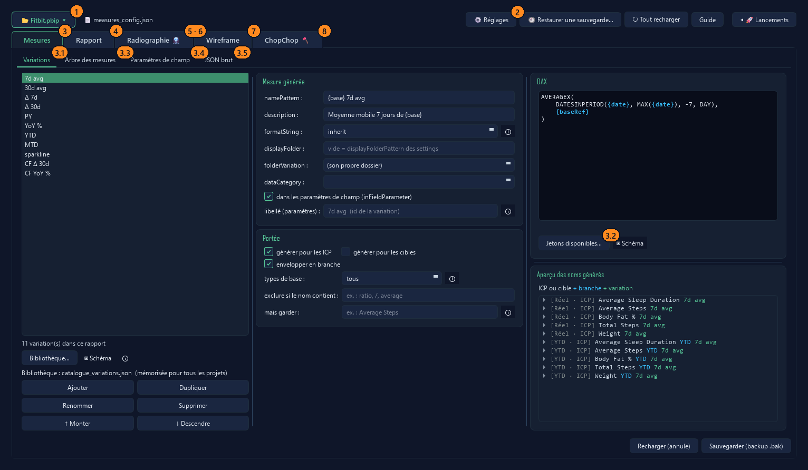
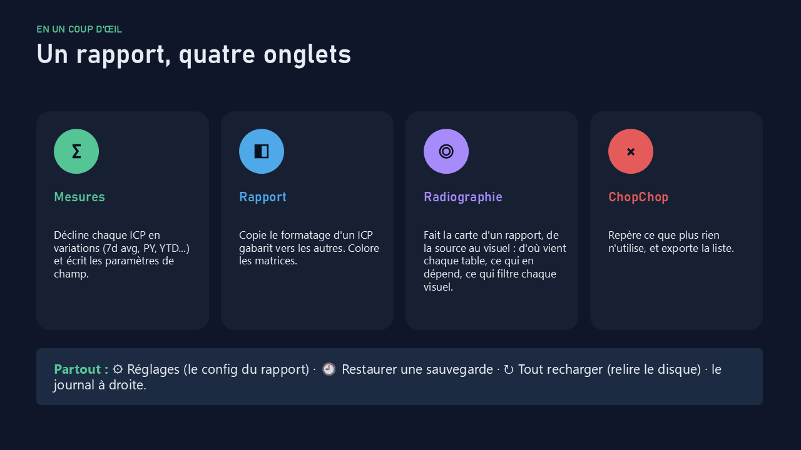
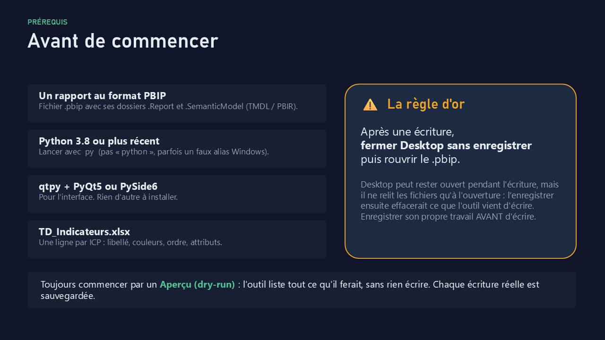
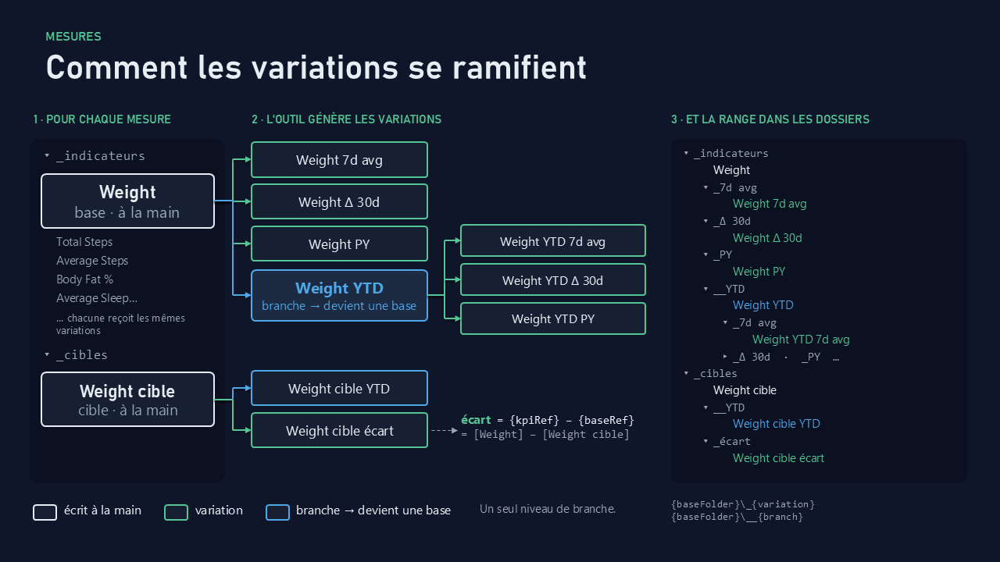
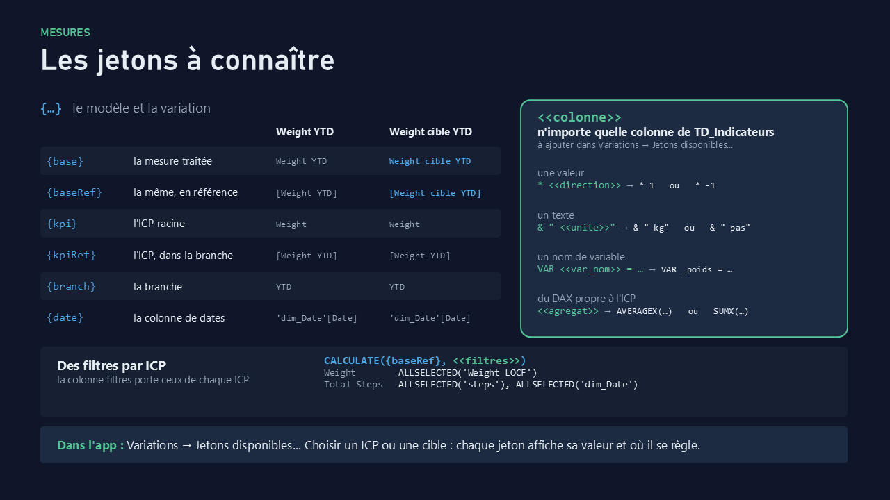
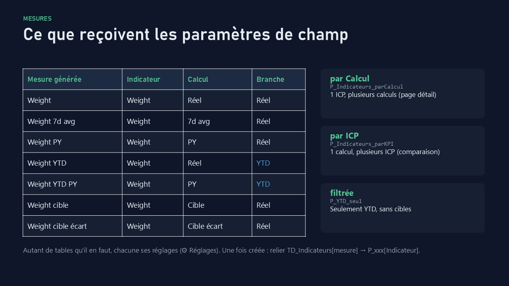
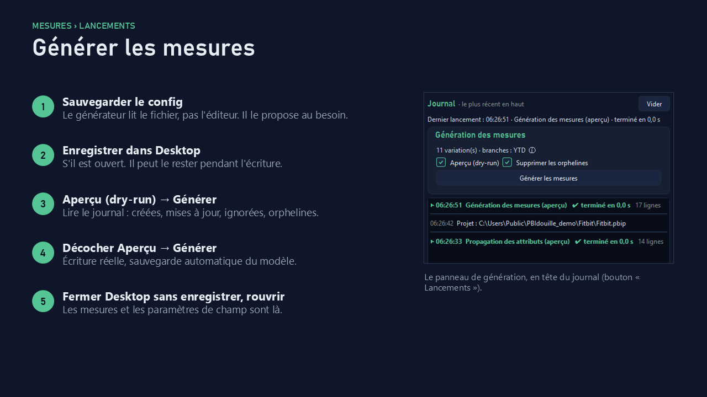
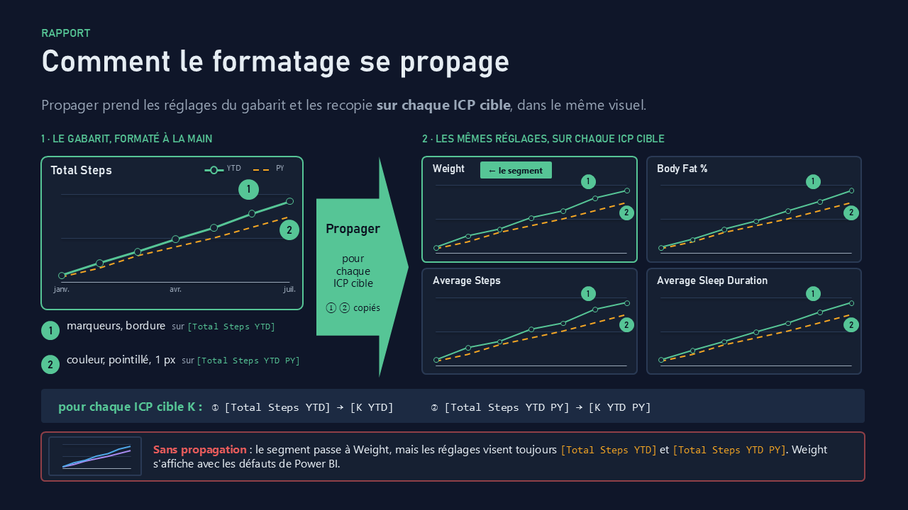
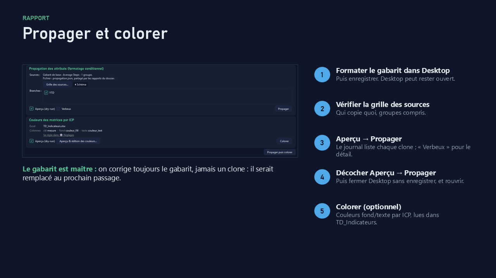
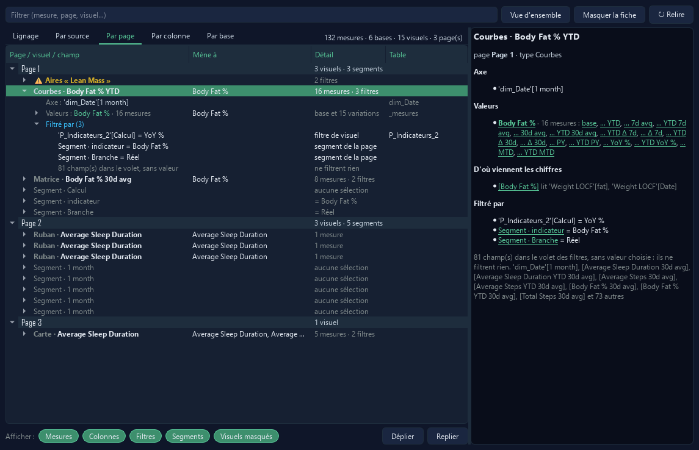

# Documentation de PBIdouille

PBIdouille écrit ce qui se répète dans un rapport Power BI au format PBIP, directement dans
ses fichiers : les mesures dérivées de chaque KPI, les tables paramètre de champ, le
formatage recopié d'un KPI vers les autres, et le ménage de ce que plus rien n'utilise.

Cette page en fait le tour en images, puis renvoie au détail. Chaque numéro de la capture
est celui d'un article, et les articles se lisent dans cet ordre.

| N° | Article | Ce qu'on y fait |
|---|---|---|
| 1 | [La barre du haut](articles/01-barre-du-haut.md) | Changer de rapport, restaurer une sauvegarde, tout recharger |
| 2 | [⚙ Réglages](articles/02-reglages.md) | Génération, Excel des indicateurs, branches, cibles, formats delta |
| 3 | **Mesures** | Les variations et ce qu'elles génèrent |
| 3.1 | [Variations](articles/03-1-variations.md) | Créer une mesure, et ce que chaque réglage change dans Power BI |
| 3.2 | [Les jetons](articles/03-2-jetons.md) | `{base}`, `<<attributs>>` de TD_Indicateurs, et où chacun se règle |
| 3.3 | [Arbre des mesures](articles/03-3-arbre-des-mesures.md) | Tout ce que la génération produira, et le DAX final |
| 3.4 | [Paramètres de champ](articles/03-4-parametres-de-champ.md) | Les tables d'un segment, et ce qu'elles contiendront |
| 3.5 | [JSON brut](articles/03-5-json-brut.md) | Modifier directement `measures_config.json` |
| 4 | [Rapport](articles/04-rapport.md) | Propager le formatage d'un KPI vers les autres, colorer les matrices |
| 5 | [Sources de données](articles/05-sources-de-donnees.md) | D'où vient chaque table, et ce qui manque sur ce poste |
| 6 | [Radiographie 🩻](articles/06-radiographie.md) | Comprendre un rapport qu'on n'a pas fait : KPI, visuels, filtres, colonnes |
| 7 | [Wireframe](articles/07-wireframe.md) | Organiser les visuels d'une page (édition de développement) |
| 8 | [ChopChop](articles/08-chopchop.md) | Repérer ce que plus rien n'utilise |

---

## Le tour en images

Les diapos du [guide de démarrage](PBIdouille%20-%20Guide%20de%20demarrage%20rapide.pptx).
L'app les montre aussi : bouton **Guide** de la barre du haut, et liens **▣ Schéma** là où
chaque notion sert.

### Un rapport, cinq onglets

Tout se passe dans cinq onglets, qui travaillent sur le même rapport. **Mesures** crée
les variations de chaque KPI et les tables paramètre de champ. **Rapport** recopie le
formatage d'un KPI vers les autres. **Sources de données** dit d'où vient chaque table.
**Radiographie** fait la carte d'un rapport qu'on n'a pas fait. **ChopChop** repère ce
que plus rien n'utilise.

### Avant de commencer

Le rapport doit être au format **PBIP**. Power BI Desktop peut rester ouvert pendant une
écriture, mais il ne relit les fichiers qu'à l'ouverture, et **enregistrer dans Desktop
après une écriture efface ce que PBIdouille vient d'écrire**. D'où trois gestes :

1. Avant d'écrire, enregistrer son travail dans Desktop.
2. Écrire avec PBIdouille.
3. Fermer Desktop **sans enregistrer**, puis rouvrir le `.pbip` : les changements y sont.

### Ouvrir un rapport

La barre du haut est la même partout : elle choisit le rapport et son config, et donne
accès aux réglages, aux sauvegardes et au journal.

→ [1 La barre du haut](articles/01-barre-du-haut.md) · [2 ⚙ Réglages](articles/02-reglages.md)

### Mesures : les variations

Une **variation** s'écrit une fois, comme `7d avg` ou `PY`, et PBIdouille en génère une
mesure pour chaque KPI. Une **branche**, comme YTD, applique ensuite les autres variations à
l'intérieur d'elle-même. L'arbre des mesures montre tout ce qui sera produit, avant
d'écrire.

→ [3.1 Variations](articles/03-1-variations.md) · [3.3 Arbre des mesures](articles/03-3-arbre-des-mesures.md)

### Mesures : les jetons

Les **jetons** sont les parties du DAX qui changent d'un KPI à l'autre : `{baseRef}` devient
`[Weight]`, `<<unite>>` devient la valeur de la colonne `unite` de TD_Indicateurs.

→ [3.2 Les jetons](articles/03-2-jetons.md)

### Mesures : les paramètres de champ

Les tables paramètre de champ permettent de choisir, dans un segment, quelle mesure un
visuel affiche. PBIdouille les remplit avec les KPI, leurs cibles et leurs variations.

→ [3.4 Paramètres de champ](articles/03-4-parametres-de-champ.md)

### Mesures : générer

La génération écrit les mesures et les tables paramètre dans le modèle. L'aperçu, coché par
défaut, montre tout sans rien écrire.

→ [3.1 Variations, sauvegarder puis générer](articles/03-1-variations.md#7-sauvegarder-puis-générer)

### Rapport : propager le formatage

Le formatage se fait une fois sur un KPI **gabarit** dans Power BI Desktop. La propagation le
recopie sur les mesures équivalentes des autres KPI, visuel par visuel. L'onglet colore
aussi les matrices.

→ [4 Rapport](articles/04-rapport.md)

### Sources de données

Le guide n'a pas de diapo pour cet onglet. Il dit d'où vient chaque table du rapport :
Excel, CSV, base ODBC ou serveur SQL, et signale un fichier local introuvable sur ce poste.

→ [5 Sources de données](articles/05-sources-de-donnees.md)

### Radiographie : comprendre un rapport qu'on n'a pas fait

Pour un rapport fait par quelqu'un d'autre, cet onglet montre quels KPI sont affichés et
où, à quelles mesures de base et à quelles colonnes mène chaque mesure, et ce qui filtre
chaque visuel : filtres, segments, interactions. Il ne s'appuie sur rien de PBIdouille et
demande un modèle local au format TMDL et des visuels au format PBIR.

→ [6 Radiographie](articles/06-radiographie.md)

### ChopChop : le ménage

ChopChop liste les mesures, colonnes et tables sans référence détectée dans le modèle et le rapport analysés. Les autres rapports consommateurs sont à vérifier séparément.

→ [8 ChopChop](articles/08-chopchop.md)

### Les filets de sécurité

Le bouton **Restaurer une sauvegarde…** liste les sessions enregistrées dans le projet. Déplier une session permet de vérifier les fichiers concernés. L’éditeur de configuration conserve aussi une copie `.bak` à côté du JSON.

→ [Restaurer une sauvegarde](articles/01-barre-du-haut.md#restaurer-une-sauvegarde)

### En cas de pépin

Les quatre problèmes les plus fréquents, et quoi faire. Le journal, dans la colonne de
droite (bouton **🚀 Lancements**), dit presque toujours pourquoi une mesure n'a pas été
générée.

---

## Aussi

- [Le guide de démarrage](PBIdouille%20-%20Guide%20de%20demarrage%20rapide.pptx), en PowerPoint
- [La référence technique](../README.md)
- `ressources/` : les images, les diapos exportées et les scripts qui les fabriquent

→ Commencer la lecture : [1 La barre du haut](articles/01-barre-du-haut.md)
