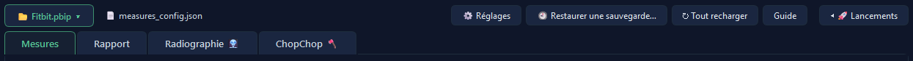

# 1 · La barre du haut

[Documentation](../README.md) › **La barre du haut** · voir aussi [⚙ Réglages](02-reglages.md)

La barre du haut est la même dans tous les onglets. À gauche, le rapport ouvert et son
config. À droite, ce qui vaut pour tout l'outil.

| Bouton | Rôle |
|---|---|
| **📂 fichier du rapport**, comme `Fitbit.pbip` | Ouvrir un rapport récent ou un autre `.pbip` |
| **📄 measures_config.json** | Choisir le config du rapport |
| **⚙ Réglages** | Les réglages globaux du config : voir [⚙ Réglages](02-reglages.md) |
| **🕘 Restaurer une sauvegarde…** | Revenir à une copie faite avant une écriture |
| **↻ Tout recharger** | Relire les fichiers sur le disque |
| **Guide** | Les schémas du guide |
| **🚀 Lancements** | Afficher ou masquer la colonne du journal |

## Changer de rapport

Cliquer sur le bouton du rapport, à gauche. Son menu propose :

- les **rapports récents**, celui qui est ouvert étant coché. Deux rapports du même nom se
  distinguent par leur dossier ;
- **Ouvrir un autre rapport…**, pour choisir un `.pbip` ;
- **Afficher le dossier dans l'Explorateur**.

Le survol du bouton affiche le chemin complet du rapport. Au démarrage, l'app rouvre le
dernier rapport utilisé.

## Le config du rapport

Le bouton **📄** montre le `measures_config.json` utilisé. Par défaut, c'est celui qui se
trouve à côté du `.pbip`, et le bouton n'affiche que son nom. Cliquer dessus permet d'en
choisir un autre, par exemple au travail si le config ne vit pas avec le rapport. Ce choix
est mémorisé pour ce rapport, et le bouton affiche alors une partie du chemin.

Si le fichier est introuvable, le bouton s'affiche en jaune.

## Restaurer une sauvegarde

Chaque outil qui écrit dans le rapport copie d'abord les fichiers touchés : génération des
mesures, propagation, couleurs, wireframe, ChopChop et Excel des indicateurs. **🕘 Restaurer
une sauvegarde…** liste toutes ces copies, la plus récente en haut.

Pour revenir en arrière :

1. Choisir une sauvegarde. La déplier montre chaque fichier et sa destination.
2. Cliquer **Restaurer cette sauvegarde** et confirmer.
3. Si Power BI Desktop est ouvert, le fermer **sans enregistrer**, puis rouvrir le
   `.pbip`. Enregistrer dans Desktop réécrirait les fichiers qui viennent d'être restaurés.

Si le projet a été copié ou déplacé avec ses sauvegardes, les fichiers du projet sont
restaurés dans le dossier ouvert. Un classeur enregistré hors du projet conserve son
chemin absolu. La confirmation indique ce chemin avant toute écriture.

L'état actuel est sauvegardé juste avant, donc une restauration peut elle-même être
annulée. Un fichier créé par l'opération d'origine est effacé, et un fichier qu'elle avait
supprimé est recréé.

Après une restauration, les onglets relisent les fichiers, comme avec **↻ Tout recharger**.

Chaque outil garde ses **10** sauvegardes les plus récentes, dans le dossier
`_backupsPBIdouille` à côté du `.pbip`.

## Tout recharger

**↻ Tout recharger** relit le modèle, le config, l'Excel des indicateurs, la grille des
sources et les pages du rapport, sans fermer l'app. Il sert après une génération, un
changement dans l'Excel ou une retouche dans Power BI Desktop.

S'il reste des changements non enregistrés, une question est posée avant :

| Choix | Effet |
|---|---|
| **Enregistrer puis recharger** | Écrit les changements, puis relit tout |
| **Recharger quand même** | Relit tout et abandonne les changements |
| **Annuler** | Ne fait rien |

## Le journal

**🚀 Lancements** affiche ou masque la colonne de droite. Elle contient le journal, le plus
récent en haut, et dans l'onglet Mesures le bouton **Générer les mesures**. Le choix est
mémorisé séparément pour l'éditeur de variations et pour le reste de l'app.

---

[Sommaire](../README.md) · [2 ⚙ Réglages](02-reglages.md) →
