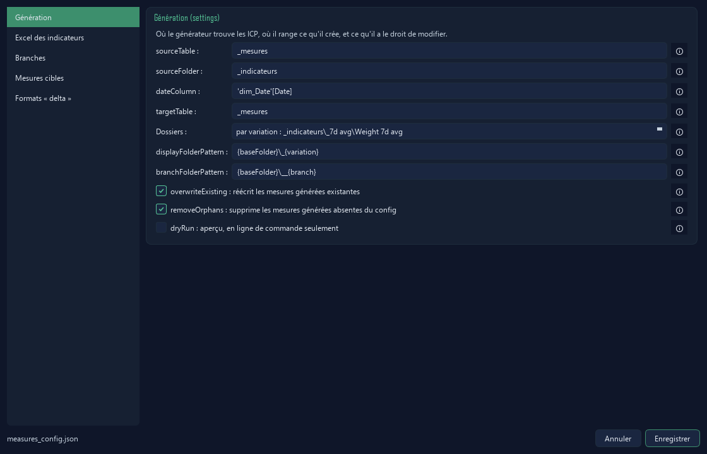
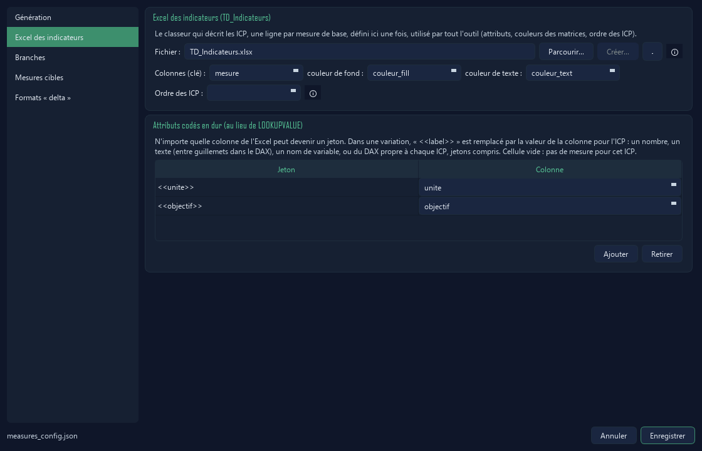
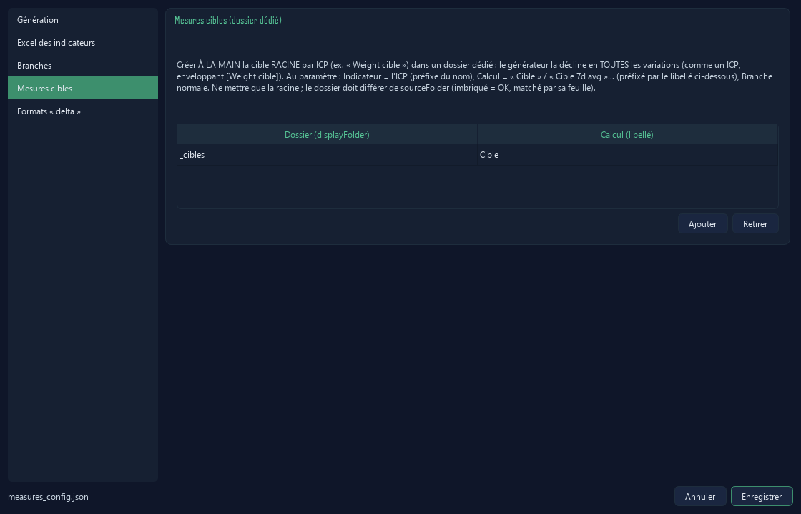

# 2 · ⚙ Réglages

[Documentation](../README.md) › **⚙ Réglages** · voir aussi [Variations](03-1-variations.md), [Les jetons](03-2-jetons.md), [Rapport](04-rapport.md)

La fenêtre **⚙ Réglages** regroupe les réglages du `measures_config.json` qui servent à
plusieurs onglets. Elle s'ouvre avec le bouton **⚙ Réglages** de la barre du haut.

| Page | Ce qu'elle décide |
|---|---|
| [Génération](#génération) | Où trouver les KPI, où ranger les mesures, ce qui peut être modifié |
| [Excel des indicateurs](#excel-des-indicateurs) | Le fichier TD_Indicateurs, ses colonnes et les attributs `<<…>>` |
| [Branches](#branches) | Les variations qui deviennent des branches, comme YTD |
| [Mesures cibles](#mesures-cibles) | Les dossiers où se trouvent les cibles |
| [Formats « delta »](#formats--delta-) | Les signes des écarts |

Le bouton **ⓘ** au bout d'un réglage donne son explication détaillée. Les tables paramètre
de champ ont leur [propre onglet](03-4-parametres-de-champ.md).

## Enregistrer ou annuler

| Bouton | Effet |
|---|---|
| **Enregistrer** | Écrit `measures_config.json` et garde l'ancienne version dans `measures_config.json.bak` |
| **Annuler** | Referme la fenêtre et oublie ce qui y a été changé |

**Enregistrer** écrit tout le config en attente, y compris les changements de
**Variations** pas encore sauvegardés. Un ancien bloc `switch`, qui ne sert plus, est retiré
à cette occasion.

Si le **JSON brut** ouvert contient une erreur, la fenêtre ne s'ouvre pas : il faut d'abord
la corriger.

Un réglage enregistré agit sur le modèle à la prochaine **Générer les mesures**.

## Génération



| Réglage | Dans `settings` | Rôle |
|---|---|---|
| **sourceTable** | `sourceTable` | La table qui contient les KPI. Défaut : `_mesures` |
| **sourceFolder** | `sourceFolder` | Le dossier d'affichage des KPI. Vide : toutes les mesures écrites à la main dans la table |
| **dateColumn** | `dateColumn` | La colonne qui remplace le jeton `{date}`, comme `'dim_Date'[Date]` |
| **targetTable** | `targetTable` | La table où créer les mesures. Vide : la table de chaque KPI |
| **Dossiers** | `folderLayout` | Le rangement des mesures : par variation ou par KPI |
| **displayFolderPattern** | `displayFolderPattern` | Le dossier des variations, comme `{baseFolder}\_{variation}` |
| **branchFolderPattern** | `branchFolderPattern` | Le dossier d'une mesure de branche, comme `{baseFolder}\__{branch}` |
| **overwriteExisting** | `overwriteExisting` | Coché : met à jour les mesures déjà générées. Décoché : crée seulement les nouvelles |
| **removeOrphans** | `removeOrphans` | L'état de départ de **Supprimer les orphelines** |
| **dryRun** | `dryRun` | Pour la ligne de commande seulement. Dans l'app, c'est **Aperçu (dry-run)** qui décide |

Avec `sourceFolder` vide, une cible écrite à la main devient aussi une base : garder ce
réglage rempli quand le modèle contient d'autres mesures.

### Le rangement des dossiers

| Choix | `Weight 7d avg` | `Weight YTD 7d avg` |
|---|---|---|
| **par variation** | `_indicateurs\_7d avg` | `_indicateurs\__YTD\_7d avg` |
| **par KPI** | `_indicateurs\Weight` | `_indicateurs\Weight\YTD` |

Par KPI, les deux motifs de dossier ne servent pas et sont grisés. Changer de rangement
déplace les mesures existantes à la prochaine génération : elles sont **modifiées**, pas
recréées.

Quand **overwriteExisting** est décoché, une mesure générée encore demandée garde sa
formule et son identifiant, même si **Supprimer les orphelines** est coché. Ce ménage
retire uniquement les mesures générées qui ne sont plus demandées.

Une mesure écrite à la main n'est jamais modifiée, quel que soit `overwriteExisting`.

## Excel des indicateurs



Ce classeur décrit les KPI, à raison d'une ligne par mesure de base. Il est défini ici une
seule fois, pour tout l'outil.

| Réglage | Dans `indicateursXlsx` | Rôle |
|---|---|---|
| **Fichier** | `path` | Le classeur. Un chemin relatif part du dossier du `.pbip` |
| **Colonnes (clé)** | `keyColumn` | La colonne qui contient le nom de la mesure |
| **couleur de fond** | `fillColumn` | Le fond utilisé par [Colorer](04-rapport.md#colorer-les-matrices) |
| **couleur de texte** | `textColumn` | Le texte utilisé par Colorer |
| **Ordre des KPI** | `orderColumn` | L'ordre des KPI dans les tables paramètre. Vide : alphabétique |

**↻** relit les colonnes, par exemple après en avoir ajouté une dans Excel.

### L'ordre des KPI

Mettre des nombres dans la colonne choisie, de préférence espacés : `10`, `20`, `30`. Ils
sont triés comme des nombres. Un texte passe après les nombres, et un KPI sans valeur passe
à la fin, avec un message au journal.

### Les attributs

**Ajouter** crée une ligne qui relie un jeton `<<…>>` à une colonne de l'Excel, et
**Retirer** supprime la ligne choisie. C'est la même liste que dans la fenêtre
[Jetons disponibles](03-2-jetons.md#créer-et-modifier-un-attribut), qui permet aussi de
modifier les valeurs.

## Branches


Une **branche** applique les autres variations à l'intérieur d'une variation, par exemple
le PY dans le cumul annuel.

1. À gauche, cocher la variation qui devient une branche.
2. À droite, choisir la branche et décocher les variations qu'elle ne doit pas appliquer.
3. Cliquer **Enregistrer**, puis générer.

Avec `MTD` coché, la génération ajoute `Weight MTD`, puis `Weight MTD PY` :

```dax
Weight MTD PY = CALCULATE([Weight PY], DATESMTD('dim_Date'[Date]))
```

Une branche applique par défaut **toutes** les variations, y compris les autres branches :
avec YTD et MTD cochés, `Weight MTD YTD` existe aussi. Pour l'éviter, décocher `YTD` dans la
liste de MTD. Une variation ajoutée plus tard entre d'elle-même dans chaque branche.

### Envelopper ou recopier

| **Envelopper la variation Réel** | DAX de `Weight YTD PY` |
|---|---|
| Coché (défaut) | `CALCULATE([Weight PY], DATESYTD('dim_Date'[Date]))` |
| Décoché | `CALCULATE([Weight YTD], SAMEPERIODLASTYEAR('dim_Date'[Date]))` |

Les deux formes ne donnent pas toujours le même résultat : voir
[Envelopper ou recopier](03-1-variations.md#envelopper-ou-recopier-en-branche).

**Patron** définit l'enveloppe, avec `{variationRef}` pour la mesure enveloppée. Vide, il est
déduit du DAX de la branche. Il doit être rempli si ce DAX ne cite pas `{baseRef}`.

## Mesures cibles



Une **cible** est une mesure écrite à la main dans Power BI, comme `Weight cible`.

1. Dans Power BI Desktop, créer une cible par KPI et les ranger dans un dossier dédié.
2. Ici, cliquer **Ajouter** et indiquer ce dossier.
3. Dans **Calcul (libellé)**, indiquer le nom affiché dans les paramètres de champ.
4. Dans [Variations](03-1-variations.md#portée), cocher **générer pour les cibles** sur
   les variations voulues.

Le nom de la cible doit commencer par celui de son KPI. Ne placer dans ce dossier que la
cible de départ, car le générateur crée le reste. Ce dossier doit être différent de
`sourceFolder`.

## Formats « delta »


Ces réglages s'appliquent aux variations dont `formatString` vaut `delta`. La ligne sous les
champs montre le résultat.

| Réglage | Dans `settings` | Rôle |
|---|---|---|
| **positif**, **négatif**, **zéro** | `deltaSymbols` | Le symbole placé devant la valeur |
| **repli sans format** | `deltaFallbackFormat` | Le format utilisé quand la mesure de base n'en a pas |

| Symboles | Affichage | Format pour une base `0.0` |
|---|---|---|
| `+`, `-`, vide | `+12,3`, `-12,3`, `0` | `+0.0;-0.0;0.0` |
| `▲ `, `▼ `, vide | `▲ 12,3`, `▼ 12,3`, `0` | `\▲ 0.0;\▼ 0.0;0.0` |

Power BI n'ajoute aucun signe tout seul : le `-` doit donc figurer ici. Avec une flèche, ne
pas en mettre, car la flèche porte déjà le sens.

---

← [1 La barre du haut](01-barre-du-haut.md) · [Sommaire](../README.md) · [3.1 Variations](03-1-variations.md) →
