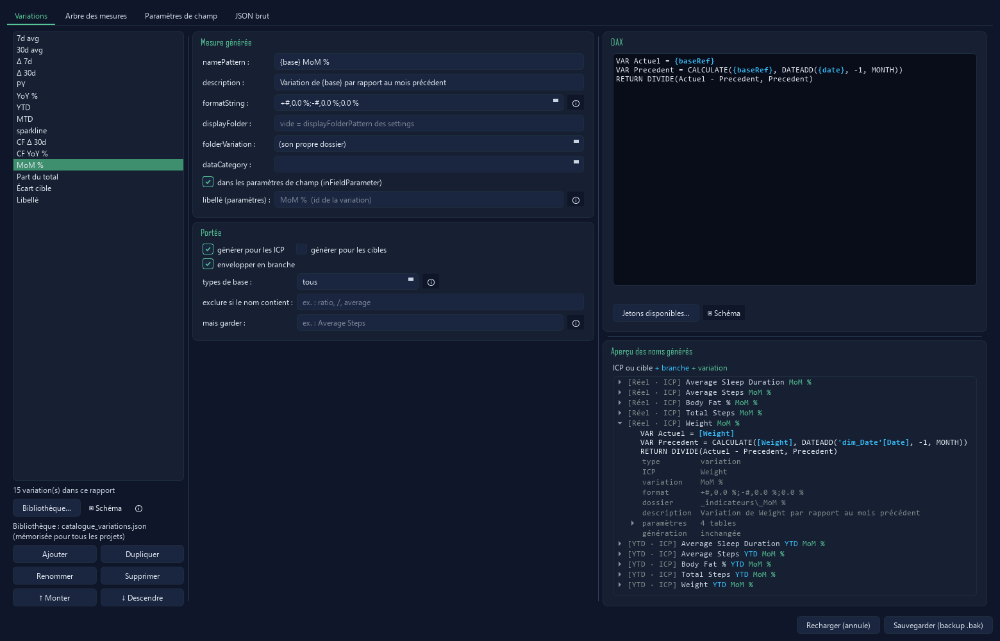
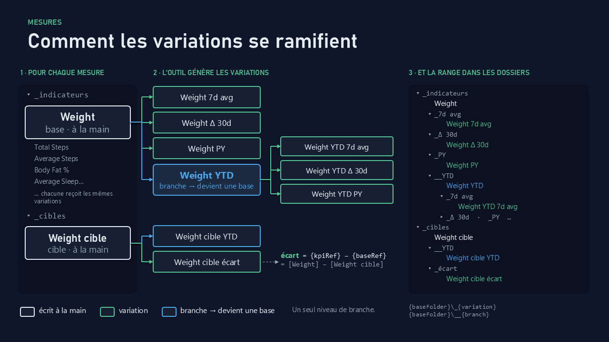
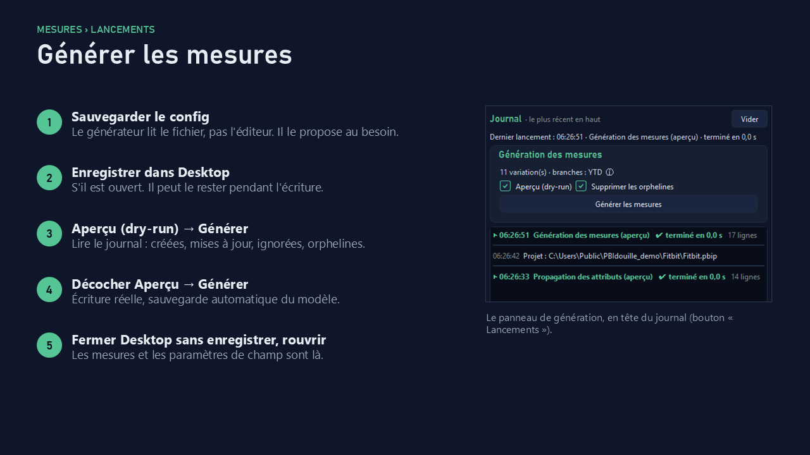

# 3.1 · Mesures › Variations

[Documentation](../README.md) › Mesures › **Variations** · voir aussi [Les jetons](03-2-jetons.md), [Arbre des mesures](03-3-arbre-des-mesures.md), [Paramètres de champ](03-4-parametres-de-champ.md)

Une **variation** est une recette de mesure. On l'écrit une seule fois, et
PBIdouille en génère une mesure pour chaque KPI, dans chaque branche, et pour
les cibles lorsque nécessaire. Avec 5 KPI et une branche YTD, une variation
donne 10 mesures dans Power BI.



De gauche à droite : la liste des variations, leurs réglages, puis le DAX et
l'aperçu de ce qui sera généré.



## Créer une nouvelle mesure

Exemple : la variation d'un KPI par rapport au mois précédent.

### 1. Ajouter la variation

Cliquer **Ajouter** sous la liste, puis lui donner un identifiant : `MoM %`.

L'identifiant n'est pas qu'un nom interne : c'est la valeur que verront les
utilisateurs dans la colonne **Calcul** des paramètres de champ, et il sert à
nommer le dossier d'affichage. Le choisir comme un libellé.

### 2. Nommer la mesure

Le nom doit être libre dans tout le modèle, y compris lorsque seule la casse diffère. Si `Archives` possède déjà `TOTAL DOUBLE`, la génération de `Total double` dans `Ventes` signale les deux tables avant toute écriture.

| Champ | Valeur |
|---|---|
| namePattern | `{base} MoM %` |
| description | `Variation de {base} par rapport au mois précédent` |

`{base}` deviendra `Weight`, `Total Steps`, `Weight YTD`…

### 3. Écrire le DAX

```dax
VAR Actuel = {baseRef}
VAR Precedent = CALCULATE({baseRef}, DATEADD({date}, -1, MONTH))
RETURN DIVIDE(Actuel - Precedent, Precedent)
```

Les [jetons](03-2-jetons.md) se colorent à la frappe : bleu pour `{…}`, vert pour
`<<…>>`, **rouge souligné** pour un jeton inconnu. Sous l'éditeur, le bouton
**Jetons disponibles…** montre ce que vaut chaque jeton pour le KPI choisi,
et où il se règle.

### 4. Choisir le format

formatString : `+#,0.0 %;-#,0.0 %;0.0 %`. Les [formats](#formatstring) sont
détaillés plus bas.

### 5. Décider où elle s'applique

Cocher **dans les paramètres de champ** si elle doit être sélectionnable dans les
segments. Dans **Portée**, laisser « générer pour les KPI ».

### 6. Vérifier dans l'aperçu

**Aperçu des noms générés** liste chaque mesure à venir. Déplier un nom pour voir
son DAX final, jetons remplacés, et ses attributs. Rien n'est écrit à ce stade,
et l'aperçu suit la saisie.

### 7. Sauvegarder, puis générer

1. **Sauvegarder** écrit le `measures_config.json` (le générateur lit ce fichier,
   pas le formulaire).
2. Si Power BI Desktop est ouvert, y **enregistrer** son travail. Il peut rester ouvert.
3. Dans le panneau **Génération des mesures**, garder **Aperçu (dry-run)** coché et
   cliquer **Générer les mesures** : le journal liste ce qui serait créé ou modifié.
4. Décocher **Aperçu (dry-run)** et relancer. Le modèle est sauvegardé avant l'écriture.
5. Fermer Desktop **sans enregistrer**, puis rouvrir le `.pbip`. Desktop ne relit les
   fichiers qu'à l'ouverture, et enregistrer à ce moment effacerait les mesures générées.



### Le résultat

Voici ce que la génération écrit pour `Weight`, dans le fichier TMDL du modèle :

```
/// Variation de Weight par rapport au mois précédent
measure 'Weight MoM %' =
        VAR Actuel = [Weight]
        VAR Precedent = CALCULATE([Weight], DATEADD('dim_Date'[Date], -1, MONTH))
        RETURN DIVIDE(Actuel - Precedent, Precedent)
    formatString: +#,0.0 %;-#,0.0 %;0.0 %
    displayFolder: _indicateurs\_MoM %
    lineageTag: d0906d3b-87f1-4f81-90ef-ebeb17e8dbe1

    annotation MeasureVariation = Weight|MoM %
```

Et dans la branche YTD, la mesure enveloppe celle du Réel :

```dax
Weight YTD MoM % = CALCULATE([Weight MoM %], DATESYTD('dim_Date'[Date]))
```

L'annotation `MeasureVariation` est ce qui permet à PBIdouille de reconnaître
ses mesures. Une mesure écrite à la main n'en a pas : elle n'est jamais modifiée.

## Ce que chaque réglage change dans Power BI

### Mesure générée

| Réglage | Dans le config | Où ça se voit dans Power BI |
|---|---|---|
| **Identifiant** | la clé de la variation | La valeur **Calcul** des paramètres de champ, et le dossier par défaut |
| **namePattern** | `namePattern` | Le **nom** de la mesure dans le volet Données |
| **description** | `description` | La **description** de la mesure : volet Propriétés, et infobulle du volet Données |
| **formatString** | `formatString` | Le **format** de la mesure, donc l'affichage dans les visuels |
| **displayFolder** | `displayFolder` | Le **dossier d'affichage** dans le volet Données |
| **folderVariation** | `folderVariation` | Range la mesure dans le dossier d'une **autre** variation |
| **dataCategory** | `dataCategory` | La **catégorie de données** : `ImageUrl` pour une image (SVG), `WebUrl` pour un lien |
| **dans les paramètres de champ** | `inFieldParameter` | Ajoute une **rangée** par mesure dans les tables paramètre de champ |

### formatString

| Valeur | Résultat pour une base `0.0` | Usage |
|---|---|---|
| `inherit` | `0.0` | Le même format que la base |
| `delta` | `+0.0;-0.0;0.0` | Un écart, avec son signe. Une base en % donne des points : `+0.0 pts` |
| `text` | aucun format | Une mesure qui rend du texte |
| `{baseFormat} kg` | `0.0 kg` | Le format de la base, complété |
| `#,0.00` | `#,0.00` | Un format fixe, le même pour tous les KPI |

Une base sans format reste sans format avec `inherit`. Avec `delta`, elle reçoit
`+#,##0.##;-#,##0.##;#,##0.##`.

### Dossiers

Sans `displayFolder`, le dossier vient de **⚙ Réglages → Génération** :

| Mesure | Rangement par variation | Rangement par KPI |
|---|---|---|
| `Weight` | `_indicateurs` | `_indicateurs` |
| `Weight MoM %` | `_indicateurs\_MoM %` | `_indicateurs\Weight` |
| `Weight YTD` | `_indicateurs\__YTD` | `_indicateurs\Weight\YTD` |
| `Weight YTD MoM %` | `_indicateurs\__YTD\_MoM %` | `_indicateurs\Weight\YTD` |

Dans `displayFolder`, on peut utiliser `{folder}` (le dossier calculé),
`{baseFolder}`, `{base}`, `{variation}`, `{kpi}` et `{branch}`. Les `<<attributs>>`
n'y sont **pas** remplacés.

### Portée

La portée décide **quelles mesures existent**. Une base écartée ne reçoit rien :
la mesure n'est pas créée.

| Réglage | Dans le config | Effet |
|---|---|---|
| **générer pour les KPI** | `appliesToKpi` | Crée la mesure pour chaque KPI (coché par défaut) |
| **générer pour les cibles** | `appliesToCibles` | Crée la mesure pour chaque cible, comme `Weight cible écart` |
| **envelopper en branche** | `wrapInBranch` | En branche, entoure la mesure Réel au lieu de recopier son DAX |
| **types de base** | `appliesToFormats` | Limite aux bases d'un type : nombre, pourcentage, devise, ou un type de TD_Indicateurs |
| **exclure si le nom contient** | `excludeNameContains` | Écarte les bases dont le nom contient ce texte |
| **mais garder** | `includeNameContains` | Rattrape une base nommée, même exclue |

Quand plusieurs filtres s'appliquent : **mais garder** l'emporte, puis
**exclure**, puis **types de base**. Les noms ignorent la casse et les accents.

### Envelopper ou recopier, en branche

| | DAX de `Weight YTD MoM %` |
|---|---|
| **Enveloppé** (par défaut) | `CALCULATE([Weight MoM %], DATESYTD('dim_Date'[Date]))` |
| **Recopié** (décoché) | Le DAX de la variation sur `[Weight YTD]`, ex. `CALCULATE([Weight YTD], DATEADD('dim_Date'[Date], -1, MONTH))` |

Envelopper garde le DAX lisible, et un correctif sur la mesure Réel se répercute
sans régénérer. Mais ce n'est pas toujours le même calcul : une variation qui
fixe sa propre fenêtre de dates (`DATEADD`, `DATESINPERIOD`, `MAX({date})`) ne
donne pas le même résultat. Pour obtenir la variation **du cumul**, décocher
« envelopper en branche » et comparer les deux.

## Modifier une variation existante

| Élément modifié | Ce qui se passe à la génération | À surveiller |
|---|---|---|
| DAX, format, description, dossier | Les mesures sont mises à jour, sous le même nom | Rien |
| **namePattern** | Les mesures sont **renommées** : les anciens noms disparaissent | Les visuels qui citent une mesure directement perdent ce champ. Les paramètres de champ, eux, suivent. Relancer **Propager** |
| **Identifiant** (Renommer) | Les noms ne bougent pas s'ils ne citent pas `{variation}` | La valeur **Calcul** change, donc les segments et filtres réglés sur l'ancienne valeur. Le dossier par défaut change aussi |
| **dans les paramètres de champ** | La rangée entre dans les tables, ou en sort | Rien côté mesures |
| **Supprimer** | Rien, tant que « Supprimer les orphelines » n'est pas coché | Avec la case, les mesures sont retirées du modèle. Vérifier d'abord qu'aucun visuel ne s'en sert |

Si une mesure écrite à la main porte déjà le nom prévu, elle n'est pas touchée :
le journal l'indique et la mesure générée est ignorée.

---

← [2 ⚙ Réglages](02-reglages.md) · [Sommaire](../README.md) · [3.2 Les jetons](03-2-jetons.md) →
