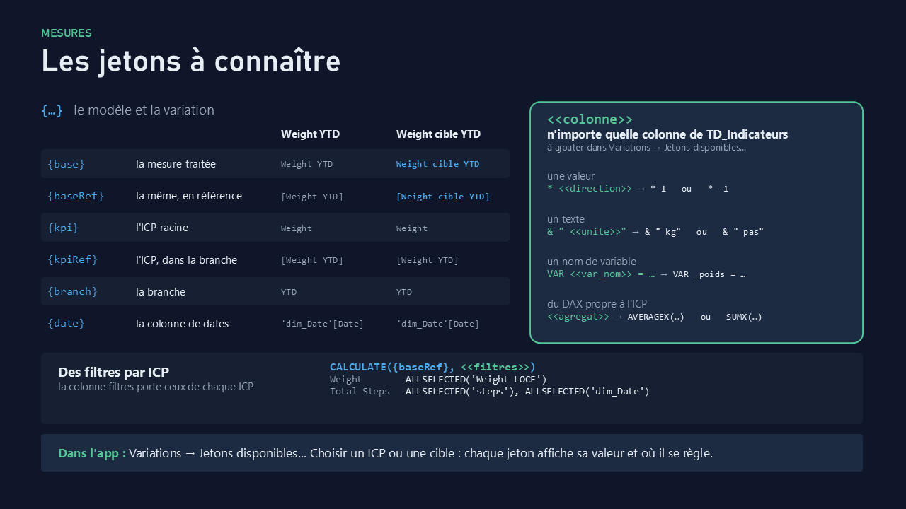
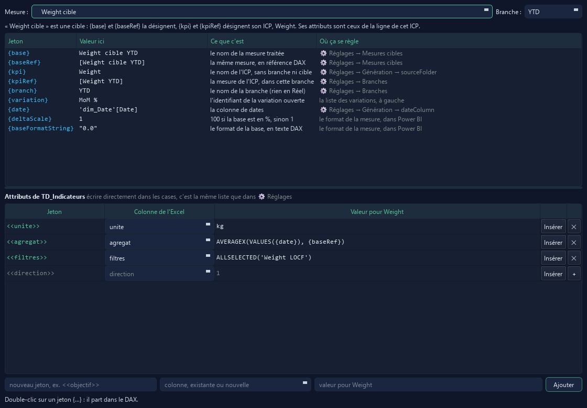

# 3.2 · Mesures › Les jetons

[Documentation](../README.md) › Mesures › **Jetons** · voir aussi [Variations](03-1-variations.md), [Arbre des mesures](03-3-arbre-des-mesures.md)

Une variation s'écrit une seule fois. Les **jetons** sont les parties qui changent
d'un KPI à l'autre : la génération les remplace pour chaque KPI, cible et branche.

Il y en a deux familles, reconnaissables à leur couleur dans l'éditeur DAX :

| Couleur | Jetons | Ce que c'est | Où ça se règle |
|---|---|---|---|
| Bleu | `{base}`, `{date}`, `{kpiRef}`… | Fournis par l'outil | Rien à créer : voir [le tableau](#où-se-règle-chaque-jeton) |
| Vert | `<<unite>>`, `<<filtres>>`… | N'importe quelle colonne de TD_Indicateurs | Directement dans la fenêtre **Jetons disponibles…** (ou **⚙ Réglages → Excel des indicateurs**, c'est la même liste) |
| Rouge souligné | | Faute de frappe, ou attribut pas encore déclaré | |



## Voir ce que vaut un jeton

Dans **Mesures › Variations**, cliquer **Jetons disponibles…** sous le DAX. La fenêtre
reste ouverte à côté de l'éditeur.

1. Choisir une **mesure** (un KPI, ou une cible sous son KPI) et une **branche**.
2. Lire la **valeur** de chaque jeton pour cette mesure, et **où elle se règle**.
3. **Double-cliquer** sur un jeton pour l'insérer dans le DAX.

Les cibles du rapport apparaissent sous leur KPI. Une cible est une mesure écrite à
la main dans Power BI, rangée dans le dossier indiqué dans **⚙ Réglages → Mesures
cibles**. Pour qu'elle existe dans une branche, cocher **générer pour les cibles** sur
la variation de cette branche.

Sous les jetons `{…}`, la section **Attributs de TD_Indicateurs** se modifie sur
place : voir [Créer et modifier un attribut](#créer-et-modifier-un-attribut).



Ces valeurs viennent de la génération elle-même : c'est ce qui sera écrit.

## Où se règle chaque jeton

| Jeton | Vient de | Où le changer |
|---|---|---|
| `{base}`, `{baseRef}` | la mesure traitée | KPI : **⚙ Réglages → Génération** (`sourceTable`, `sourceFolder`). Cible : **⚙ Réglages → Mesures cibles**. Branche : **⚙ Réglages → Branches** |
| `{kpi}` | le KPI | **⚙ Réglages → Génération** (`sourceTable`, `sourceFolder`) |
| `{kpiRef}` | le KPI, dans la branche | **⚙ Réglages → Génération**, et **⚙ Réglages → Branches** |
| `{branch}` | la branche | **⚙ Réglages → Branches** |
| `{variation}` | l'identifiant de la variation | La liste des variations (**Renommer**) |
| `{date}` | la colonne de dates | **⚙ Réglages → Génération** (`dateColumn`) |
| `{deltaScale}`, `{baseFormatString}` | le format de la mesure de base | Dans Power BI Desktop, puis régénérer |
| `<<attribut>>` | une colonne de TD_Indicateurs | La section **Attributs de TD_Indicateurs** de la fenêtre, ou **⚙ Réglages → Excel des indicateurs → Attributs codés en dur** |

Le classeur lui-même se choisit en haut de la même page,
**⚙ Réglages → Excel des indicateurs**, avec sa colonne clé (`mesure` par défaut).

## Les jetons `{…}`

| Jeton | Ce que c'est | `Weight` | `Weight YTD` | `Weight cible` | `Weight cible YTD` |
|---|---|---|---|---|---|
| `{base}` | la mesure traitée | `Weight` | `Weight YTD` | `Weight cible` | `Weight cible YTD` |
| `{baseRef}` | la même, en référence DAX | `[Weight]` | `[Weight YTD]` | `[Weight cible]` | `[Weight cible YTD]` |
| `{kpi}` | le KPI | `Weight` | `Weight` | `Weight` | `Weight` |
| `{kpiRef}` | le KPI, dans la branche | `[Weight]` | `[Weight YTD]` | `[Weight]` | `[Weight YTD]` |
| `{branch}` | la branche | *(rien)* | `YTD` | *(rien)* | `YTD` |

Ceux-ci ne dépendent pas de la branche :

| Jeton | Ce que c'est | Exemple |
|---|---|---|
| `{variation}` | l'identifiant de la variation | `MoM %` |
| `{date}` | la colonne de dates du modèle | `'dim_Date'[Date]` |
| `{deltaScale}` | `100` si le format de la base est un %, sinon `1` | `1` |
| `{baseFormatString}` | le format de la base, en texte DAX | `"0.0"` |

Ils fonctionnent dans le **nom**, la **description** et le **DAX**.

### KPI et cibles

Une cible est une mesure de base à part entière : `{base}` et `{baseRef}` la
désignent, alors que `{kpi}` et `{kpiRef}` désignent son KPI. C'est ce qui permet
de les comparer :

```dax
{kpiRef} - {baseRef}
```

```dax
Weight cible écart = [Weight] - [Weight cible]
```

Cocher **générer pour les cibles** et décocher **générer pour les KPI** : sur un KPI,
`{kpiRef}` et `{baseRef}` sont la même mesure et l'écart vaudrait 0.

### `{branch}` dans un nom de mesure

Hors branche, `{branch}` disparaît **avec l'espace qui le touche**, ce qui permet
de viser n'importe quelle mesure de la même branche :

| Écrit | En Réel | En YTD |
|---|---|---|
| `[{kpi} cible {branch}]` | `[Weight cible]` | `[Weight cible YTD]` |
| `[{kpi} {branch} PY]` | `[Weight PY]` | `[Weight YTD PY]` |

Une variation dont le DAX cite `{branch}` est écrite pour la branche : elle est
toujours recopiée, jamais enveloppée.

## Les jetons `<<…>>` : n'importe quelle colonne de TD_Indicateurs

Chaque colonne de `TD_Indicateurs.xlsx` peut devenir un jeton. Sa valeur est celle
de la ligne du KPI, **écrite telle quelle** à la place du jeton. Une même variation
peut donc se comporter différemment pour chaque KPI.

### Créer et modifier un attribut

Tout se fait dans la section **Attributs de TD_Indicateurs** de la fenêtre **Jetons
disponibles…**, sans ouvrir autre chose.

Chaque jeton y est écrit comme dans le DAX, `<<unite>>`. À la saisie d'un nom, les
chevrons sont facultatifs.

**Pour en ajouter un**, utiliser la ligne sous le tableau : le nom du jeton, la colonne
et la valeur du KPI choisi, puis **Ajouter**. Si la colonne n'existe pas encore, elle
est créée dans `TD_Indicateurs.xlsx`, et dans son tableau Excel s'il y en a un. Sans
colonne indiquée, elle prend le nom du jeton.

**Pour modifier**, écrire directement dans les cases :

| Case | Ce que ça change |
|---|---|
| **Jeton** | Le nom du jeton. Le DAX qui citait l'ancien nom est à corriger |
| **Colonne de l'Excel** | La colonne lue. Un nom nouveau crée la colonne |
| **Valeur pour…** | La cellule du KPI choisi, dans l'Excel. Pour une cible, celle de son KPI |

**Insérer** met le jeton dans le DAX, et **✕** le retire sans toucher à la colonne.
`direction` est toujours proposé : s'il n'est pas déclaré, il est grisé, et **＋** le
déclare.

Cette liste est celle de **⚙ Réglages → Excel des indicateurs → Attributs codés en
dur** : un changement ici s'y retrouve, et inversement. Le classeur est sauvegardé
avant chaque écriture (**🕘 Restaurer une sauvegarde…**, dans la barre du haut), et **Excel doit être
fermé** pour écrire dedans ; sinon la fenêtre le dit et rien ne change. Le config est
enregistré avec, sauf s'il avait déjà des modifications en attente.

Exemple de `TD_Indicateurs` :

| mesure | direction | objectif | unite | var_nom | agregat | filtres |
|---|---|---|---|---|---|---|
| Weight | 1 | 180 | kg | `_poids` | `AVERAGEX(VALUES({date}), {baseRef})` | `ALLSELECTED('Weight LOCF')` |
| Total Steps | 1 | 10000 | pas | `_pas` | `SUMX(VALUES({date}), {baseRef})` | `ALLSELECTED('steps'), ALLSELECTED('dim_Date')` |

### Une valeur

```dax
{baseRef} - <<objectif>>
```

```dax
Weight reste = [Weight] - 180
Total Steps reste = [Total Steps] - 10000
```

### Du texte

La valeur arrive sans guillemets : les mettre dans le DAX.

```dax
FORMAT({baseRef}, {baseFormatString}) & " <<unite>>"
```

```dax
Weight libellé = FORMAT([Weight], "0.0") & " kg"
Total Steps libellé = FORMAT([Total Steps], "#,0") & " pas"
```

### Un nom de variable, ou un morceau de nom

```dax
VAR <<var_nom>> = {baseRef}
RETURN <<var_nom>> * 2
```

Le jeton marche aussi dans le **nom** de la mesure (`{base} en <<unite>>` donne
`Weight en kg`) et dans sa **description**.

### Du DAX différent pour chaque KPI

Une cellule peut contenir du code, **jetons compris**. La variation reste unique,
et chaque KPI apporte sa logique :

```dax
VAR valeur = <<agregat>>
RETURN valeur * <<direction>>
```

```dax
Weight tendance =
    VAR valeur = AVERAGEX(VALUES('dim_Date'[Date]), [Weight])
    RETURN valeur * 1

Total Steps tendance =
    VAR valeur = SUMX(VALUES('dim_Date'[Date]), [Total Steps])
    RETURN valeur * 1
```

### Des filtres propres à chaque KPI

Pour une part du total, chaque KPI doit retirer les filtres de **ses** tables. La
colonne `filtres` les porte, avec la fonction voulue :

```dax
DIVIDE({baseRef}, CALCULATE({baseRef}, <<filtres>>))
```

```dax
Weight part du total =
    DIVIDE([Weight], CALCULATE([Weight], ALLSELECTED('Weight LOCF')))

Total Steps part du total =
    DIVIDE([Total Steps], CALCULATE([Total Steps], ALLSELECTED('steps'), ALLSELECTED('dim_Date')))
```

| Dans la cellule | Le total calculé |
|---|---|
| `ALLSELECTED('steps')` | **suit les segments** : le total de ce que l'utilisateur a sélectionné |
| `ALL('steps')` | ignore tous les filtres de la table |
| `REMOVEFILTERS('steps')` | comme `ALL`, écrit pour un `CALCULATE` |

Plusieurs tables : les séparer par des virgules. Pour utiliser deux fonctions
différentes, faire deux colonnes.

Une valeur Excel manquante dans le nom, la formule ou la description fait ignorer la variation pour ce KPI. Le journal indique le jeton à renseigner.

### Les règles

- **Cellule vide : pas de mesure** pour ce KPI, et le journal dit laquelle et
  pourquoi. Aucune mesure à moitié écrite.
- **Une cible lit la ligne de son KPI.**
- **La valeur est figée à la génération.** Après un changement dans l'Excel,
  relancer **Générer les mesures**.
- Les `<<attributs>>` ne sont **pas** remplacés dans `displayFolder`.

---

← [3.1 Variations](03-1-variations.md) · [Sommaire](../README.md) · [3.3 Arbre des mesures](03-3-arbre-des-mesures.md) →
