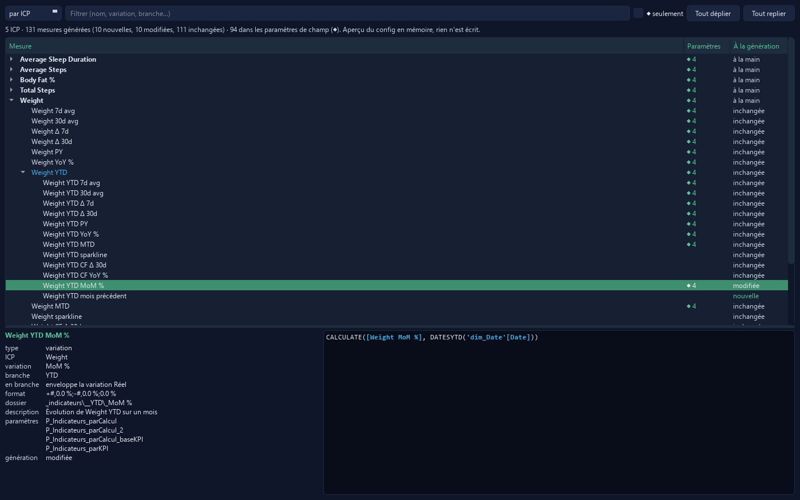
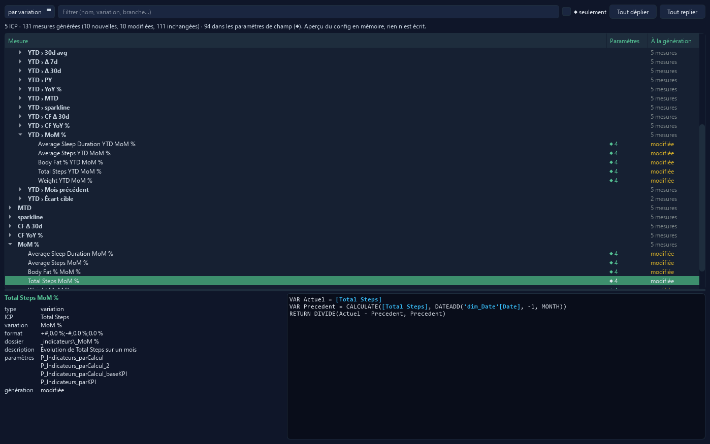

# 3.3 · Mesures › Arbre des mesures

[Documentation](../README.md) › Mesures › **Arbre des mesures** · voir aussi [Variations](03-1-variations.md), [Les jetons](03-2-jetons.md), [Paramètres de champ](03-4-parametres-de-champ.md)

L'**arbre des mesures** montre tout ce que **Générer les mesures** produira, rangé
selon l'origine de chaque mesure. Il sert à vérifier le résultat avant d'écrire
quoi que ce soit : ce qui sera créé, ce qui changera, et le DAX final de chaque
mesure.

C'est un aperçu. L'onglet ne modifie ni le modèle, ni `measures_config.json`, et
rien ne s'y édite : les changements se font dans [Variations](03-1-variations.md).



La ligne du haut résume l'ensemble :

```
5 KPI · 131 mesures générées (10 nouvelles, 10 modifiées, 111 inchangées) · 94 dans les paramètres de champ (◆)
```

## Vérifier un changement avant de générer

1. Modifier ou ajouter une variation dans **Variations**.
2. Ouvrir **Arbre des mesures**. Le changement y est déjà, même sans avoir sauvegardé.
3. Taper le nom de la variation dans le filtre, et lire la colonne **À la génération**.
4. Cliquer sur une mesure pour lire son DAX final dans la fiche.
5. Sauvegarder, puis lancer **Générer les mesures**.

## Les deux rangements

La liste en haut à gauche change le rangement. Le choix est conservé d'une session
à l'autre, et la fiche reste sur la même mesure.

### Par KPI

Chaque mesure est placée sous celle dont elle dérive :

```
Weight                          KPI, écrit à la main
  Weight MoM %                  variation
  Weight YTD                    branche
    Weight YTD MoM %            variation dans la branche
  Weight cible                  cible, écrite à la main
    Weight cible écart          variation de la cible
    Weight cible YTD            branche de la cible
      Weight cible YTD écart    variation de la cible, dans la branche
```

| Apparence | Mesure |
|---|---|
| **Gras** | Un KPI, écrit à la main |
| **Gras orange** | Une cible, écrite à la main |
| Bleu | La mesure d'une branche, comme `Weight YTD` |
| Normal | Une variation |

### Par variation

Ce rangement répond à une autre question : qu'est-ce que cette variation produit,
pour tous les KPI ?



| Groupe | Contenu |
|---|---|
| **Mesures écrites à la main** | Les KPI et les cibles |
| Une **variation**, comme `MoM %` | Ses mesures hors branche |
| Une **branche**, comme `YTD` | Les mesures de la branche, puis ses sous-groupes |
| Un **sous-groupe**, comme `YTD › MoM %` | Cette variation dans cette branche |

Chaque groupe indique son nombre de mesures. Cliquer sur un groupe affiche ce nombre
dans la fiche.

## Les colonnes

### Paramètres

**◆** indique que la mesure est dans au moins une [table paramètre de champ](03-4-parametres-de-champ.md). Un
chiffre s'y ajoute quand il y en a plusieurs : **◆ 4** veut dire quatre tables, et
l'infobulle les nomme. Une colonne vide veut dire que la mesure n'est dans aucune
table.

### À la génération

| État | Ce que la génération fera |
|---|---|
| **à la main** | Rien : c'est un KPI ou une cible, écrit dans Power BI |
| **nouvelle** | Créer la mesure |
| **modifiée** | Réécrire la mesure, car son contenu change |
| **inchangée** | Rien : le modèle contient déjà ce résultat |

## La fiche d'une mesure

Cliquer sur une mesure affiche sa fiche sous l'arbre : ses attributs à gauche, son
DAX à droite.

Le **DAX** est celui qui sera écrit, jetons remplacés. Ce qui vient d'un jeton `{…}`
est en bleu, ce qui vient d'un `<<…>>` est en vert, comme dans l'éditeur. Le survol
liste chaque jeton et sa valeur, et le texte peut être sélectionné pour le copier.
Pour un KPI ou une cible, c'est le DAX du modèle.

| Attribut | Ce qu'il indique |
|---|---|
| **type** | Base (un KPI), cible racine, variation ou branche |
| **KPI** | Le KPI d'origine, avec « (cible) » pour une mesure dérivée d'une cible |
| **variation**, **branche** | La variation et la branche qui produisent la mesure |
| **en branche** | Si la mesure enveloppe la variation Réel ou recopie son DAX : voir [Envelopper ou recopier](03-1-variations.md#envelopper-ou-recopier-en-branche) |
| **format**, **dossier**, **description**, **catégorie** | Les propriétés écrites dans le modèle |
| **paramètres** | Les tables paramètre de champ qui la contiennent, ou « aucun » |
| **génération** | Le même état que dans l'arbre |

Un attribut sans valeur n'est pas affiché.

## Trouver une mesure

Le **filtre** cherche dans le nom de la mesure et dans son infobulle, sans tenir
compte des majuscules. Il peut donc viser plus que des noms :

| Texte du filtre | Résultat |
|---|---|
| `mom` | Les mesures dont le nom ou la variation contient « mom » |
| `branche : ytd` | Tout ce qui appartient à la branche YTD |
| `de la cible` | Les variations dérivées d'une cible |
| `cible racine` | Les cibles écrites à la main |
| `P_Indicateurs_parKPI` | Les mesures de cette table paramètre |

Par KPI, les mesures parentes restent visibles pour garder le chemin. Par variation,
un groupe sans résultat disparaît.

**◆ seulement** limite l'arbre aux mesures présentes dans une table paramètre.
**Tout déplier** et **Tout replier** agissent sur tout l'arbre.

## Quand l'arbre se met à jour

L'arbre est recalculé à chaque ouverture de l'onglet et après chaque génération. Il
lit le config **en mémoire** : les modifications de **Variations** y apparaissent
avant d'être sauvegardées.

L’arbre présente l’aperçu des mesures du générateur avec le config en mémoire. La génération relit le config enregistré. Pour obtenir le même résultat, enregistrer les modifications et conserver les mêmes sources et options. Les avertissements s’affichent en jaune sous la fiche.

## Ce que l'arbre ne montre pas

- **Les orphelines.** Les mesures d'une variation retirée disparaissent de l'arbre,
  mais restent dans le modèle tant qu'une génération ne les supprime pas avec
  **Supprimer les orphelines**.
- **Les autres mesures du modèle.** Seuls les KPI, les cibles et les mesures générées
  y figurent.

---

← [3.2 Les jetons](03-2-jetons.md) · [Sommaire](../README.md) · [3.4 Paramètres de champ](03-4-parametres-de-champ.md) →
