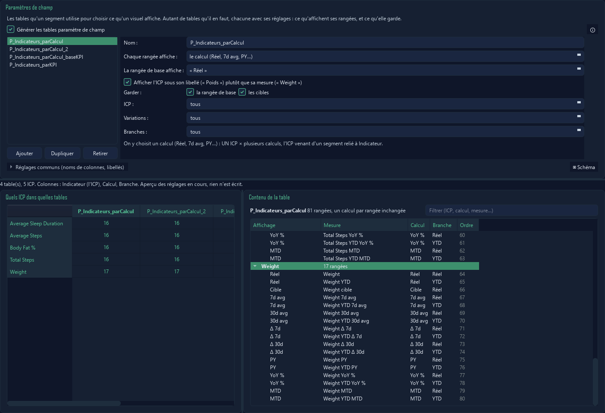
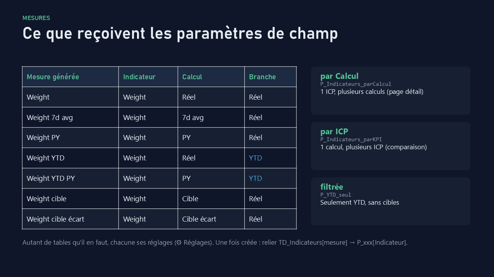
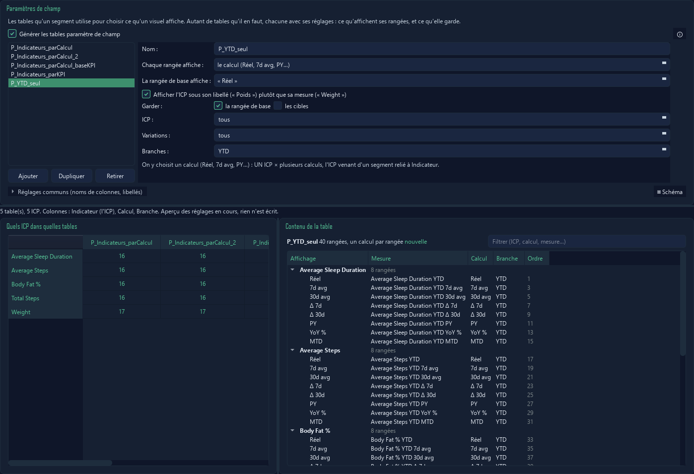

# 3.4 · Mesures › Paramètres de champ

[Documentation](../README.md) › Mesures › **Paramètres de champ** · voir aussi [Variations](03-1-variations.md), [Arbre des mesures](03-3-arbre-des-mesures.md)

Un **paramètre de champ** est une table Power BI qui liste des mesures. Placé dans un
segment, il permet de choisir quelle mesure un visuel affiche : `Réel`, `7d avg`,
`PY`, ou un autre KPI.

Si le nom existe déjà, le générateur vérifie la partition calculée et les métadonnées du paramètre. Un conflit avec une table Power Query interrompt l’aperçu ou la génération avant toute écriture. Choisissez un nom libre pour créer un nouveau paramètre.

PBIdouille écrit ces tables à partir des KPI, des cibles et des variations. L'onglet
se lit de haut en bas : les **réglages** de chaque table, puis **ce qu'elle
contiendra**.





## Ce que contient une table

Chaque rangée correspond à une mesure. Voici la rangée de `Weight YTD PY` :

| Colonne | Valeur | Rôle |
|---|---|---|
| *nom de la table* | `PY` | Le texte affiché dans le segment |
| *nom de la table* `Fields` | `[Weight YTD PY]` | La mesure, colonne masquée |
| *nom de la table* `Ordre` | `76` | Le tri, colonne masquée |
| `Indicateur` | `Weight` | Le KPI |
| `Calcul` | `PY` | Le calcul |
| `Branche` | `YTD` | La branche |

Une table reçoit, pour chaque KPI :

- sa mesure de **base**, affichée `Réel` par défaut ;
- ses **cibles** ;
- ses **variations** dont la case **dans les paramètres de champ** est cochée dans
  [Variations](03-1-variations.md) ;
- ces mêmes mesures dans chaque **branche**.

Dans le projet de démonstration, `Weight` a ainsi 17 rangées : 8 calculs en Réel, les
mêmes 8 en YTD, et sa cible.

## Créer une table

1. Cliquer **Ajouter** sous la liste et donner un nom à la table.
2. Choisir ce qu'affiche chaque rangée : voir [Les trois usages](#les-trois-usages).
3. Décocher ce que la table ne doit pas contenir.
4. Vérifier le résultat dans **Contenu de la table**, en bas.
5. Cliquer **Sauvegarder**, enregistrer dans Power BI Desktop s'il est ouvert, puis lancer
   **Générer les mesures**.
6. Fermer Desktop **sans enregistrer** et rouvrir le `.pbip`. Pour une table nouvelle,
   relier sa colonne `Indicateur` à la table des KPI, si un segment de KPI doit la filtrer. Cette relation se crée une
   seule fois, dans Power BI Desktop.

**Dupliquer** crée une copie de la table choisie. C'est utile pour avoir deux
sélections indépendantes sur une même page.

### Exemple : une table limitée à YTD

Dans **Branches**, décocher `(hors branche)`. Dans **Garder**, décocher **les cibles**.
La table passe à 8 rangées par KPI, toutes en YTD :



Le config ne retient que ce qui s'écarte des valeurs par défaut :

```json
{ "name": "P_YTD_seul", "includeTargets": false, "excludeBranches": [""] }
```

## Les trois usages

| Chaque rangée affiche | La rangée de base affiche | Dans le segment, on choisit | Le reste vient de |
|---|---|---|---|
| **le calcul** | **« Réel »** | `Réel`, `7d avg`, `PY`… | Un segment de KPI relié à `Indicateur` |
| **le calcul** | **le KPI** | Le KPI et ses calculs, dans le même segment : `Poids`, `7d avg`, `PY`… | Rien de plus |
| **le KPI** | sans objet | `Poids`, `Pas`… | Un segment sur la colonne `Calcul` |

La phrase affichée sous les réglages rappelle l'usage de la table choisie.

## Les réglages d'une table

| Réglage | Dans le config | Effet |
|---|---|---|
| **Nom** | `name` | Le nom de la table dans le modèle |
| **Chaque rangée affiche** | `rows` | `calcul` (défaut) ou `kpi` |
| **La rangée de base affiche** | `baseRow` | `calcul` (défaut) ou `kpi`. Sans effet quand chaque rangée affiche déjà le KPI |
| **Afficher le KPI sous son libellé** | `kpiLabel` | Là où le KPI s'affiche, utilise son libellé (`Poids`) plutôt que le nom de sa mesure (`Weight`). Coché par défaut |
| **Garder : la rangée de base** | `includeBase` | Décoché, le KPI hors branche disparaît. La base d'une branche, comme `Weight YTD`, reste |
| **Garder : les cibles** | `includeTargets` | Décoché, les rangées des cibles disparaissent |
| **KPI** | `excludeKpis` | Les KPI de la table |
| **Variations** | `excludeVariations` | Les variations de la table. En décocher une l'écarte aussi de ses branches |
| **Branches** | `excludeBranches` | Les branches de la table. `(hors branche)` désigne le Réel et ses variations |

**KPI**, **Variations** et **Branches** gardent ce qui est coché, mais le config retient
ce qui est **décoché**. Un KPI ou une variation ajouté plus tard entre donc de lui-même
dans chaque table.

## Les réglages communs

**Réglages communs**, sous la liste, s'appliquent à toutes les tables.

| Réglage | Dans `fieldParameter` | Rôle |
|---|---|---|
| **Colonne KPI** | `kpiColumn` | La colonne du KPI, `Indicateur` par défaut |
| **Colonne Calcul** | `calcColumn` | La colonne du calcul, `Calcul` par défaut |
| **Colonne Branche** | `branchColumn` | La colonne de la branche, `Branche` par défaut |
| **Libellé de la base** | `baseLabel` | Le calcul de la mesure de base, comme `Réel`. Vide : `Base` |
| **Branche « hors branche »** | `noBranchLabel` | La branche de ce qui n'est dans aucune branche, comme `Réel`. Vide : `Base` |
| **Libellés (table)** | `kpiLabelLookup.table` | La table qui donne les libellés, comme `TD_Indicateurs` |
| **Libellés (colonne clé)** | `kpiLabelLookup.keyColumn` | La colonne qui contient le nom de la mesure |
| **Libellés (colonne affichée)** | `kpiLabelLookup.labelColumn` | La colonne qui contient le libellé |

Si la table des libellés n'existe pas dans le modèle, le KPI s'affiche sous le nom de sa
mesure, et un avertissement le signale.

## Lire l'aperçu

Le bas de l'onglet se recalcule à chaque réglage modifié. C'est la génération elle-même,
lancée en aperçu : rien n'est écrit.

### Quels KPI dans quelles tables

Chaque case donne le nombre de rangées d'un KPI dans une table, et `0` veut dire qu'il
en est absent. L'infobulle liste ses calculs. Cliquer sur une case ouvre cette table sur
ce KPI, et cliquer sur un en-tête ouvre la table.

### Contenu de la table

Les rangées sont groupées par KPI :

| Colonne | Contenu |
|---|---|
| **Affichage** | Le texte visible dans le segment. En bleu italique, c'est le libellé du KPI |
| **Mesure** | La mesure derrière la rangée |
| **Calcul**, **Branche** | Les valeurs de ces colonnes |
| **Ordre** | Le rang de tri |

Le filtre cherche dans toutes ces colonnes et dans le nom du KPI.

Si l'affichage indique `libellé de « Weight »`, le libellé n'a pas été trouvé dans
l'Excel. La valeur ne sera connue qu'au rafraîchissement du modèle.

## Ce que fait la génération

L'état de la table s'affiche à côté de son nom :

| État ou situation | Résultat |
|---|---|
| **nouvelle** | La table est créée et ajoutée au modèle |
| **modifiée** | Seule la liste des rangées est réécrite |
| **inchangée** | Rien |
| **vide** | Aucune rangée après les filtres : la table n'est pas touchée, et un avertissement le signale |
| **source introuvable** | La table existe, mais sa définition n'a pas été reconnue : elle n'est pas touchée |
| Table **retirée** de la liste | Elle reste dans le modèle. La supprimer dans Power BI Desktop si plus aucun visuel ne s'en sert |
| Table **renommée** | Une nouvelle table est créée, et l'ancienne reste dans le modèle avec ses visuels |
| **Générer les tables paramètre de champ** décoché | Le générateur ne touche à aucune table |

---

← [3.3 Arbre des mesures](03-3-arbre-des-mesures.md) · [Sommaire](../README.md) · [3.5 JSON brut](03-5-json-brut.md) →
