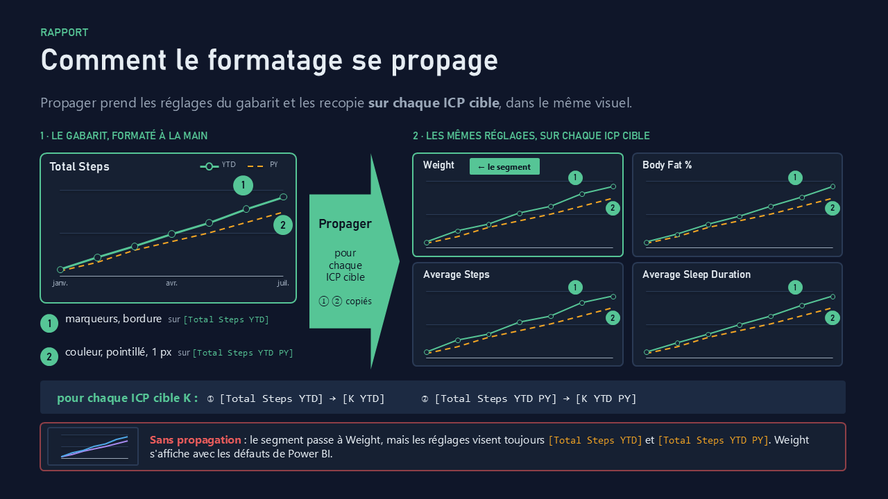
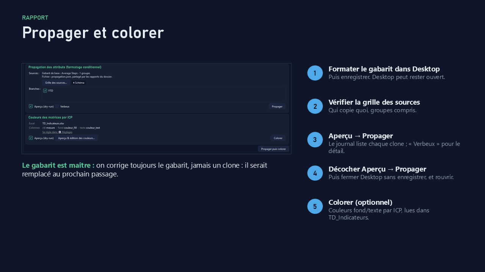
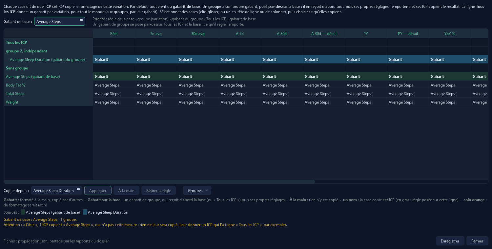
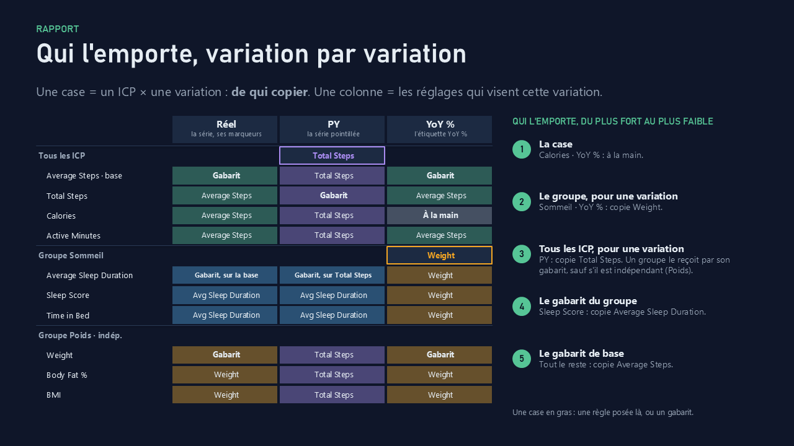
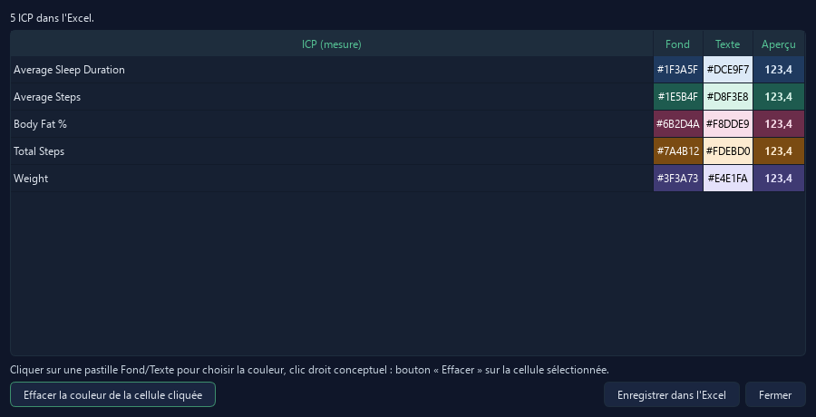

# 4 · Rapport

[Documentation](../README.md) › **Rapport** · voir aussi [Paramètres de champ](03-4-parametres-de-champ.md), [ChopChop](08-chopchop.md)

L'onglet **Rapport** recopie le formatage d'un KPI vers les autres, et colore les
matrices par KPI. Il agit sur les visuels du rapport, pas sur le modèle.

## Pourquoi propager

Dans un visuel piloté par un paramètre de champ, un formatage conditionnel, un titre ou
une étiquette est rattaché à **une mesure précise**. Quand le segment passe à un autre
KPI, ce réglage ne s'applique plus.

La propagation règle ce problème : le formatage se fait une fois sur un KPI **gabarit**
dans Power BI Desktop, puis PBIdouille le recopie sur les mesures équivalentes des
autres KPI.

## Propager le formatage

1. Dans Power BI Desktop, formater le KPI gabarit et **enregistrer**. Desktop peut rester
   ouvert.
2. Dans **Rapport**, cliquer **Grille des sources…** et choisir le **gabarit de base**.
3. Cliquer **Enregistrer** dans la grille, puis fermer la fenêtre.
4. Cocher les **branches** à traiter.
5. Laisser **Aperçu (dry-run)** coché, cliquer **Propager** et lire le journal.
6. Décocher **Aperçu (dry-run)**, cliquer **Propager** et confirmer.
7. Fermer Desktop **sans enregistrer**, puis rouvrir le `.pbip`. Enregistrer à ce moment
   effacerait la propagation.

**Verbeux** ajoute le détail de la recherche au journal. Sans grille enregistrée, la
propagation refuse de démarrer : PBIdouille ne choisit jamais le gabarit à la place de
l'utilisateur.

### Ce que la propagation fait

- Elle aligne chaque case de la grille sur sa source. Ce que la source porte est
  recopié, et **ce qu'elle ne porte plus est retiré**.
- Elle ne touche pas un visuel où la source n'a aucun réglage.
- Elle n'écrit jamais une référence vers une mesure absente du modèle.
- Elle laisse aux **couleurs des matrices** leurs propres réglages.

Une couleur de série posée à la main sur un autre KPI est donc remplacée par celle de sa
source. Pour garder un réglage propre à un KPI, mettre sa case **À la main**.

Chaque visuel modifié est sauvegardé avant l'écriture. La restauration se fait depuis
[🕘 Restaurer une sauvegarde…](01-barre-du-haut.md#restaurer-une-sauvegarde).

## La grille des sources

La grille répond à une question : **de quel KPI chaque KPI copie-t-il le formatage de
chaque variation ?** Les lignes sont les KPI, les colonnes sont les variations.

Une colonne couvre toutes les branches : la colonne `PY` vaut pour `Weight PY` et
`Weight YTD PY`. Sur une carte, le détail d'une étiquette a sa propre colonne, juste
après elle. Tant qu'aucune règle ne la vise, il suit son étiquette.

### Les niveaux de règles

| Niveau | Où le régler | Effet |
|---|---|---|
| **Case** | La case d'un KPI | Ce KPI, pour cette variation |
| **Groupe, par variation** | La ligne du groupe | Tous les KPI du groupe, pour cette variation |
| **Gabarit du groupe** | Menu **Groupes** | Ce que les KPI du groupe copient par défaut |
| **Tous les KPI** | La ligne **Tous les KPI** | Un gabarit pour cette variation, pour tout le monde |
| **Gabarit de base** | En haut de la fenêtre | Tout ce qu'aucune autre règle ne décide |

La première règle de cette liste qui répond l'emporte.

Un gabarit de groupe se pose **par-dessus** la base : il en reçoit d'abord tout, puis ses
propres réglages l'emportent, propriété par propriété. Dans Desktop, il suffit donc d'y
formater ce qui distingue le groupe. Un groupe **indépendant** ne reçoit rien de la base.

### Lire une case

| Texte | Signification |
|---|---|
| **Gabarit** | Formaté à la main dans Desktop, et copié par d'autres KPI |
| **Gabarit sur la base** | Gabarit de groupe, qui reçoit d'abord la base |
| **À la main** | Rien n'y est copié : le KPI garde son formatage |
| Un nom de KPI | La case copie ce KPI. En gras, la règle est posée sur cette ligne |
| **pas de mesure** | Ce KPI n'a pas cette variation |
| **non propagé** | Aucune règle ne s'applique |
| Coin orange | Du formatage serait retiré, et l'infobulle dit pourquoi |

### Modifier la grille

Sélectionner des cases par glissement, ou avec un en-tête de ligne ou de colonne, puis :

| Action | Effet |
|---|---|
| **Copier depuis** + **Appliquer** | Les cases copient le KPI choisi |
| **À la main** | Les cases ne copient plus rien |
| **Retirer la règle** | Les cases suivent de nouveau la règle plus large |

Ces actions sont aussi au clic droit. **Groupes** permet de créer un groupe avec les KPI
sélectionnés, d'y ajouter ou d'en retirer des KPI, de choisir son gabarit, de le rendre
indépendant, de le renommer ou de le supprimer.

**Enregistrer** écrit `propagation.json` à côté du `.pbip`. Ce fichier est partagé par
tous les rapports du dossier.

Certaines combinaisons sont refusées, avec le KPI en cause : une copie de copie, une
source inconnue, un KPI dans deux groupes, ou le gabarit de base placé dans un groupe.

## Colorer les matrices

**Colorer** donne à chaque colonne d'une matrice la couleur de son KPI, lue dans
TD_Indicateurs.

1. Dans **Aperçu & édition des couleurs…**, donner une couleur de fond et de texte à
   chaque KPI, puis cliquer **Enregistrer dans l'Excel**.
2. Dans Desktop, sur la matrice voulue, appliquer à la main sur **un** KPI un fond **et**
   un texte, avec l'option `Specific column`. Ce gabarit désigne la matrice à traiter.
3. Enregistrer dans Desktop, qui peut rester ouvert.
4. Laisser **Aperçu (dry-run)** coché, cliquer **Colorer** et lire le journal.
5. Décocher **Aperçu (dry-run)**, cliquer **Colorer** et confirmer.
6. Fermer Desktop **sans enregistrer**, puis rouvrir le `.pbip`.

- Les colonnes `couleur_fill` et `couleur_text` sont créées dans l'Excel si elles
  manquent. Une ancienne colonne `couleur` n'est pas touchée.
- Une matrice sans gabarit de couleur est ignorée.
- Un gabarit qui n'a qu'un fond ne colore que le fond, et le journal le signale.

L'Excel et ses colonnes se règlent dans
[⚙ Réglages → Excel des indicateurs](02-reglages.md#excel-des-indicateurs), et le lien **Se règle dans ⚙ Réglages** y mène directement.

**Colorer** conserve les sélecteurs des autres tables et des colonnes indépendantes. Les fichiers `visual.json` modifiés sont sauvegardés et peuvent être restaurés depuis le ruban.

## Propager puis colorer

**Propager puis colorer** lance les deux, dans cet ordre, avec les cases **Aperçu** de
chaque section. Une écriture réelle demande une confirmation.

---

← [3.5 JSON brut](03-5-json-brut.md) · [Sommaire](../README.md) · [5 Sources de données](05-sources-de-donnees.md) →
