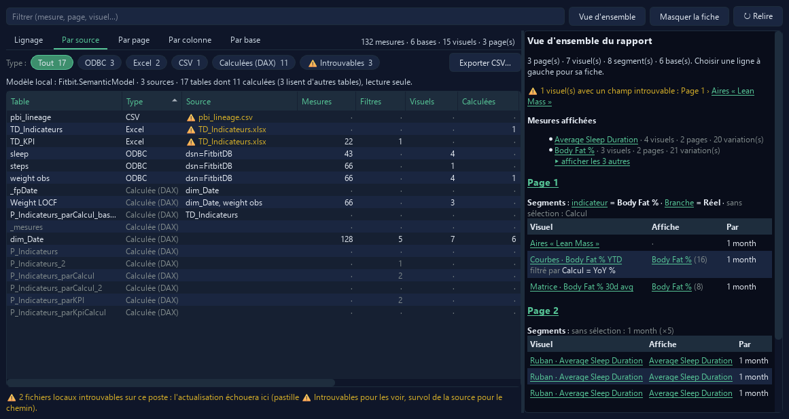

# 5 · Sources de données

[Documentation](../README.md) › **Sources de données** · voir aussi [ChopChop](08-chopchop.md)

L'onglet **Sources de données** indique d'où vient chaque table du rapport ouvert : un
Excel, un CSV, une base ODBC, un serveur SQL. Il sert à savoir de quoi dépend un rapport,
et à repérer ce qui empêchera son actualisation sur un autre poste.

L’onglet lit les expressions M enregistrées dans le projet. Un lecteur réseau mappé, par exemple `P:\`, a la même forme qu’un lecteur local. L’accès à la source dépend du poste et du compte qui actualisent le rapport.

La ligne du haut résume le modèle : son nom, le nombre de sources et le nombre de tables.

## Les deux regroupements

| Regroupement | Ce qu'il montre | Question |
|---|---|---|
| **Regrouper par source** | Une ligne par source, avec les tables qui la lisent | De quoi dépend ce rapport ? |
| **Regrouper par table** | Une ligne par table, avec ce qu'elle lit | D'où vient cette table ? |

| Colonne | Contenu |
|---|---|
| **Source / table** | Le type de source, ou le nom de la table |
| **Mode** | `import`, `directQuery` ou autre mode de la table |
| **Détail** | Le chemin, le DSN, le serveur et la base, ou l'URL |
| **Connecteur M** | La fonction Power Query utilisée, comme `Excel.Workbook` |

Les **tables calculées** ne lisent rien à l'extérieur : paramètres de champ, calendrier,
table de mesures. Elles sont rangées à part, dans un groupe replié.

## Repérer un fichier manquant

Un **⚠** devant un chemin indique qu'un fichier local n'existe pas sur ce poste.
L'actualisation échouera donc ici. Un message le rappelle sous la liste.

Les chemins réseau, comme `\\serveur\dossier`, ne sont pas testés, pour éviter de faire
attendre l'onglet. L'absence de ⚠ ne garantit donc pas qu'ils soient accessibles.

Quand un argument de source est un **paramètre Power Query**, sa valeur est affichée avec
lui.

## Chercher et réutiliser

| Geste | Effet |
|---|---|
| **Filtre** | Cherche dans toutes les colonnes : table, chemin, serveur, connecteur |
| **Clic droit → Copier** | Copie le chemin ou le nom de la ligne |
| **Clic droit → Afficher dans l'Explorateur** | Ouvre le dossier d'un fichier local existant |
| **Exporter CSV…** | Écrit une ligne par partition et par connecteur, séparateur `;` |
| **↻ Relire** | Relit les fichiers du modèle |

Le CSV contient les colonnes `Table`, `Partition`, `Mode`, `Connecteur`, `Détail 1` et
`Détail 2`.

## Rapport en connexion live

Un rapport connecté à un modèle publié n'a pas ses sources dans le projet. L'onglet
l'indique et donne le nom du modèle : ses sources se consultent dans le modèle publié.

---

← [4 Rapport](04-rapport.md) · [Sommaire](../README.md) · [6 Radiographie](06-radiographie.md) →
