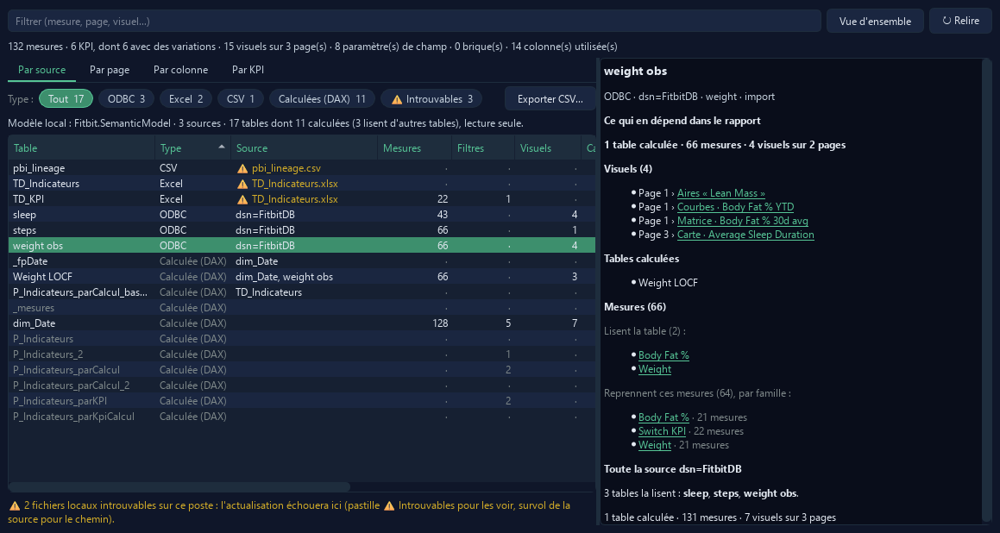
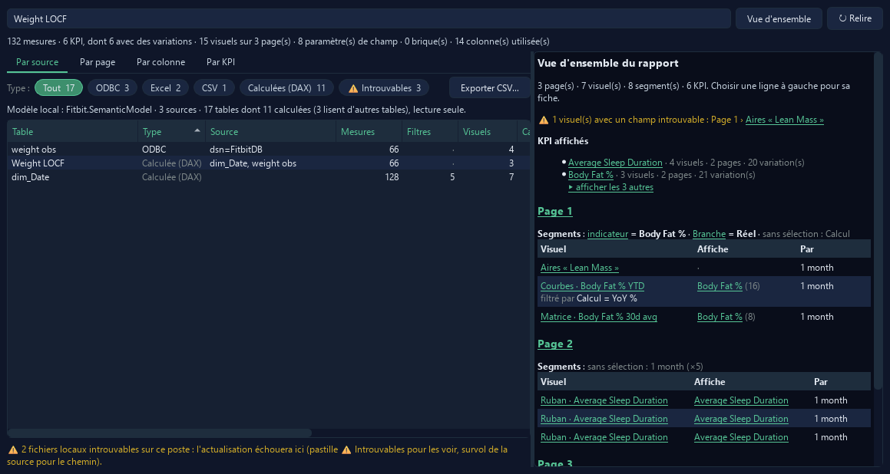
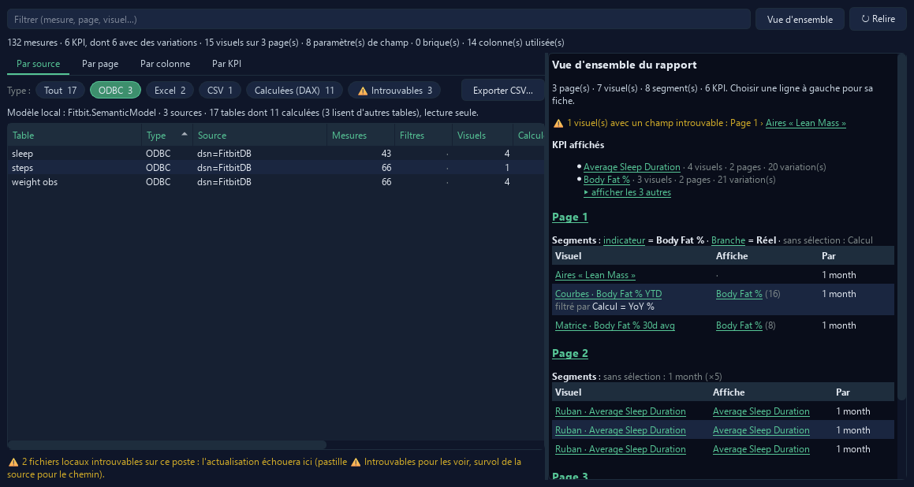

# 5 · Sources de données

[Documentation](../README.md) › **Sources de données** · voir aussi [Radiographie](06-radiographie.md), [ChopChop](08-chopchop.md)

La vue **Par source** de l'onglet [Radiographie](06-radiographie.md) indique d'où vient
chaque table du rapport ouvert : un Excel, un CSV, une base ODBC, un serveur SQL. Elle
sert à savoir de quoi dépend un rapport, ce que le rapport perdrait sans une source, et à
repérer ce qui empêchera son actualisation sur un autre poste.

La vue lit les requêtes Power Query enregistrées dans le projet. Elle ne modifie rien. Le
filtre et le bouton **↻ Relire** de la Radiographie servent aussi pour elle.

La ligne du haut résume le modèle : son nom, le nombre de sources et le nombre de tables.

## La liste des tables

Chaque table a sa ligne, avec ce qu'elle lit :

| Colonne | Contenu |
|---|---|
| **Table** | Le nom de la table |
| **Type** | Excel, CSV, ODBC, SQL Server… Le survol donne la fonction Power Query, comme `Excel.Workbook` |
| **Source** | Le nom du fichier, ou le DSN, le serveur et la base, l'URL |
| **Mesures**, **Filtres**, **Visuels**, **Calculées** | Combien d'éléments du rapport dépendent de la table (voir [Ce qui dépend d'une table](#ce-qui-dépend-dune-table)) |
| **Élément lu** | Ce que la table prend dans la source : la feuille ou le tableau d'un classeur, la table d'une base, ou `requête SQL` |
| **Mode** | `import`, `directQuery` ou autre mode de la table |
| **Reprise par** | Les tables calculées qui lisent cette table, directement ou par une autre |
| **Emplacement** | Le dossier du fichier |

Un clic sur un en-tête trie la liste. Trier par **Source** range ensemble les tables qui
lisent le même fichier ou la même base. Le survol d'une source donne son chemin complet,
et la liste des tables qui la lisent.

**Élément lu** distingue les tables qui viennent du même classeur : `Table1 (tableau)`,
`Feuil1 (feuille)`. Une base donne sa table avec son schéma, comme `dbo.Ventes`. Une
requête SQL écrite à la main dans Power Query s'affiche `requête SQL` : son texte se lit
dans l'éditeur de requêtes de Power BI.

## Ce qui dépend d'une table

Les colonnes de comptes disent combien d'éléments du rapport perdraient leurs données sans
la table :

| Colonne | Compte |
|---|---|
| **Mesures** | Les mesures qui lisent la table, et celles qui reprennent ces mesures |
| **Filtres** | Les filtres du volet qui ont une valeur, et les segments, posés sur ses colonnes |
| **Visuels** | Les visuels qui affichent une de ses colonnes ou une mesure qui en dépend |
| **Calculées** | Les tables calculées qui la reprennent, et les colonnes calculées qui la lisent |

Une table compte avec les tables calculées qui la reprennent : `Weight LOCF` lit
`weight obs`, donc ce qui lit `Weight LOCF` dépend aussi de `weight obs`. Un clic sur un
en-tête de compte trie du plus grand au plus petit.

Un clic sur une ligne ouvre sa **fiche**, à droite : les visuels et les filtres d'abord,
puis les tables et colonnes calculées, puis les mesures. Les mesures qui lisent la table
sont nommées une à une ; celles qui les reprennent sont regroupées par famille, comme
`Body Fat % · 21 mesures`. Chaque nom mène à sa fiche. Quand plusieurs tables lisent la
même source, la fiche donne aussi le total de **toute la source**, sans compter deux fois
ce que ces tables partagent.

## Les tables calculées

Les **tables calculées** ne lisent rien à l'extérieur : paramètres de champ, calendrier,
table de mesures. Elles viennent en bas de la liste.

Leur DAX lit souvent d'autres tables du modèle. Leur **Source** donne alors ces tables :
`Weight LOCF` est calculée à partir de `dim_Date` et `weight obs`. Le survol donne la
source de chacune, comme `weight obs : ODBC, dsn=FitbitDB`, et les sources externes au
bout de la chaîne quand une table calculée en lit une autre.

Dans l'autre sens, **Reprise par** dit quelles tables calculées lisent une table.
`weight obs` est reprise par `Weight LOCF` : même si aucun visuel n'affiche `weight obs`,
la supprimer du modèle casserait `Weight LOCF`. Une table calculée reprise par une autre
le dit aussi, comme `dim_Date`, que lisent `_fpDate` et `Weight LOCF`.

Une table calculée qui ne lit aucune table et que rien ne reprend est grisée.

Seules comptent les tables que le DAX cite, pour les tables calculées comme pour les
colonnes calculées et les mesures. Une table lue à travers
une mesure, comme dans un paramètre de champ qui propose `[Body Fat %]`, n'y figure pas.
**Reprise par** ne dit pas non plus si une mesure, une relation ou un visuel se sert de
la table : [ChopChop](08-chopchop.md) le dit pour les mesures et les colonnes.

## Filtrer par type

Les pastilles au-dessus de la liste ne gardent qu'un genre de table. Chacune donne son
nombre de tables.

| Pastille | Garde |
|---|---|
| **Tout** | Toutes les tables |
| **Excel**, **CSV**, **ODBC**… | Les tables qui lisent ce type de source. Une pastille par type présent dans le modèle |
| **Calculées (DAX)** | Les tables calculées par le modèle |
| **⚠ Introuvables** | Les tables dont le fichier local n'existe pas sur ce poste |

## Repérer un fichier manquant

Un **⚠** devant une source indique qu'un fichier local n'existe pas sur ce poste.
L'actualisation échouera donc ici. Un message le rappelle sous la liste, et la pastille
**⚠ Introuvables** ne garde que ces tables.

Les chemins réseau, comme `\\serveur\dossier`, ne sont pas testés, pour éviter de faire
attendre l'onglet. L'absence de ⚠ ne garantit donc pas qu'ils soient accessibles.

Un lecteur réseau mappé, comme `P:\`, a la forme d'un chemin local : il est testé, mais
sur ce poste seulement. Un poste où cette lettre ne pointe pas au même endroit échouera
quand même.

Quand un argument de source est un **paramètre Power Query**, sa valeur est affichée avec
lui.

## Chercher et réutiliser

| Geste | Effet |
|---|---|
| **Filtre** de la Radiographie | Cherche dans toutes les colonnes, le chemin complet et le connecteur M |
| **Clic sur un en-tête** | Trie la liste sur cette colonne |
| **Clic droit → Copier** | Copie le chemin complet de la source, ou le nom de la table |
| **Clic droit → Afficher dans l'Explorateur** | Ouvre le dossier d'un fichier local existant |
| **Exporter CSV…** | Écrit une ligne par partition et par connecteur, séparateur `;` |
| **↻ Relire** de la Radiographie | Relit les fichiers du modèle |

Le CSV contient les colonnes `Table`, `Partition`, `Mode`, `Connecteur`, `Détail 1`,
`Détail 2`, `Objet`, l'élément lu, et `Tables lues`, les tables du modèle que lit une
table calculée.

Une table découpée en plusieurs partitions qui lisent la même source, comme une table en
actualisation incrémentielle, tient sur une ligne avec son nombre de partitions. Le CSV
garde une ligne par partition.

## Rapport en connexion live

Un rapport connecté à un modèle publié n'a pas ses sources dans le projet. La vue
l'indique et donne le nom du modèle : ses sources se consultent dans le modèle publié.

Sans modèle local, les onglets qui lisent ou écrivent le modèle (Mesures, Rapport,
Radiographie, ChopChop) le disent, et **Générer les mesures** reste grisé.

---

← [4 Rapport](04-rapport.md) · [Sommaire](../README.md) · [6 Radiographie](06-radiographie.md) →
