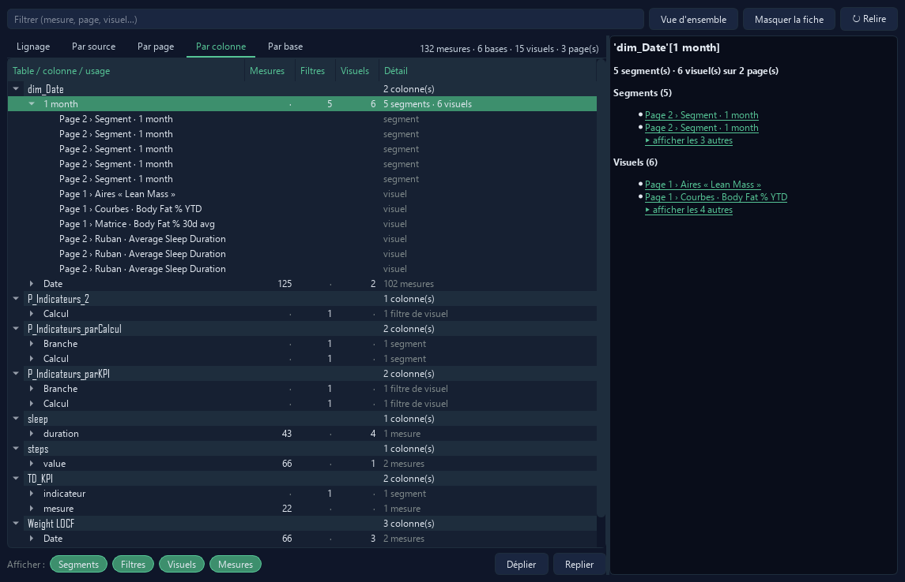

# 6 · Radiographie 🩻

[Documentation](../README.md) › **Radiographie** · voir aussi [Sources de données](05-sources-de-donnees.md), [ChopChop](08-chopchop.md)

L'onglet **Radiographie** fait la carte d'un rapport qu'on n'a pas fait : quels KPI il
affiche et où, ce que chaque mesure calcule vraiment, et ce qui filtre chaque visuel. Il
sert à savoir où regarder avant de modifier un rapport, ou quand un chiffre semble faux.

La radiographie lit les fichiers TMDL d’un modèle local et les définitions PBIR des visuels, y compris pour un rapport créé sans PBIdouille. Une connexion live seule ne fournit pas ces fichiers. L’analyse se fait en lecture seule.

La ligne du haut résume le rapport : le nombre de mesures, de KPI, de visuels et de pages,
de paramètres de champ, de briques et de colonnes utilisées.

## Les trois vues

| Vue | Ce qu'elle montre | Question |
|---|---|---|
| **Par page** | Chaque page, ses visuels, leurs champs et ce qui les filtre | Que montre ce visuel, et d'où vient le chiffre ? |
| **Par KPI** | Les familles de mesures, de la plus affichée à la moins affichée | Quels sont les KPI de ce rapport ? |
| **Par colonne** | Chaque colonne utilisée, et partout où elle sert | Qu'est-ce qui touche à cette colonne ? |

À droite, la **fiche** décrit ce qui est choisi. Ses liens mènent d'une mesure à un visuel,
d'un visuel à un segment, d'une colonne à une page.

## Par page : la carte du rapport

Chaque page se déplie sur ses visuels, et chaque visuel sur ses champs. Un visuel sans
titre est nommé par son type et son premier champ, comme `Courbes · Body Fat % YTD` : deux
graphiques sans titre restent ainsi reconnaissables.

| Colonne | Contenu |
|---|---|
| **Page / visuel / champ** | La page, le visuel, puis ses mesures et ses colonnes |
| **Mène à** | Pour une mesure, les mesures de base qu'elle utilise au bout du compte |
| **Détail** | Pour un visuel, ses mesures et ses filtres ; pour une mesure, sa place dans sa famille |
| **Table** | La table de la mesure ou de la colonne |

**Mène à** répond à la question « d'où vient ce chiffre ? ». Une mesure de base est une
mesure qui n'en référence aucune autre : c'est elle qui lit les colonnes du modèle. Ainsi
`Body Fat % YTD` mène à `Body Fat %`, qui lit `'Weight LOCF'[fat]`. Le survol de la cellule
donne la liste complète, colonnes comprises.

Un **paramètre de champ** se déplie sur les mesures qu'il propose : le visuel affiche
celle que choisit son segment.

### Ce qui filtre un visuel

Sous ses champs, chaque visuel a une ligne **Filtré par**, avec :

- ses filtres du volet qui ont une valeur, comme `'P_Indicateurs_2'[Calcul] = YoY %` ;
- les filtres de sa page et du rapport ;
- les segments de sa page qui ont une sélection, comme `Segment · Branche = Réel`.

Un segment dont l'interaction avec le visuel est coupée dans Power BI n'y figure pas,
puisqu'il ne le filtre pas. Power BI place aussi dans le volet chaque champ du visuel,
sans valeur : ces champs ne filtrent rien et tiennent sur une seule ligne grisée.

Les segments sont grisés dans la liste, avec leur sélection dans **Détail** : ils
choisissent ce que les autres visuels affichent.

### Repérer un champ cassé

Un **⚠** devant un visuel signale un champ introuvable dans le modèle : une mesure ou une
colonne renommée ou supprimée. Dans Power BI, ce visuel s'affiche en erreur.

## Par KPI : les familles de mesures

Un rapport compte souvent des centaines de mesures. Cette vue les range en **familles** :
un KPI et ses variations. Les familles qu'on voit le plus dans les visuels viennent en
premier.

Une mesure est une **variation** quand elle utilise une autre mesure dont le nom est contenu
dans le sien : `Body Fat % 30d avg` utilise `[Body Fat %]`, elle en est donc une variation.
La colonne **Variation** donne ce qui s'ajoute au nom du KPI, comme `… 30d avg`.

| Ce qu'on voit | Signification |
|---|---|
| Nom en **gras** | Un KPI, avec le nombre de ses variations |
| Nom en *italique*, variation en jaune | Une famille rapprochée **par le nom seulement** : les mesures commencent par les mêmes mots, mais aucune n'utilise l'autre. À vérifier |
| Ligne grisée | Une mesure qu'aucun visuel n'affiche |

Un premier mot générique comme `Total` ou `Average` ne suffit pas à rapprocher deux mesures
par le nom.

Sous les familles, trois groupes :

| Groupe | Contenu |
|---|---|
| **Briques** | Les mesures que d'autres mesures reprennent, hors de leur famille. Souvent invisibles dans les visuels, et ce qu'il faut lire en premier |
| **Jamais affichées** | Les mesures qu'aucun visuel n'affiche, hors famille et hors brique. [ChopChop](08-chopchop.md) dit si on peut les supprimer |
| **Variations repérées** | Les variations écrites pour plusieurs KPI, et pour combien |

## Par colonne : où sert chaque colonne

Cette vue liste les colonnes que le rapport utilise, table par table. Chaque colonne se
déplie sur ses usages, dans l'ordre où on les cherche quand un chiffre est faux :

| Usage | Détail |
|---|---|
| **Segment** | La sélection du segment |
| **Filtre de rapport**, **de page**, **de visuel** | La valeur du filtre |
| **Visuel** | L'agrégation, s'il y en a une |
| **Mesure** | Une mesure dont le DAX lit cette colonne |

Les champs posés par Power BI dans le volet d'un visuel, sans valeur, ne sont pas comptés :
ils ne filtrent rien. Une colonne introuvable dans le modèle porte un **⚠**.

## La fiche

| Choix | Ce que montre la fiche |
|---|---|
| **Mesure** | Sa famille, sa table et son dossier, où elle est affichée, les paramètres de champ qui la proposent, ce à quoi elle mène, ce qu'elle utilise, qui l'utilise, et son DAX |
| **Visuel** | Sa page et son type, chaque champ avec ce à quoi il mène, et ce qui le filtre |
| **Page** | Les KPI qu'elle affiche et ses visuels |
| **Colonne** | Tous ses usages, rangés par genre |
| **Paramètre de champ** | Les visuels qui l'utilisent et les mesures qu'il propose |

## Chercher

| Geste | Effet |
|---|---|
| **Filtre** | Garde, dans les trois vues, les lignes qui contiennent le texte, avec leurs parents |
| **Clic sur un lien** de la fiche | Sélectionne la mesure ou le visuel dans sa vue |
| **↻ Relire** | Relit le modèle et les pages du rapport |

## Limites

- Les familles sont **déduites**. Une variation qui n'utilise pas sa base et ne commence
  pas par son nom reste seule.
- Une colonne citée dans le DAX sans sa table, comme `[Date]`, n'est pas comptée dans les
  colonnes lues.
- Les filtres Top N et de date relative sont reconnus par leur type ; le détail de leur
  condition peut manquer.
- Un segment **synchronisé** depuis une autre page n'apparaît pas dans **Filtré par**.

---

← [5 Sources de données](05-sources-de-donnees.md) · [Sommaire](../README.md) · [7 Wireframe](07-wireframe.md) →
