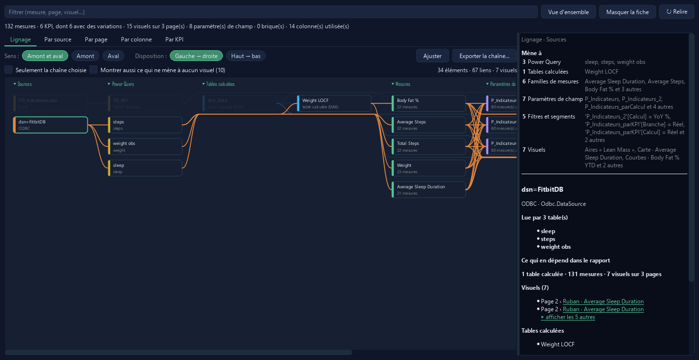
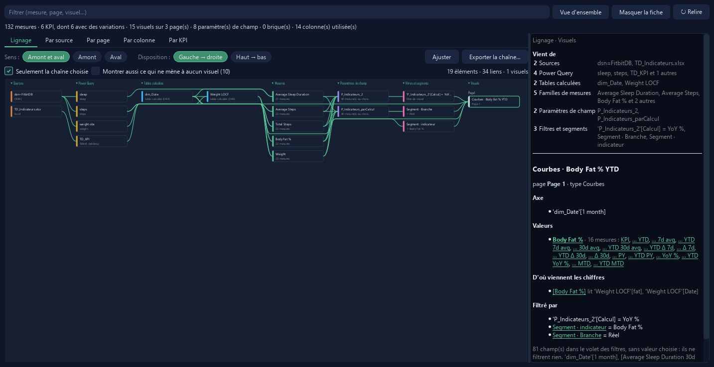
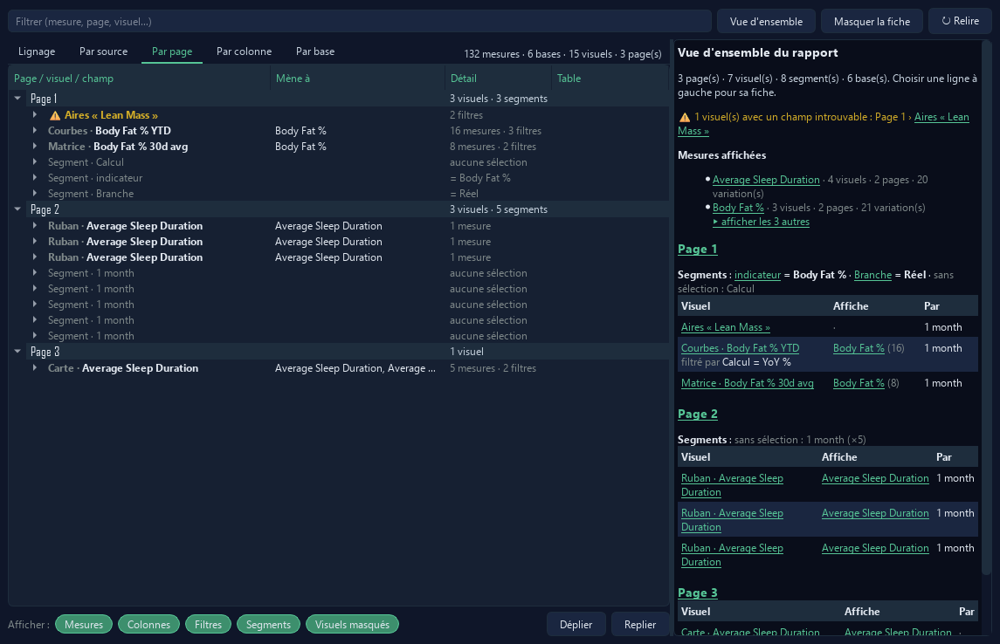
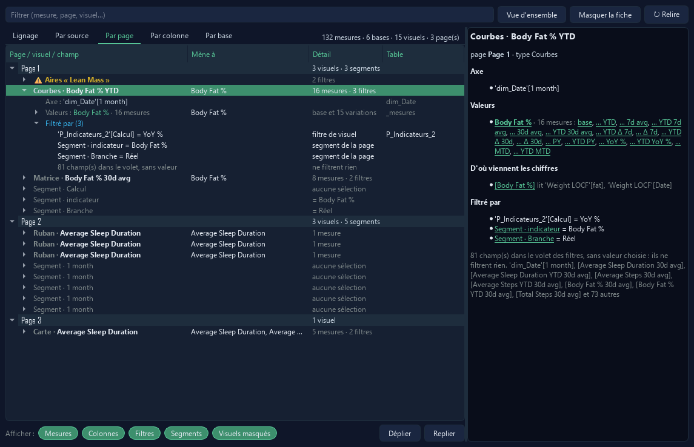
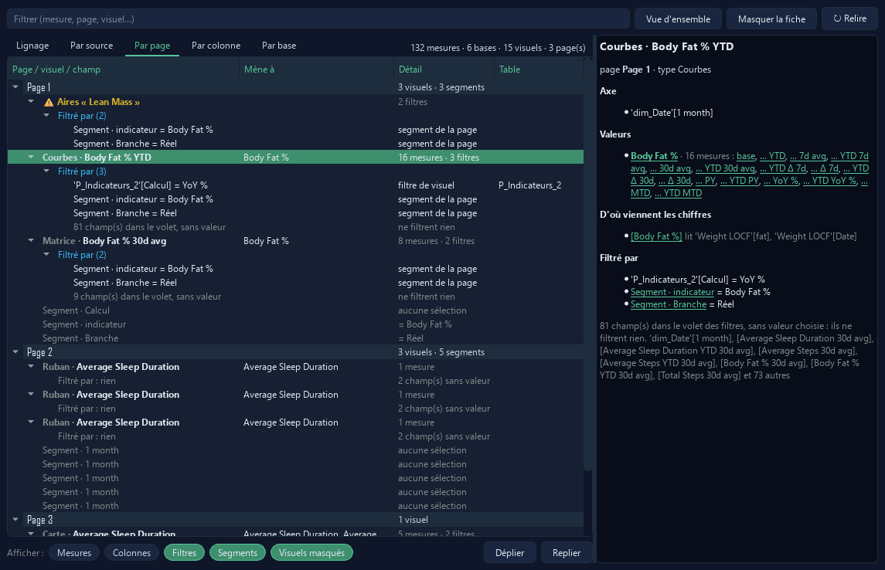
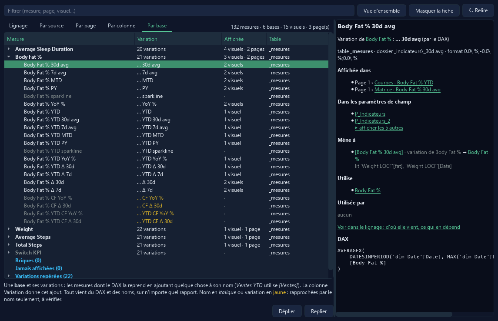

# 6 · Radiographie 🩻

[Documentation](../README.md) › **Radiographie** · voir aussi [Sources de données](05-sources-de-donnees.md), [ChopChop](08-chopchop.md)

L'onglet **Radiographie** fait la carte d'un rapport qu'on n'a pas fait : quels KPI il
affiche et où, ce que chaque mesure calcule vraiment, et ce qui filtre chaque visuel. Il
sert à savoir où regarder avant de modifier un rapport, ou quand un chiffre semble faux.

Il fonctionne sur un rapport fait sans PBIdouille : il ne lit que le DAX des mesures, leurs
noms et les fichiers des visuels. Il lui faut donc un modèle local, au format TMDL, et un
rapport au format PBIR : un rapport en connexion live n'a aucune mesure à lui donner. Il
ne modifie rien dans le projet.

La ligne du haut résume le rapport : le nombre de mesures, de KPI, de visuels et de pages,
de paramètres de champ, de briques et de colonnes utilisées.

## Les quatre vues

Les vues vont du plus large au plus fin :

| Vue | Ce qu'elle montre | Question |
|---|---|---|
| **Lignage** | Tout le rapport en un graphe, de la source de données au visuel | Qu'est-ce qui sert à quoi, d'un bout à l'autre ? |
| **Par source** | Chaque table, sa source, et combien d'éléments du rapport en dépendent | D'où viennent les données, et que perdrait-on sans cette source ? |
| **Par page** | Chaque page, ses visuels, leurs champs et ce qui les filtre | Que montre ce visuel, et d'où vient le chiffre ? |
| **Par colonne** | Chaque colonne utilisée, combien d'éléments en dépendent, et où elle sert | Qu'est-ce qui touche à cette colonne ? |
| **Par KPI** | Les familles de mesures, de la plus affichée à la moins affichée | Quels sont les KPI de ce rapport ? |

La vue **Par source** a son propre article : [Sources de données](05-sources-de-donnees.md).

À droite, la **fiche** décrit ce qui est choisi. Ses liens mènent d'une mesure à un visuel,
d'un visuel à un segment, d'une colonne à une page. Une longue liste n'y montre que ses
deux premières lignes, et un lien **▸ afficher les N autres** ; un long DAX, ses
premières lignes. **▴ replier** la referme. Choisir un autre élément replie tout.

## Le lignage : de la source au visuel

La vue **Lignage** dessine tout le rapport en un graphe, de gauche à droite ou de haut en
bas (menu **Affichage**) :

| Bande | Contenu |
|---|---|
| **Sources** | Les fichiers, bases et serveurs que lit le modèle |
| **Power Query** | Les tables qui lisent une source, et les requêtes partagées, y compris celles qui ne font qu'en reprendre une autre et les requêtes-fonctions |
| **Tables calculées** | Les tables écrites en DAX qui en lisent d'autres |
| **Mesures** | Une boîte par famille de mesures : un KPI et ses variations |
| **Paramètres de champ** | Les tables qui proposent des mesures à un segment |
| **Filtres et segments** | Les filtres du volet qui ont une valeur, et les segments |
| **Visuels** | Les visuels, rangés par page |
| **Pages** | Les pages du rapport : chaque visuel mène à la sienne |

Un trait relie ce qui est lu à ce qui le lit : une table aux mesures dont le DAX la cite,
une famille aux visuels qui l'affichent, un filtre aux visuels qu'il filtre. Le liseré de
couleur d'une boîte dit sa bande. Un trait qui saute une colonne passe entre ses boîtes,
jamais à travers. Les traits qui vont vers une même boîte lointaine se rejoignent dès la
sortie de leur colonne, puis font le trajet ensemble, en un seul trait. Plus un trait
porte de liens, plus il est clair : un tronc de cinq liens se voit de loin. Son
infobulle les nomme.

Une requête Power Query qui en lit une autre se place une colonne plus loin, avec un trait
entre les deux. Une requête qui appelle une requête-fonction, comme `fnCharger("x")`, la
lit aussi. La chaîne va ainsi de la source à la requête finale, même à travers une requête
qui n'a pas de connecteur à elle.

Les pages sont au bout de la chaîne : chaque visuel mène à sa page, et une page est ce que
ses visuels montrent. Un clic sur une page allume tout ce qu'elle montre, de la source au
visuel ; avec seulement **Sources** et **Pages**, on voit quelle source sert à quelle page.

### Masquer des colonnes, garder des pages

Le menu **Colonnes** masque des bandes entières. Leurs boîtes disparaissent, et les traits
passent à travers elles : avec **Sources**, **Mesures** et **Visuels** seuls, chaque source
mène droit aux familles qui la lisent, puis aux visuels. Le bouton dit combien de colonnes
restent, et **Toutes les colonnes** les remet.

Le menu **Pages** ne garde que ce qui mène aux pages cochées : leurs visuels, leurs filtres
et segments, et tout ce qui les alimente, jusqu'aux sources. Le menu reste ouvert pour en cocher plusieurs ;
**Toutes les pages** revient au rapport entier.

Un clic sur une boîte allume sa **chaîne** et éteint le reste :

| Couleur | Ce que c'est |
|---|---|
| **Vert** | L'amont : ce dont la boîte vient (ses sources, ses tables, les mesures qu'elle reprend) |
| **Orange** | L'aval : ce qui en dépend (les mesures, les filtres, les visuels) |

Une source montre ainsi son chemin jusqu'aux visuels ; un visuel, d'où viennent ses
chiffres et ce qui le filtre. Les pastilles **Sens** ne gardent que l'amont ou que l'aval.
Un clic dans le vide efface le choix.

Sous le graphe, une ligne donne les dépendances de la boîte choisie : combien elle en a
de **directes**, c'est-à-dire reliées à elle par un seul trait, et combien **en tout**,
dans chaque sens. La fiche, à droite, les reprend en tableau avec le nombre de
**niveaux**, c'est-à-dire de pas jusqu'à la plus lointaine. Elle détaille ensuite la
chaîne bande par bande, puis décrit la boîte choisie. Une famille repliée compte pour
une boîte.

### Suivre une seule mesure

Une famille de mesures tient en une boîte, marquée **+**. Un **double-clic** la déplie en
une boîte par mesure, avec les liens entre elles : `Body Fat % YTD` reprend `Body Fat %`,
et `Body Fat % YTD 7d avg` reprend `Body Fat % YTD`. Un clic sur l'une d'elles allume
alors la chaîne de cette mesure seule : ses sœurs qui n'en dépendent pas restent éteintes,
et l'export ne garde qu'elle. Un double-clic sur une mesure dépliée, marquée **−**,
replie sa famille.

La fiche d'une mesure, dans n'importe quelle vue, a un lien **Voir dans le lignage** : il
ouvre le lignage, déplie sa famille et la choisit. La fiche d'une famille, dans le
lignage, a un lien pour la déplier.

Un clic sur le **titre d'une bande** (▾ Mesures) la replie en une seule boîte, par
laquelle passent ses liens ; un clic sur cette boîte, ou sur le titre, la déplie. Sur un
gros rapport, une bande de plus de 40 éléments s'ouvre repliée.

| Geste | Effet |
|---|---|
| **Sens** : Amont et aval, Amont, Aval | Choisit la partie de la chaîne qui s'allume, qui se dessine seule et qui s'exporte |
| **Chaîne seule** | Redessine le graphe avec la chaîne de la boîte choisie, rien d'autre |
| **Exporter…** | Écrit la chaîne en CSV : une ligne par élément, une par mesure pour une famille |
| **Affichage** : Gauche → droite, Haut → bas | La disposition du graphe |
| **Clic sur le titre d'une bande** | La replie ou la déplie |
| **Colonnes** | Masque des bandes ; leurs traits passent à travers |
| **Pages** | Ne garde que ce qui mène aux pages cochées |
| **Affichage** : Montrer aussi ce qui ne mène à aucun visuel | Ajoute, en pointillés, ce que rien de visible n'utilise : une table chargée pour rien, une mesure jamais affichée |
| **Ajuster** | Montre tout le graphe dans la vue |
| **Ctrl + molette**, **glisser** | Zoome, déplace |
| **Filtre** de la Radiographie | Éteint les boîtes qui ne contiennent pas le texte |

Par défaut, le graphe ne montre que ce qui mène à un visuel ou à un segment : ce que le
rapport utilise vraiment. Dans le menu **Affichage**, la case **Montrer aussi ce qui ne mène à aucun visuel** dit combien d'éléments restent cachés.

### Exporter une chaîne

**Exporter…** écrit un CSV (séparateur `;`) de la chaîne de la boîte choisie,
dans le sens choisi. Une source exporte tout ce qui en dépend ; une mesure, ce dont elle
vient et les visuels qui l'affichent.

| Colonne | Contenu |
|---|---|
| **Sens** | `amont`, `choisi` ou `aval` |
| **Distance** | Le nombre de liens entre l'élément et la boîte choisie |
| **Bande** | Sources, Power Query, Mesures… |
| **Élément**, **Détail**, **Page** | Son nom, son détail, la page d'un visuel |
| **Famille** | Pour une mesure, sa famille : une famille s'exporte mesure par mesure |
| **Mène à un visuel** | `non` pour ce que rien de visible n'utilise |

### Fermer la fiche

**Masquer la fiche**, en haut, laisse toute la largeur aux vues ; **Afficher la fiche**
la rouvre, comme **Vue d'ensemble**. Le choix est retenu d'une session à l'autre.

## La vue d'ensemble

À l'ouverture de l'onglet, avant tout choix, la fiche résume le rapport. Le bouton
**Vue d'ensemble** y revient à tout moment. On y lit, de haut en bas :

- les visuels qui ont un champ introuvable, s'il y en a ;
- les **KPI affichés**, du plus vu au moins vu, avec leur nombre de visuels, de pages et
  de variations ;
- les filtres du rapport ;
- chaque page, avec ses segments et leur sélection, puis un tableau de ses visuels.

| Colonne | Contenu |
|---|---|
| **Visuel** | Son nom, ses filtres propres, et le segment de la page qui ne le filtre pas, s'il y en a un |
| **Affiche** | Ses mesures, une famille par ligne : `Body Fat % (16)` pour 16 mesures de la famille |
| **Par** | Ses colonnes : axe, lignes, légende |

Chaque nom est un lien vers sa fiche. C'est la page à lire pour savoir ce que contient un
rapport avant d'entrer dans le détail.

## Par page : la carte du rapport

Chaque page est un bandeau, qui se déplie sur ses visuels, puis ses segments. Un visuel
est en gras, son type en gris devant son nom. Un visuel sans titre est nommé par son type
et son premier champ, comme `Courbes · Body Fat % YTD` : deux graphiques sans titre
restent ainsi reconnaissables.

Un visuel se déplie sur ses champs, rangés par **rôle** comme dans le volet Visualisations
de Power BI : **Axe**, **Valeurs**, **Légende**, **Lignes**, **Info-bulles**… Un rôle qui
n'a qu'un champ tient sur une ligne, le rôle en gris, comme `Axe : 'dim_Date'[1 month]`.

Quand un visuel affiche plusieurs mesures d'une même famille, elles tiennent sur une ligne
repliée, comme `Body Fat % · 16 mesures`. La déplier donne chaque mesure, avec ce que sa
variation ajoute au nom du KPI, comme `… YTD`. Ce que la ligne de la famille dit déjà,
comme la table ou la mesure de base, ne se répète pas sur chaque mesure.

| Colonne | Contenu |
|---|---|
| **Page / visuel / champ** | La page, le visuel, puis ses champs, rôle par rôle |
| **Mène à** | Pour une mesure, les mesures de base qu'elle utilise au bout du compte ; pour un visuel, celles de tout ce qu'il affiche |
| **Détail** | Pour un visuel, ses mesures et ses filtres ; pour une mesure, sa place dans sa famille |
| **Table** | La table de la mesure ou de la colonne |

**Mène à** répond à la question « d'où vient ce chiffre ? ». Une mesure de base est une
mesure qui n'en référence aucune autre : c'est elle qui lit les colonnes du modèle. Ainsi
`Body Fat % YTD` mène à `Body Fat %`, qui lit `'Weight LOCF'[fat]`. Le survol de la cellule
donne la liste complète, colonnes comprises.

Un **paramètre de champ** se déplie sur les mesures qu'il propose : le visuel affiche
celle que choisit son segment.

### Ce qui filtre un visuel

Sous ses champs, chaque visuel a une ligne **Filtré par**, avec :

- ses filtres du volet qui ont une valeur, comme `'P_Indicateurs_2'[Calcul] = YoY %` ;
- les filtres de sa page et du rapport ;
- les segments de sa page qui ont une sélection, comme `Segment · Branche = Réel`.

Un segment dont l'interaction avec le visuel est coupée dans Power BI n'y figure pas,
puisqu'il ne le filtre pas. Power BI place aussi dans le volet chaque champ du visuel,
sans valeur : ces champs ne filtrent rien et tiennent sur une seule ligne grisée. Un
visuel que rien ne filtre a une ligne grisée **Filtré par : rien**.

Les segments sont grisés dans la liste, avec leur sélection dans **Détail** : ils
choisissent ce que les autres visuels affichent.

### Repérer un champ cassé

Un **⚠** devant un visuel signale un champ introuvable dans le modèle : une mesure ou une
colonne renommée ou supprimée. Dans Power BI, ce visuel s'affiche en erreur.

### Choisir ce qu'on voit

Sous la liste, les pastilles **Afficher** allument ou éteignent une catégorie de lignes.
Toutes sont allumées au départ.

| Pastille | Lignes concernées |
|---|---|
| **Mesures** | Les mesures et les paramètres de champ des visuels |
| **Colonnes** | Les colonnes des visuels : axes, lignes, légendes |
| **Filtres** | Les lignes **Filtré par**, les filtres de page et du rapport |
| **Segments** | Les segments, dans la liste des visuels de chaque page |
| **Visuels masqués** | Les visuels masqués dans le volet Sélection |

Par exemple, éteindre **Mesures** et **Colonnes** ne laisse sous chaque visuel que ce qui
le filtre. **Déplier** ouvre alors tous les visuels d'un coup, et **Replier** revient aux
pages. **Déplier** laisse fermés les familles et les paramètres de champ : tout déplié,
un visuel garde une ligne par rôle. Un clic sur la flèche d'une famille l'ouvre.

## Par KPI : les familles de mesures

Un rapport compte souvent des centaines de mesures. Cette vue les range en **familles** :
un KPI et ses variations. Les familles qu'on voit le plus dans les visuels viennent en
premier.

Cette vue marche sur n'importe quel rapport, fait ou non avec PBIdouille : les familles se
déduisent du DAX et des noms des mesures, jamais de `TD_Indicateurs` ni du
`measures_config.json`. Une ligne sous la vue le rappelle.

Une mesure est une **variation** quand elle utilise une autre mesure dont le nom est contenu
dans le sien : `Body Fat % 30d avg` utilise `[Body Fat %]`, elle en est donc une variation.
La colonne **Variation** donne ce qui s'ajoute au nom du KPI, comme `… 30d avg`.

| Ce qu'on voit | Signification |
|---|---|
| Nom en **gras** | Un KPI, avec le nombre de ses variations |
| Nom en *italique*, variation en jaune | Une famille rapprochée **par le nom seulement** : les mesures commencent par les mêmes mots, mais aucune n'utilise l'autre. À vérifier |
| Ligne grisée | Une mesure qu'aucun visuel n'affiche |

Un premier mot générique comme `Total` ou `Average` ne suffit pas à rapprocher deux mesures
par le nom.

Sous les familles, trois groupes :

| Groupe | Contenu |
|---|---|
| **Briques** | Les mesures que d'autres mesures reprennent, hors de leur famille. Souvent invisibles dans les visuels, et ce qu'il faut lire en premier |
| **Jamais affichées** | Les mesures qu'aucun visuel n'affiche, hors famille et hors brique. [ChopChop](08-chopchop.md) dit si on peut les supprimer |
| **Variations repérées** | Les variations écrites pour plusieurs KPI, et pour combien |

## Par colonne : où sert chaque colonne

Cette vue liste les colonnes que le rapport utilise, table par table. Pour chaque
colonne, trois comptes disent ce qui en dépend :

| Colonne | Compte |
|---|---|
| **Mesures** | Les mesures qui lisent la colonne, et celles qui reprennent ces mesures |
| **Filtres** | Les filtres qui ont une valeur, et les segments, posés sur la colonne |
| **Visuels** | Les visuels qui l'affichent, et ceux qui affichent une mesure qui en dépend |

`'dim_Date'[Date]` n'est affichée par aucun visuel, mais 102 mesures la lisent : 125 en
dépendent en tout.

Chaque colonne se déplie sur ses usages, dans l'ordre où on les cherche quand un chiffre
est faux :

| Usage | Détail |
|---|---|
| **Segment** | La sélection du segment |
| **Filtre de rapport**, **de page**, **de visuel** | La valeur du filtre |
| **Visuel** | L'agrégation, s'il y en a une |
| **Mesure** | Une mesure dont le DAX lit cette colonne |

Quand plus de quatre mesures lisent la colonne, elles tiennent sur une ligne repliée,
**Lue par 102 mesures**, qui se déplie sur leurs familles. Deux autres lignes repliées
disent ce qui en dépend par une mesure : **Reprise par N autres mesures**, et les visuels
qui affichent ces mesures.

Les champs posés par Power BI dans le volet d'un visuel, sans valeur, ne sont pas comptés :
ils ne filtrent rien. Une colonne introuvable dans le modèle porte un **⚠**.

Les pastilles **Afficher** de cette vue gardent un genre d'usage : **Segments**,
**Filtres**, **Visuels**, **Mesures**. Une colonne dont aucun usage n'est allumé disparaît.
Ainsi, avec seulement **Segments** et **Filtres**, la vue ne garde que les colonnes sur
lesquelles le rapport filtre.

## La fiche

| Choix | Ce que montre la fiche |
|---|---|
| **Rien**, ou le bouton **Vue d'ensemble** | Le résumé du rapport, page par page (voir [La vue d'ensemble](#la-vue-densemble)) |
| **Mesure** | Sa famille, sa table et son dossier, où elle est affichée, les paramètres de champ qui la proposent, ce à quoi elle mène, ce qu'elle utilise, qui l'utilise, et son DAX |
| **Table** (vue Par source) | Ce qui en dépend : visuels, filtres, tables et colonnes calculées, mesures par famille ; et le total de toute sa source |
| **Visuel** | Sa page et son type, ses champs rôle par rôle (les variations d'un KPI sur une ligne), d'où viennent ses chiffres, et ce qui le filtre |
| **Page** | Les KPI qu'elle affiche, ses segments et le tableau de ses visuels |
| **Colonne** | Ce qui en dépend en une ligne, puis ses usages par genre ; les mesures par famille |
| **Paramètre de champ** | Les visuels qui l'utilisent et les mesures qu'il propose |

## Chercher

| Geste | Effet |
|---|---|
| **Filtre** | Garde, dans les trois vues, les lignes qui contiennent le texte, avec leurs parents |
| **Pastilles Afficher** | Allument ou éteignent une catégorie de lignes, dans les vues Par page et Par colonne |
| **Déplier**, **Replier** | Ouvrent tout ce que la vue montre (sauf les familles, dans Par page), ou la replient sur ses pages, familles ou tables |
| **Vue d'ensemble** | Ramène la fiche au résumé du rapport |
| **Clic sur un lien** de la fiche | Sélectionne la mesure ou le visuel dans sa vue |
| **↻ Relire** | Relit le modèle et les pages du rapport |

## Limites

- Les familles sont **déduites**. Une variation qui n'utilise pas sa base et ne commence
  pas par son nom reste seule.
- Une colonne citée dans le DAX sans sa table, comme `[Date]`, n'est pas comptée dans les
  colonnes lues.
- Les filtres Top N et de date relative sont reconnus par leur type ; le détail de leur
  condition peut manquer.
- Un segment **synchronisé** depuis une autre page n'apparaît pas dans **Filtré par**.

---

← [5 Sources de données](05-sources-de-donnees.md) · [Sommaire](../README.md) · [7 Wireframe](07-wireframe.md) →
